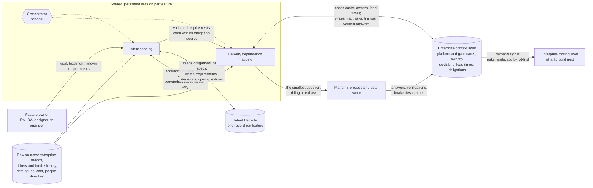

# Two modules, one optional orchestrator: the overview

Date: 2026-10-31. Part of the definition of two enterprise product capabilities for a large, matrixed, platform-centric, regulated organisation. This page is the one-page map of the set. The concept briefs are [05 intent shaping](05-concept-intent-shaping.md) and [06 delivery dependency mapping](06-concept-delivery-dependency-mapping.md); the road from day one to the destination is [07](07-staged-roadmap.md); the launch-day narratives are [08](08-working-backwards.md). The method both modules run is in [01 the requirements taxonomy](01-requirements-taxonomy.md) and [02 the structured inquiry](02-structured-inquiry.md); where the work lives and how its context is judged is in [03 the context-layer model](03-context-layer-model.md) and [04 the context trust criteria](04-context-trust-criteria.md). The organisation is never named; examples are fictional and say so.

## The goal

The overarching goal for both modules: **faster, more efficient and higher-quality articulation of product intent, in a form that is maximally compatible with, and useful to, spec-driven development.**

- **Faster and more efficient:** less elapsed time from goal to ready, and lower human effort spent getting there.
- **Higher quality:** fewer missed requirements, more actionable requirements, and dependencies resolved before handoff.
- **Spec-driven-development ready:** the outputs are the input a spec-driven toolchain or a coding agent consumes directly, not a document someone has to translate.

Every measure, format and handoff below should be read against this goal.

## What the two modules are

The project's working definition: two capabilities, described as modules so that how they are packaged stays open.

| Module | Takes | Produces | The question it answers |
|---|---|---|---|
| **Intent shaping** | A feature goal as a person states it: the problem, the treatment in mind, the requirements they already know | The same intent, augmented with the enterprise obligations any feature carries here (the requirements whose source is outside the feature's own goal: law and regulation; enterprise policy and standards; platform and architecture standards; the business; contracts and counterparties; classes S2 to S6 in [01](01-requirements-taxonomy.md)) and validated against a completeness standard, with every added requirement sourced | "What must be true for this to ship here?" |
| **Delivery dependency mapping** | The validated requirements | For each requirement, which existing platforms, processes and gates could satisfy it, what onboarding to or clearing each takes, and where real build work is needed; a map by phase with evidence per edge, a "could not find" list, and asks drafted for named owners | "Who has to do what, outside this team, before it can ship?" |

Both modules are **deployed, shared and persistent**: a session per feature that stays open for weeks, that owners can join to answer, and that outlives whoever started it ([shared-agents synthesis](../research-shared-persistent-agents/01-synthesis.md), interactions C2, C8 and C9). Both are **job-family agnostic**: for product managers, business analysts, designers and software engineers doing a product-management task. The unit is the task, not the role.

Neither module owns the requirements. They contribute to an **intent lifecycle**: a record per feature (intent, requirements, open questions, decisions with reasons, the dependency map, the asks) that is findable through an enterprise data product and readable by people and agents alike. Its form is open; [03](03-context-layer-model.md) lays out the options. And both read from and write to an **enterprise context layer** (platform and gate cards, owner records, decision records, lead-time observations, obligation references) that gets better with every session; [04](04-context-trust-criteria.md) says how "better" is judged.

## The picture

Read it left to right. A person brings a goal. Intent shaping turns it into validated requirements with an obligation source on each. Delivery dependency mapping turns each requirement into the platforms, processes, gates and owners that can satisfy it, drafts the asks, and writes back what it learns. Owners answer once; their answers become context the next feature starts from. The asks, waits and gaps across many features are the demand signal that says which data sets and tools the organisation should build next. That last arrow is the two-sided marketplace made explicit; [07](07-staged-roadmap.md) sets out how it is meant to turn.

The arrow back from mapping to shaping matters: a requirement often changes once its delivery path is known (the fictional bank's "pre-approved" wording in [the film brief](../research-dependency-agent/07-film-brief.md) is the example; a softer wording needs no eligibility call, so phase one can ship without the decisioning platform). How often the two modules hand back and forth, and whether they run in sequence, interleaved, or continuously through delivery, is open; [02](02-structured-inquiry.md) lists the handoff points and [05](05-concept-intent-shaping.md) and [06](06-concept-delivery-dependency-mapping.md) describe the seam from each side.

## The packaging, as options

The project does not pick one. The reference workload for the first comparison is already agreed as intent shaping: the register's sequencing dimension records the hypothesis "a task agent beats a skill in a general harness on a standardised job", to be tested on intent shaping against a no-agent baseline with a human-scored rubric ([options register, sequencing](../../options/DIMENSIONS.md#sequencing-which-jobs-first-and-which-layer-first); [work-structure](../../options/DIMENSIONS.md#work-structure-how-structured-the-work-is-what-agent-shape-fits-and-the-unit-of-an-agent)). The S05 derivation walks the two extremes on one fixture ([worked derivation](../user-story-mapping/worked-derivation-s05.md)).

| Packaging | What it is | Gives you | Costs and risks | What would favour it |
|---|---|---|---|---|
| **One agent with two modules** (an orchestrator routes between shaping and mapping inside one session) | One deployed service, one identity, one session per feature; the modules are stages or skills the orchestrator invokes | One place to go; the seam is internal, so handing back and forth is cheap; one record | The orchestrator's path decisions are a new thing to check; one service's identity must be reconciled with both shaping reviewers and platform owners; a single owner for a large surface | Evidence that interleaving (requirement to dependency and back) is the common case; a harness that already supports multi-stage sessions |
| **Two agents** (shaping and mapping as separate deployed services that hand a record between them) | Each has its own owner, identity, rights profile and eval set; the intent record is the handoff object | Separation of duties by construction (the shaper cannot ratify; the mapper cannot approve); rights can differ (mapping will earn submit rights that shaping never needs); each can be built and funded by a different team | Two services to run; the handoff is a seam that can lose reasoning ([S05 Journey A's failure beat](../user-story-mapping/worked-derivation-s05.md)); a person may become the relay between them | Evidence that the modules sequence rather than interleave; different sponsors (product for shaping, platform engineering for mapping); audit's preference for separated identities |
| **Skills in a general harness** (the modules are versioned skills in the harness the organisation already runs, over a shared plain-text context repo) | No new service; a shaping skill and a mapping skill, with hooks for the fail-closed checks; the session is wherever the harness keeps it | Lowest cost to start; harness-portable; one shaping skill is the Intent Factory's Action 4 ([first-party position](../../research/sources/geoff-building-accelerating-intent-factory.md)) | Shared, persistent and owner-joinable only if the harness provides it; identity is the user's, so submit-on-behalf-of is not available; non-engineers must be able to run it; the eval and rights model is per skill | The bake-off showing a skill matches a task agent on quality and review effort; a harness with durable, shareable sessions |
| **A hybrid** (skills for the single-player day-one work; a deployed service for the shared, persistent, identity-bearing work) | Shaping runs as a skill where the person is; mapping's asks, timings and write-back run as a service with its own identity | Matches each module to what it needs (shaping needs the person; mapping needs persistence and identity) | Two surfaces for one feature; the record must bridge them | Evidence that the two modules' needs differ as much as this page suggests |

A research round on agent-to-agent handoff and orchestration models has started and is the work that will inform this choice: whether product work relays through the feature's record from one module to the next, or a general harness is the through line that calls sub-agents and primitives ([research-agent-handoff-models](../research-agent-handoff-models/)).

Across all four, the same conditions hold: a durable session, an identity decided before launch, a visibility default, a place for the agent to report and ask, a human gate in code on every side effect, and a curate step on anything that compounds (the six conditions of the [shared-agents synthesis](../research-shared-persistent-agents/01-synthesis.md), section A).

## What is settled and what is open

Settled, as the project's working definition: job-family agnostic; capabilities as modules with packaging open; requirements live in an intent lifecycle, not in an agent; the choice between candidate platforms (or build) is interactive with the person, and the considerations surfaced are written back as context; cold start is single-player usefulness from raw sources plus three to five anchor platforms and gates co-curated with their owners; owners get a demand signal, asks in one shape, each question answered once, and their own lead times (per platform, never per person) from day one; the destination is autonomy within policy (submit intake and onboard; assemble gate evidence; close routine gates by policy; ratify simple intent); the pilot proves four things (time to ready; fewer late surprises and less rework; context that compounds; owners pulling it in unmandated).

Open, laid out as options rather than decided: how the modules sequence in time ([02](02-structured-inquiry.md), [05](05-concept-intent-shaping.md) section 9); what makes written-back context trusted ([04](04-context-trust-criteria.md)); whether requirements partition by obligation source or by quality attribute ([01](01-requirements-taxonomy.md)); where the intent lifecycle lives ([03](03-context-layer-model.md)); and the packaging above.
