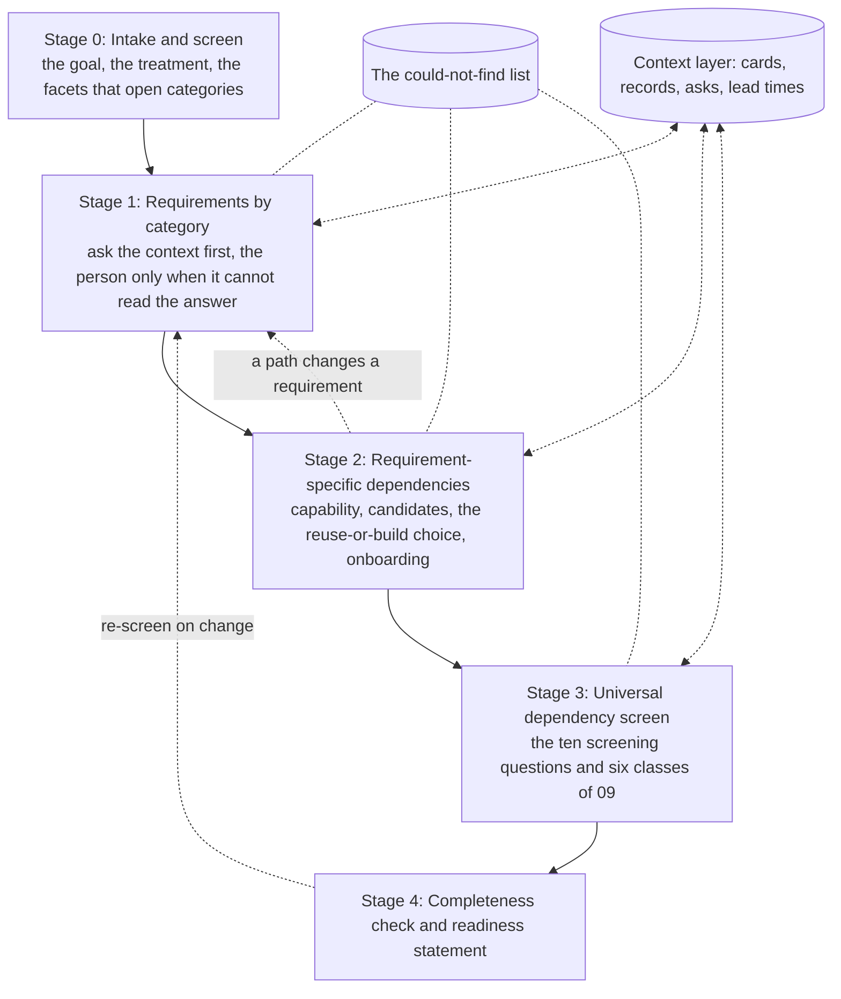

# The structured inquiry: from a feature goal to a mapped, checked intent

Date: 2026-10-31. Part of the definition work for two product capabilities, intent shaping and delivery dependency mapping ([00-overview.md](00-overview.md); concept briefs [05](05-concept-intent-shaping.md) and [06](06-concept-delivery-dependency-mapping.md)). This document is the method both modules use from day one: the inquiry that takes a feature goal, finds the requirements it carries by category ([01-requirements-taxonomy.md](01-requirements-taxonomy.md)), resolves each requirement to the platforms, processes and gates that could satisfy it, runs the universal dependency screen ([09-dependency-taxonomy.md](../research-dependency-agent/09-dependency-taxonomy.md)), and checks the result for completeness. It gives the handoff points between the modules with the timing left open, the day-one heuristics for an organisation whose context is thin, what each step writes back to the context layer ([03-context-layer-model.md](03-context-layer-model.md)), a worked example on the cohort-offer case, and the questions that would decide among the options.

It is written for anyone doing a product-management task, whatever their job title: the project's working definition is that the users are product managers, business analysts, designers and engineers, and the unit is the task, not the role. Fictional examples are labelled. Evidence is in the research library (`../../research/sources/`), labelled first-party, independent, vendor claim or anecdote.

## 1. The shape in one page

Five stages, one running list, and a write-back after every step.

Stage 0 and stage 1 are intent shaping's work. Stage 2 and stage 3 are delivery dependency mapping's. Stage 4 is shared, and the arrows back are why the timing between the modules is an open question (section 7).

Six rules apply at every stage. They come from the project's earlier work and the evidence behind it, and the concept briefs restate them as what each module must not do.

1. **Read before asking.** Every question is put to the context first and to a person only when the context cannot answer it. A person is asked the smallest question, with the evidence attached and what happens if the answer is no ([shared-agent synthesis](../research-shared-persistent-agents/01-synthesis.md), C8; [09](../research-dependency-agent/09-dependency-taxonomy.md), section 3).
2. **Nothing without a source or a tag.** No requirement without an obligation reference or an "asserted by" name; no dependency edge without a source; no owner without a source or an "inferred, unconfirmed" tag; no date without a source or an "assumed" tag. Over-prediction is the documented failure of language models at this job ([LEREDD](../../research/sources/arxiv-darif-leredd-requirement-dependencies.md), independent).
3. **Provisional until verified.** Everything the agent writes is provisional until a named person verifies it, and the record shows which entries are provisional.
4. **The agent proposes; a person decides.** It classifies, drafts and routes. It does not ratify intent, approve a gate, choose a platform alone, send an ask (at the crawl stage) or advise that a gate can be skipped.
5. **Verification rides on real asks.** An owner is asked to verify a card or a fact only when a feature needs it; nothing is asked for the record's sake ([06-mvp](../research-dependency-agent/06-mvp.md), section 3).
6. **Everything is written back.** Each answer, decision and correction is written once, with owner, date and source, where the next feature's inquiry will read it. The write-back is the point: the inquiry is the mechanism by which the organisation's context improves ([04](../research-dependency-agent/04-destination.md), V6).

## 2. Stage 0: intake and screen

**What arrives.** A feature goal in whatever form the person has it: a problem ("customers with salary credits and no savings product do not know about the fee waiver"), a treatment ("show them an offer at login"), requirements they already have in mind, constraints they know of, and sometimes a prototype or a deck. The person may be a product manager, an analyst, a designer or an engineer; the inquiry does not change by role.

**What the agent reads first.** Before asking anything, it looks for three things: the intent lifecycle home for this feature if one already exists ([03](03-context-layer-model.md), section 1); the nearest **past features of the same kind** (same channel, same product, same customer action), by enterprise search over past specs and the ticket history; and the **baseline** for that kind of feature, if one has been written (section 8, heuristic 3). It records what it found and what it could not find, and shows the person that list before the first question.

**The screen.** Ten facets of the intent decide which requirement categories expand in stage 1 and which dependency classes the universal screen in stage 3 will open. They are the requirements-side counterpart of the ten screening questions in [09](../research-dependency-agent/09-dependency-taxonomy.md), section 3, and are modelled the same way on published gate screenings, where two of nine criteria decide whether a privacy assessment is needed ([ICO](../../research/sources/ico-when-do-we-need-a-dpia.md), regulator).

| # | Facet: does the feature... | Opens (source classes from [01](01-requirements-taxonomy.md)) | Also opens in the dependency screen |
|---|---|---|---|
| 1 | Show, say or send anything to a customer (copy, offer, notification, document)? | S2 promotions and disclosure; S3 brand and content; Q3 | C3 sign-off on wording |
| 2 | Decide anything about a customer (eligibility, price, limit, routing)? | S2 conduct and fairness; S3 decisioning policy; S5 decision rights | A4 rules and configuration; C2 model risk if a model decides |
| 3 | Collect, read, combine or share customer data, and is any of it personal, special-category or financial? | S2 privacy law; S3 classification and records; Q2, Q5 | B1 data access; C2 privacy screen |
| 4 | Move money, change a price, a rate, a term or a filed form? | S2; S5 pricing; S6 scheme or partner terms | C3, C4 external approval |
| 5 | Target a group of customers, or treat groups differently? | S2 fairness; S3 vulnerability policy; Q6 | A2 decisioning platform; C2 |
| 6 | Use or change a model, score or AI component? | S2 and S3 model risk; Q11 | C2 model risk |
| 7 | Touch a channel with its own rules (app store, web, branch, contact centre, print)? | S4 channel platform standards; S5 operations | A2, E2 release vehicles |
| 8 | Involve a third party, new or existing (vendor, partner, scheme)? | S6; S2 outsourcing rules | A3, C2 third-party risk, E3 |
| 9 | Create or change an operational process (servicing, complaints, fraud, incident)? | S5 operations; S3 control standards; Q7 | A4, C3 |
| 10 | Need to be measured, reported or experimented on? | S5 KPIs; S4 metrics platform; Q9 | B2 platform access |

Every facet answered "yes" opens categories; every facet the agent could not answer from the intent goes on the could-not-find list as the first questions for the person. A facet answered "no" is recorded as "no, because", so the completeness check in stage 4 can see it was asked.

**What stage 0 writes.** The feature descriptor and the intent record (goal, problem, treatment, phases) in the lifecycle home; the screen's answers with their sources; the first could-not-find list.

## 3. Stage 1: requirements by category

The agent walks the source classes of [01](01-requirements-taxonomy.md), because they say where to read and whom to ask. For each class it has questions for the context, questions for the person that it asks only when the context cannot answer, and a write-back. Each requirement found is then written in checkable form with an attribute class, a fit criterion where one can be stated, and a validator.

### 3.1 The questions, by source class

| Class | Ask the context first | Ask the person only when | Writes back |
|---|---|---|---|
| **S1 Customer and feature goal** | What did the last feature of this kind specify, and which of those requirements apply here? What do the research notes and the prototype say? What acceptance criteria did past specs use for this kind of behaviour? | The goal, treatment or success measure is absent or ambiguous; two past specs disagree about the customer action; a requirement in the intent has no evidence behind it (the stance the project's working definition takes: challenge any requirement without evidence, [intent factory](../../research/sources/geoff-building-accelerating-intent-factory.md), first-party position) | The requirement records; the open-question register; the evidence links |
| **S2 Law and regulation** | Which published screening criteria apply, by their own text (privacy triggers, promotion rules, model-risk scope, filed terms, outsourcing rules)? What did compliance find on the last feature of this kind? What does the legal and compliance library say about this product and channel? | The screening cannot be run from the intent (a facet is unknown); a criterion's applicability turns on a judgement the agent is not allowed to make; two sources disagree about whether a rule applies; the library has nothing for this product | An obligation reference per requirement (document, section, owner); the gate record with "applies, criteria cited" or "does not appear to apply, criteria cited"; never "does not apply" without the criterion |
| **S3 Enterprise policy and standards** | Which policies name this kind of feature, channel, data or customer? What does the control catalogue require for this data classification? What accessibility level, brand rules and records schedule apply? What did past specs' non-functional sections carry? | A policy says "must" and nothing says why or who owns it; a policy is older than its review date; the policy library has no entry and the agent found the rule only in a past spec | The obligation reference with its source chain (policy, and the law or standard behind it, if known); a flag on every policy with no owner or reason |
| **S4 Platform and architecture standards** | Which platforms will this consume (from the screen and the past feature's map), and what does each require of a consumer: its card, its intake, its contracts, its release vehicle? Is there a mandate to use a strategic platform for this capability? Which architecture decisions bind this kind of integration? | No card or intake exists and the last integrations happened by chat; the mandate is contested; the platform's standard conflicts with the feature's goal | The platform or capability card, drafted if absent and marked provisional; the obligation reference pointing at the card's consumer conditions |
| **S5 The business** | What does the business case say about target market, volume, budget, pricing and KPIs? Who holds the decision rights for this product (decision-rights document, past decisions)? What does operations' runbook say about servicing this kind of feature? | The business constraint is not written anywhere; the decision right is unclear or held by someone who left; operations has not been asked | The requirement with the business owner as validator; the owner record for the decision right |
| **S6 Contracts and counterparties** (if the organisation has them, [01](01-requirements-taxonomy.md), section 5.1) | What do the contract register and the third-party register say about the parties involved? What terms did the last feature with this partner carry? | The contract is not in the register; the terms are known only to the relationship owner | The obligation reference to the contract; the owner record for the relationship |

The order of the walk is a design choice. The lean is S1 first (so the person's own goal is on the record before the enterprise's requirements arrive), then S2 and S3 (the enterprise obligations that cannot be waived), then S4 (which depends on knowing what the feature does), then S5 and S6. An alternative walks by the facets the screen opened, in the order of their expected cost of late discovery (privacy and promotions first, because they take longest to clear). Both are compatible with the record; the pilot can try both.

### 3.2 Writing each requirement

A requirement leaves stage 1 with the fields the context-layer convention gives it ([03](03-context-layer-model.md), section 1.5): an identifier, a statement, its category under both axes of [01](01-requirements-taxonomy.md) (source class and attribute class), its obligation reference or "asserted by", its validator, its phase, and a status of `proposed` until the validator confirms it. Two further fields are worth carrying from the start, because the completeness check uses them: a **fit criterion**, the test that would show the requirement is met, in the practitioner template's sense ([Volere](../../research/sources/volere-requirements-specification-template.md), first-party), and a **representation** (operational, quantitative, qualitative or declarative), which decides how it can be verified ([Glinz](../../research/sources/glinz-on-non-functional-requirements.md), independent). The agent fills both where it can and marks them open where it cannot; a requirement with no stateable fit criterion is usually a goal, not a requirement, and the inquiry says so.

### 3.3 Validation

The agent proposes requirements; validators confirm them. The validator is the source class's owner ([01](01-requirements-taxonomy.md), section 8.1), grouped so that one person receives one message with all the requirements they validate. The method is the one the project's working definition takes from risk review: a knowable universe, heuristics per category, the agent classifies with a confidence, low confidence asks for detail, novel cases go to a person who may add them to the universe ([intent shaping in a well-managed environment](../../research/sources/geoff-intent-shaping-well-managed-environment.md), first-party position). It is evaluated the same way: a labelled sample of requirements registers graded by the validators, with false positives (enterprise obligations proposed that do not apply) and false negatives (obligations missed) tracked per category ([05](05-concept-intent-shaping.md), section 8).

At the crawl stage a person sends the validation requests. The agent drafts, groups and tracks.

## 4. Stage 2: requirement-specific dependencies

For each validated requirement, mapping asks four questions in order. The unit of work is the requirement; the output is one or more rows in the dependency map, each in a class of [09](../research-dependency-agent/09-dependency-taxonomy.md).

### 4.1 What capability satisfies it?

The requirement is restated as a capability need, in words that do not presume a platform: "evaluate cohort membership per customer at display time, with each decision logged and reproducible". This step matters because the same requirement can be met by several kinds of thing, and naming the platform first forecloses the choice. For most S2 and S3 requirements the capability is a process ("a privacy assessment", "promotion approval"); for most S1 and S4 requirements it is a platform or a build; for S5 it is often a decision.

### 4.2 Which existing platforms, processes or gates could provide it?

The agent looks for candidates in this order, which is the order of reliability on day one ([03](03-context-layer-model.md), section 3):

1. **Platform and gate cards** already in the context layer, verified and in date.
2. **The map of the nearest past feature** of the same kind: what it used for this capability, and whether it was happy (section 8, heuristic 1).
3. **Catalogues** (developer portal, service catalogue, data catalogue, API registry), treated as hypotheses, not facts, because half of engineers do not trust them and the ownership fields drop people who left ([Port survey](../../research/sources/port-state-of-idp-2025-metadata-trust.md), vendor survey; [CODEOWNERS](../../research/sources/github-docs-about-code-owners.md), first-party).
4. **Enterprise search** over decks, wikis and code for the capability's words and their synonyms (decisioning, rules engine, arbitration, targeting, segmentation, eligibility), and for the gate's name.
5. **Tickets and chat** for who last asked for this capability and where they were sent.

Each candidate gets a card, drafted from what was found and marked provisional: what it does and does not do, its owner (sourced or inferred), its intake, its known consumers, its lead time if any was ever measured, its lifecycle (strategic, tolerated, deprecated). For gates the card is the gate's published criteria and evidence list, or a note that none is published.

### 4.3 The choice: reuse, onboard, build, wait or waive, made with the person

The choice between candidates, or between a candidate and building, is **interactive**. The project's working definition is explicit that the considerations that decide it are often not in the context, so the agent's job is to lay out the considerations it can read, ask for the ones it cannot, and write all of them back so the next feature's choice is better informed.

The considerations the agent surfaces from context, as a table per requirement:

| Consideration | Where it comes from | What it looks like |
|---|---|---|
| Fit: does the candidate do what the capability needs, as it is today? | The card; the catalogue; the past integration; the runbook (and the disagreement between them, if any) | "The decisioning engine evaluates rules in real time per the catalogue; the runbook says nightly batch for this rule type" |
| Mandate: is there a policy or architecture decision that requires or forbids a candidate? | S4 requirements; architecture decision records | "A standing decision mandates the strategic decisioning platform for customer-facing eligibility" |
| Onboarding cost and route: what does it take to consume it? | The card's intake; the last two integrations' tickets | "Client registration, data-access request for the salary-credit feature, rule authoring in their tool, a connection agreement" |
| Lead time: how long has it taken others? | Measured lead times if any; else the past integrations' ticket timestamps, labelled as an estimate from n cases | "About six weeks from intake to production on the two cases found; unverified" |
| Capacity: is the owning team able to take this on? | The platform's planning board; past demands | "Capacity is spoken for this quarter; a demand is needed" |
| Data and terms: can the feature get the data the candidate needs, under terms it can live with? | Data catalogue; data contracts | "Salary-credit data is classified confidential; purpose limitation to servicing" |
| Lifecycle and risk: is the candidate strategic, tolerated or deprecated; who else depends on it? | The card; the deprecation register | "Version 1 is scheduled for retirement next year" |
| Cost: is there a chargeback or licence? | Service catalogue; internal agreements | "Charged per decision" |
| Governance: which gates does each option trigger? | The gate cards; the screening criteria | "Using the propensity score triggers model risk; the rule-only option does not" |

The considerations the agent cannot read and asks for, as questions to the person (and, through the person, to the owners):

- What the candidate's roadmap is, and whether the owner would welcome this consumer.
- What the team's own skills and preferences are, and what it has tried before.
- What relationships and politics bear on the choice.
- What the business is willing to wait for, and what it would pay to avoid waiting.
- What the compliance reviewer prefers (one decision log, or two).

The decision is the person's. The agent writes a decision record ([03](03-context-layer-model.md), section 2.5) with the options considered, every consideration tagged `from_context` or `surfaced_in_session`, the reasons for and against, who decided and whether it is reversible. The `surfaced_in_session` considerations are the ones the context layer lacked; they are written back to the candidates' cards ("the owner's roadmap retires version 1 next year; said by the owner on this date") so that the next team's table is fuller. That is the mechanism by which each use builds the context layer.

Five outcomes are possible and each produces a different dependency row: **reuse** as-is (a B-class grant and possibly a D3 agreement); **onboard** (the cascade of A2, B2, C and D rows the platform's intake implies); **build** (an A1 row owned by the feature team, plus the architecture gate it triggers); **wait** (an E1 row on a platform's planned capability, with the date tagged as its source says); or **waive** the requirement (allowed only for S1 and S5 requirements, by their owner, with the reason recorded; never for S2, and for S3 only through the policy's exception process, which is itself a C-class dependency).

### 4.4 Onboarding

For a reuse or onboard outcome the agent expands the platform's intake into its steps, from the card or, where no card exists, from the last two integrations' tickets, labelled as inferred. The expansion follows the staged shape the research found for platform onboarding: intake, prioritisation, funding, access, environments, data agreements, assurance evidence, conformance, connection agreement, and then the platforms that platform depends on ([00-summary](../research-dependency-agent/00-summary.md), citing NHS England's onboarding guidance, first-party). Each step is a row in the map with its class, owner and route. At the crawl stage the agent pre-fills what the intake asks for from the spec and the map, and a person submits; at later stages, within policy and with an identity, the agent submits ([07](07-staged-roadmap.md)).

**What stage 2 writes.** The candidate cards (provisional); the decision record per choice; the dependency-map rows linked to the requirement; the ask drafts to owners; the first lead-time observations when a request enters a queue.

## 5. Stage 3: the universal dependency screen

The requirement-specific pass finds what the requirements name. It does not find what nobody wrote as a requirement: the funding the platform's work needs, the release train that does not line up, the owner who left, the two records that disagree, the question only one person can answer. Those are the slow edges the research says cause the delay ([Tkalich et al.](../../research/sources/arxiv-tkalich-critical-dependencies-cse.md), independent), and the universal screen exists to find them.

The screen is the one in [09](../research-dependency-agent/09-dependency-taxonomy.md), section 3, run over the whole intent and the map as it stands: the ten screening questions, then the per-class questions for every class the screen opened, then the cross-checks, then the asks. This document does not restate them. Three things are specific to running it after stages 1 and 2:

- **Inputs are richer.** The screen's first question ("which systems of record does this read from or write to") is largely answered by the map; the screen confirms and looks for what the map missed. Its tenth question ("what did the agent fail to find, and what disagreed") is the could-not-find list, which by now has entries from every stage.
- **Classes C, D and F are where to look hardest.** The research says these are the classes most likely to be empty by omission, because they live in forms, portfolios and people rather than in code ([09](../research-dependency-agent/09-dependency-taxonomy.md), section 5). The requirement-specific pass tends to find A and B well and C partly (through the S2 and S3 requirements); D, E and F it finds only by accident.
- **Every F item is a question for a person**, and the screen's output is the ask list, grouped by owner, drafted and not sent.

The screen could also run *before* stages 1 and 2, on the raw goal, because it reads only the context and is cheap; [06](06-concept-delivery-dependency-mapping.md), section 10, makes that case. Section 7 lists it as a timing option.

**What stage 3 writes.** The map's remaining rows, each sourced or on the could-not-find list; the ask register; cross-check findings as F3 items with both sources attached; the lead-time observations for every queue the feature enters.

## 6. Stage 4: completeness check and readiness

The check is deterministic and honest about what it does: it does not grade the content, only whether each category was looked at and each record is well formed. It can be scripted against the lifecycle home ([03](03-context-layer-model.md), section 1.5, gives the two rules the convention already has).

| Check | Passes when |
|---|---|
| Every requirement category the screen opened has at least one requirement, or an explicit "none found, because" with a source | No category is silently empty |
| Every requirement has a source class, an attribute class, an obligation reference or an "asserted by", a validator, and a status | No requirement is unowned or unsourced |
| Every `validated` requirement has a `satisfied_by` link to at least one dependency row, or a recorded waiver with its reason and owner | No requirement is left unmapped |
| Every dependency class the universal screen opened has rows, or an explicit "none found, because" | [09](../research-dependency-agent/09-dependency-taxonomy.md), section 5 |
| Every dependency row has a source or a could-not-find status; every owner is sourced or tagged inferred; every date is sourced or tagged assumed | Rule 2 |
| Every reuse-or-build decision has a decision record with considerations | The context-layer rule |
| Every open question has an owner and a blocking flag; every blocking question is routed or explicitly assumed | Nothing blocking is unrouted |
| Every gate the screening opened has a gate record: applies or not, criteria cited, evidence list with present or missing per item | No gate concluded "does not apply" without a criterion |
| The could-not-find list is present and non-empty on a first pass, or its emptiness is explained | An empty list on day one is a sign of under-reading, not completeness |

Alongside the scripted check, a **fresh-context reader test**: an agent instance with no memory of the session reads the record against the category list and the class list and reports what it cannot find. That is the check the project's skill-spectrum guide recommends for process artefacts ([03-design-guide](../research-skill-rigidity-spectrum/03-design-guide.md)).

The output is a **readiness statement**, not a readiness decision: what is validated, what is mapped, what is waiting and on whom, what could not be found, and what the person who ratifies the intent needs to know. The person who shaped the intent does not ratify it; separation of duties applies to the agent and the people alike ([01-synthesis, section G](../research-skill-rigidity-spectrum/01-synthesis.md)). The three numbers the pilot reports come from this stage: verification rate (share of proposed requirements, cards and answers a named person verified), reuse rate (share of this feature's requirements and edges that came from a previous feature's verified entries) and wait time per platform and gate ([06-mvp](../research-dependency-agent/06-mvp.md), section 5).

## 7. The handoff points between the modules

The unit that crosses the seam is a requirement: shaping produces it with a source and a validator; mapping fills in what satisfies it and who must act ([05](05-concept-intent-shaping.md), section 9; [06](06-concept-delivery-dependency-mapping.md), section 10). Because the two modules share the record and the context layer, a handoff is a field changing state, not a document being sent. There are five points at which that can happen, and the timing question is which of them the organisation uses.

| Handoff | What crosses | When it can happen | What comes back |
|---|---|---|---|
| **H1. After the screen** (end of stage 0) | The intent and the screen's facets | Immediately; needs no validated requirement | The universal screen's early findings: gates, funding, calendars and tacit-knowledge questions that decide phase boundaries |
| **H2. Per validated requirement** (during stage 1) | One requirement with `satisfied_by` empty | As each validator confirms | A changed requirement (the delivery path changes the wording); a constraint shaping did not see; a new obligation the platform's intake imposes |
| **H3. After the set is validated** (end of stage 1) | The whole requirements register | Once, when validation is complete | The map, the choices and the asks, in one pass |
| **H4. On any change** (any time) | The changed requirement, edge or environment fact | Whenever the spec, an answer or a calendar moves | A targeted re-screen of what changed, and notifications to the affected owners only |
| **H5. At readiness** (stage 4) | The readiness statement | Once, before ratification | Nothing; this is the exit |

The timing options, with the evidence, are laid out in [05](05-concept-intent-shaping.md), section 9: **sequential** (H3 and H5 only), **interleaved** (H2 as each requirement validates, with H1 as an early universal screen), and **continuous through delivery** (H4 stays on after ratification). A fourth, **mapping-first**, runs H1 before any shaping: the universal screen on the raw goal, so that the anchors (the three to five platforms and gates co-curated with their owners for the pilot) and the long-lead gates are known before the requirements are written. The concept briefs lean interleaved for the pilot because only the interleaved form measures the rate of mapping-driven requirement changes without a second pass over the same owners; this document adds that H1 is cheap and compatible with all four, so the real choice is between H2 and H3, and the pilot should measure how often a requirement changes after its path is known. If that rate is low, sequential is simpler and kinder to validators; if high, interleaved earns its longer session.

What the pilot measures to decide: the share of requirements whose wording changed after mapping; the number of times a validator was asked twice about the same requirement; the elapsed time from goal to readiness under each form; and whether the person found the interleaved session tolerable, which is a question for them.

## 8. Day-one heuristics for a context-constrained environment

The environment the inquiry starts in is the scattered cell of the maturity model ([05-maturity-model](../research-dependency-agent/05-maturity-model.md)): several catalogues, intake by form and meeting, gate criteria known to reviewers, calendars in heads. The raw sources the project assumes can be read are enterprise search over documents, decks, wikis and code; tickets, service-management records and intake history; catalogues, stale as they are; chat history; and the people directory. The heuristics below are what the inquiry does with them before any platform card has been verified. Each names what it yields, how it fails, and what it writes back; [03](03-context-layer-model.md), section 3, has the source-by-source detail.

| # | Heuristic | What it yields | How it fails | What it writes back |
|---|---|---|---|---|
| 1 | **Copy the map of the nearest past feature of the same kind.** Find, by enterprise search and ticket history, the last feature with the same channel, product and customer action; take its requirements, its platforms, its gates and its owners as the starting hypothesis, every item tagged "from feature X, unverified here" | Most of the enterprise requirements and most of the A, B and C rows on day one, in minutes | The past feature was itself incomplete, or shipped before a rule changed; copied items look authoritative | The baseline (heuristic 3) grows by one feature; the reuse rate is measured from this |
| 2 | **Read the gate pages as the screen.** Where a gate publishes its criteria (privacy triggers, change classes, model-risk scope, promotion rules), run them from the intent and cite the criterion | The C-class rows with their criteria; the "applies" or "does not appear to apply" with a reason | Criteria known only to reviewers; a criterion that turns on a judgement | The gate card: criteria as found, evidence list as found, the gap if none is published |
| 3 | **Keep a baseline per kind of feature.** The enterprise obligations that every feature of a kind carries (every customer-facing offer; every change to a filed term; every new use of personal data), drafted from the first few features and the policy library, marked provisional, verified item by item as features need them | The S2 and S3 requirements without re-reading the library each time | The baseline ossifies; nobody owns it | Each verification dates one item; the baseline's verification rate is a health metric |
| 4 | **Mine policy documents for "must" sentences** and treat each as a candidate enterprise obligation with its document as the reference and the reason as unknown until found | S3 requirements at volume | Over-collection; stale policies; "must" sentences that are aspirations | The obligation reference with `source chain: unknown`; the first ask to the policy owner closes it |
| 5 | **Infer owners from tickets and ownership files, then confirm.** The catalogue's owner field, the ownership file, and the last three tickets answered; where they disagree, propose the most recent responder as "inferred, unconfirmed" and ask them | Owners for platforms, gates and decisions on day one | The responder was covering; the file silently dropped someone who left ([CODEOWNERS](../../research/sources/github-docs-about-code-owners.md), first-party); the pattern of suggest-then-confirm is the one a catalogue vendor documents ([OpsLevel](../../research/sources/opslevel-docs-service-detection.md), first-party) | The owner record, confirmed or still inferred; the catalogue correction drafted for the owner to accept |
| 6 | **Treat chat-channel intake as a route.** Where the last two teams onboarded by messaging a channel, record the channel as the platform's intake, with the two cases as evidence and the lead time from their timestamps | An intake route where none is published; a first lead-time estimate | The channel is not the owner's preferred route; the estimate from two cases misleads | The platform card's intake field, marked "observed, not published"; the demand signal that prompts the owner to write it down |
| 7 | **Reconstruct lead times from past tickets.** For each gate and platform in the map, find the last few requests in the ticket tool and time them from open to decision; label the number with its case count | The only lead times that exist, since no organisation found publishes any ([02-challenges](../research-dependency-agent/02-challenges.md)) | Small samples; changed processes | The lead-time observation; replaced by the measured time when this feature's own request completes |
| 8 | **Treat catalogues as hypotheses.** Read the configuration database, the developer portal and the data catalogue, but never as the sole source for an edge; cross-check against a runbook, a recent ticket or code | The system and data edges fast | Stale by default; half of engineers do not trust them ([Port survey](../../research/sources/port-state-of-idp-2025-metadata-trust.md), vendor survey) | F3 record-conflict items where sources disagree, with both attached |
| 9 | **Search by capability synonyms.** Decisioning, rules engine, arbitration, targeting, segmentation, eligibility, offer management: enterprise search for the words different teams use for the same capability, across decks and code | Candidate platforms nobody listed as such | False candidates (a slide that mentions the word); duplicates | The capability card listing the names each team uses, so the next search is one query |
| 10 | **Use the directory for roles, not names.** Route validation and asks to the role that holds the decision right (the compliance reviewer for this product line; the data owner for this domain), found through the directory's reporting lines and past sign-offs, never to the person who happened to answer last time unless they hold the role | Routing that survives people moving | Directories that are out of date; roles that exist on paper only | The owner record keyed by role, with the current holder and the date |
| 11 | **Ask once, and make the answer findable.** Before asking any person anything, search decision records and past sessions for the same question; after an answer, write it where the next search will find it, with the person's role, the date and the source they gave | The compounding the project is testing | The record is written where nobody searches; the answer's context is lost | The decision record or obligation reference; the "answered once" count |
| 12 | **Time your own waits.** Every request the feature makes, from the first validation ask to the last gate, is timed from the moment it enters a queue, per platform and per gate, never per person | The measurement nobody has, from session one | Misread as a league table of people; the privacy chill ([Bernstein](../../research/sources/asq-bernstein-transparency-paradox.md), independent) | The lead-time observations that feed the portfolio signal ([04](../research-dependency-agent/04-destination.md), V7) |

Two heuristics the inquiry should *not* use, because the evidence is against them: asking owners to verify cards the feature does not need (a standalone curation pass floods owners with requests that ride on nothing; capture as a by-product of work is what has worked, [06-mvp](../research-dependency-agent/06-mvp.md), section 7), and chasing (untargeted bot volume gets switched off, [Dependabot study](../../research/sources/arxiv-he-dependabot-exploratory-study.md), independent).

## 9. What each step writes back

The context layer is the point of the inquiry, not a side effect of it. The table says what each stage writes, with the provenance every object carries ([03](03-context-layer-model.md), section 2.1: who or what wrote it, from which source, when, verified by whom, when it expires), and who verifies it.

| Stage | Writes | Verified by | Where it lives |
|---|---|---|---|
| 0 Intake and screen | The feature descriptor and intent record; the screen's facets with sources; the first could-not-find list | The intent owner | The feature's lifecycle home |
| 1 Requirements | Requirement records with both classes, obligation reference, validator, fit criterion; obligation references (document, section, owner, source chain) into the shared context; the baseline for this kind of feature, updated; owner records for validators; gate records with applicability and criteria cited | Each requirement by its validator; each obligation reference by the document's owner, when a feature needs it | Requirements in the feature's home; obligation references, baseline, owner and gate records in the shared context |
| 2 Requirement-specific dependencies | Candidate platform and capability cards (provisional); decision records with every consideration tagged by origin; dependency-map rows linked to requirements; onboarding steps as rows; ask drafts; the first lead-time observations | Cards by the platform owner; decisions by the person who decided; edges by the owner they name | Cards, decisions and lead times in the shared context; the map and asks in the feature's home |
| 3 Universal screen | The remaining map rows; the ask register; F3 record conflicts with both sources; corrections to stale records drafted for their owners; lead-time observations for every queue entered | Owners, through the asks; record corrections by the record's owner | As above |
| 4 Completeness and readiness | The readiness statement; the three numbers; the could-not-find list in its final form, which is the demand signal to platform and gate owners | The person who ratifies | The feature's home; the numbers aggregated across features for the portfolio signal |

Three rules govern every write-back, from the project's earlier findings: provisional until a named person verifies, visibly; expiry if nobody re-verifies by the date the object carries ([Stripe panel](../../research/sources/stripe-sessions-2024-10x-engineer-panel.md), first-party: documentation is verified or archived); and timings per platform and gate, never per person. The trust criteria that decide what "verified" should mean are the subject of [04](04-context-trust-criteria.md).

## 10. Worked example: the cohort-targeted offer and the rules engine

Fictional throughout. The organisation is the unnamed retail bank of the film brief. The person is a marketing product manager, though nothing below would change if they were an analyst or an engineer. The agent runs at the crawl stage: it reads, drafts and tracks; a person sends and decides. Day counters mark time in a session that stays open.

### Day 1: intake and screen

**The goal, as brought.** "Customers who get a regular salary paid in and have no savings product with us are missing the fee-waiver offer on the everyday account. I want to show them an offer at login: open a savings pot and the monthly fee is waived for a year. Requirements I have: only that cohort; only once a month; a tap-through to open the pot; measure uptake."

**What the agent read first.** The lifecycle home has nothing for this feature. The nearest past feature of the same kind is the loan offer on the home screen from the film brief, shipped five months ago, with its requirements register and map in its home. A second past feature, a savings-rate promotion by email, is close on product and far on channel. The baseline for "customer-facing offer in the servicing app" exists from the loan feature, with eleven items, seven verified.

**The screen.** Facets 1 (show something), 2 (decide eligibility), 3 (read salary-credit transactions, personal and financial data), 5 (target a group), 7 (the app channel) and 10 (measure) are yes from the intent. Facet 6 (a model) is unknown: the person has not said whether "regular salary" is a rule or a score. Facet 4 (money or price) is no, because a fee waiver is a pricing change: corrected to yes on reading the loan feature's register, which carried a pricing-approval requirement for its rate display. Facets 8 and 9 are no, with the reason recorded.

**Could not find (day 1).** Whether cohort membership is a rule or a score; whether a fee waiver counts as a pricing change under the pricing policy (the policy says "changes to fees and charges"; a time-limited waiver is not mentioned); the owner of the offers and decisioning engine (the catalogue names someone who moved teams in the spring); and whether the decisioning engine can be called at login in real time (the catalogue says yes; its runbook describes a nightly batch for "campaign cohorts").

### Day 1: requirements by category

The agent proposes fourteen requirements, eleven of them from the baseline and the loan feature's register (tagged "from feature: loan offer, unverified here"), three from the intent. The table shows the ones that matter for the example; the full register is in the feature's home.

| Id | Requirement | Source | Attribute | Reference | Validator | Status |
|---|---|---|---|---|---|---|
| R-01 | Offer shown at login only to customers with regular salary credits above the threshold, no savings product, and marketing consent | S1 | Q1, Q2 | The intent | The marketing PM | proposed |
| R-02 | Cohort evaluated at the moment of display, not from a nightly list, so a customer who opened a pot yesterday does not see it today | S1 | Q1, Q8 | The intent, on the agent's question "how stale may the cohort be?" | The marketing PM | proposed |
| R-03 | The eligibility rule for each customer is reproducible and explainable for a complaint | S2, chain: S3 decisioning policy, because: complaints-handling rules | Q6, Q7 | Decisioning policy, section on customer-facing decisions | Compliance reviewer for the product line | proposed, from baseline |
| R-04 | The cohort definition does not act as a proxy for a protected characteristic | S2 | Q6 | Fair-treatment policy; the loan feature's compliance finding | Compliance reviewer | proposed, from baseline |
| R-05 | If a score or model decides membership, it enters model-risk governance before use | S2, S3 | Q11 | Model-risk policy, scope section | Model-risk team | proposed; applies only if facet 6 is yes |
| R-06 | Salary-credit data used only within the purposes the customer consented to; marketing opt-outs honoured | S2 | Q5, Q2 | Privacy policy; consent schema | Privacy team | proposed, from baseline |
| R-07 | Every offer decision written to the bank's single decisioning log | S3, chain: S4 | Q2 | Architecture decision on decision logging | Architecture review | proposed, from the loan feature |
| R-08 | Offer copy approved as a financial promotion | S2 | Q6, Q3 | Promotion-approval criteria page | Compliance reviewer | proposed, from baseline |
| R-09 | A time-limited fee waiver is a pricing change and needs pricing approval | S5 | Q11 | Pricing policy (ambiguous: see could-not-find) | Pricing committee | proposed, uncertain |
| R-10 | Servicing staff can see why a customer did or did not get the offer | S5, chain: S2 complaints | Q7 | Operations runbook for offers; the loan feature's register | Operations lead | proposed, from the loan feature |
| R-11 | Uptake measured against a holdout; experiment registered | S5 | Q9 | The experiment registry's rules | Product analytics | proposed |
| R-12 | Must use the strategic decisioning platform for customer-facing eligibility | S4 | Q10 | Architecture decision record | Architecture review | proposed |

**Questions to the person**, asked only because the context could not answer: is "regular salary" a rule (for example, three credits of the same payer in three months) or a propensity score? How stale may the cohort be? Is the once-a-month cap per customer or per campaign? The person answers: a rule, defined with the data team; staleness of a day is fine but a customer who opens a pot must stop seeing it the same day; per customer. R-02 is rewritten with that fit criterion; R-05 is marked "does not apply, because membership is a rule, confirmed by the marketing PM on day 1"; the model-risk gate record says so, with the criterion cited.

**Validation asks**, drafted and grouped by validator: one message to the compliance reviewer carrying R-03, R-04 and R-08 with the baseline's verification dates; one to privacy for R-06; one to the pricing committee's secretary for R-09 with the policy's ambiguous sentence quoted; one to operations for R-10; one to architecture for R-07 and R-12. The person sends them.

### Day 2: requirement-specific dependencies for R-01 and R-02

**Capability.** "Evaluate, per customer, at login, whether they meet a rule over their transaction history and product holdings and consent flags, with each evaluation logged and reproducible."

**Candidates**, from the context layer, the loan feature's map, the catalogue and search by synonyms:

| Candidate | What the agent found | Fit, as read | Owner | Intake | Lead time |
|---|---|---|---|---|---|
| The offers and decisioning engine | Used by the loan feature for eligibility; the catalogue says real-time rule evaluation; the runbook describes nightly batch for "campaign cohorts" | Fits if real-time applies to this rule type; the two records disagree | Catalogue names someone who moved; the last three tickets answered by the decisioning platform team: inferred owner | Client registration, rule authoring in their tool, data-access request, connection agreement, per the loan feature's map | About six weeks on the loan feature's tickets; one case |
| The campaign tool's segment builder | Used by the savings-rate email; builds cohorts nightly from the warehouse | Fits the cohort definition; fails R-02 (same-day stop) and R-07 (writes its own log) | Marketing technology team, confirmed on the email feature | Self-service for marketing users | Days |
| The experimentation service's targeting rules | Found by search; targets by attributes at request time | Real-time; but its documentation says it is for experiments and "not a system of record for eligibility decisions", and it would breach R-07 and R-12 | Platform engineering | Self-service | Days |
| Build the rule in the app's backend | The loan feature considered and rejected this; the architecture decision behind R-12 forbids it for customer-facing eligibility | Fails R-12 | The feature team | None | None, but the architecture gate |

**The choice, with the person.** The agent lays out the considerations it could read: the mandate (R-12 points at the decisioning engine); fit (uncertain until the batch-or-real-time question is settled); onboarding route and a single-case lead time; the data condition (salary-credit data is confidential; purpose limitation to servicing, which marketing use may breach: a question for privacy already open under R-06); governance (the engine's rule changes are under controlled change, which satisfies R-03). It asks for what it cannot read: the decisioning team's roadmap and appetite; whether marketing already has segment-builder capacity it would rather use; what compliance prefers on logs; how long the business will wait.

The person brings the answers over the next two days: the decisioning team is retiring its batch path next year and wants real-time consumers; marketing would prefer the segment builder for speed but accepts the mandate; the compliance reviewer, asked by the person, wants one decision log. The decision record: **onboard to the offers and decisioning engine**, with the campaign tool rejected because of R-02, R-07 and R-12, the experimentation service rejected because of its own documentation and R-07, and build rejected because of R-12. Considerations tagged `surfaced_in_session`: the roadmap retirement, marketing's preference, compliance's one-log preference. Each is written back: the roadmap note to the engine's card ("batch path retires next year; said by the platform's product owner, day 3"); the one-log preference to the decisioning-policy obligation reference as a reviewer's reading of it.

**Onboarding**, expanded from the loan feature's map and marked inferred: client registration (B2, platform intake); data-access request for the salary-credit feature from the transactions domain (B1, data owner, with the privacy question attached); rule authoring in the engine's tool (A4, the feature team with the data team); the engine's own change gate for a new rule (C1); a connection agreement (D3); the engine's release train (E2); and the engine's intake form, which the agent pre-fills from the spec for the person to submit.

### Day 2: the universal screen

Run over the intent and the map. Beyond what stage 2 found: the decisioning team's capacity for this quarter is spoken for, so a demand is needed (D2, opened by screening question 7); the app's release train and a year-end freeze bind the launch date (E2, question 8); the pricing question (R-09) is a decision nobody has made for a waiver, which is F2 until it is routed to the pricing committee, when it becomes C3; the catalogue-versus-runbook disagreement on real-time evaluation is F3, with both sources attached, for the inferred owner; and the owner inference itself is a B-class question to that person. Classes C, D and F all have rows. The ask register now has nine asks across six owners; the person reviews and sends them.

### Day 5: answers, and a requirement that changes

The decisioning platform's inferred owner confirms the ownership (the catalogue correction is drafted for them to accept) and the real-time path ("the runbook describes the legacy batch; real-time rules have been live since the spring; release note attached"). The record is written with their role, the date and the release note; the runbook line is struck through in the context layer. The data owner answers that salary-credit data may be used for eligibility of a servicing-related offer under the existing purpose, but a *marketing* purpose would need a consent check: R-06 is rewritten to say the offer is presented as a servicing message about the account's fees, and R-08's promotion question is re-opened with that wording, because a servicing message about a fee may not be a promotion at all. That is the handoff back across the seam (H2): a requirement changed because its path was known.

The pricing committee's secretary answers that a time-limited waiver is a pricing change under the policy's intent though not its words, and that the committee meets fortnightly; R-09 is validated, a C3 row is added with the next meeting's date as its source, and the obligation reference gains a line: "time-limited waivers are in scope; said by the committee secretary; policy wording to be clarified at the next review".

### Day 9: completeness and readiness

The scripted check passes except for two items it reports: the demand to the decisioning team has no decision yet (D2, waiting, day 4 in the queue), and the promotion question on the servicing wording is open with the compliance reviewer (C3, routed). The fresh-context reader finds nothing missing against the categories. The readiness statement says: twelve requirements validated, two changed by mapping, one marked not applicable with its criterion; a map of twenty-three rows across six owners, nineteen sourced, four inferred and confirmed, none invented; two items waiting, on the demand and the promotion reading; a could-not-find list of one, the engine's lead time, which this feature is now timing. The person who sponsors the feature ratifies the intent; the person who shaped it does not.

### What the context layer gained

From one feature: a confirmed owner for the decisioning engine and a corrected catalogue entry; a corrected runbook, at its home, with the owner's consent; the engine's card with its intake, its roadmap note and a lead time now being measured; the data owner's reading of the servicing purpose, written once; the pricing committee's reading of waivers, written once; a baseline for app offers grown from eleven items to thirteen, with two more verified; a decision record that the next team choosing a cohort mechanism will read in a second. The next feature of this kind should start with most of its register and map already verified, and the reuse rate will say whether it did.

## 11. Key questions that would decide among the options

1. **Which axis should the conversation walk, source or attribute?** Answered by running the stage 1 walk both ways on three to five live features and comparing the number of requirements found, the number of person-questions needed and what the person said about it. Affects section 3.1 and [01](01-requirements-taxonomy.md), section 7.
2. **How often does a requirement change after its delivery path is known?** Answered by the pilot's registers under the interleaved form. Decides sequential against interleaved (section 7).
3. **Should the universal screen run first, on the raw goal?** Answered by comparing, on the pilot features, which long-lead gates and funding rows it finds before shaping and whether knowing them changed the requirements. Decides mapping-first against the rest.
4. **Are process requirements found at stage 1 (class Q11) or as dependencies at stage 3 (class C)?** Answered by checking on past features when each would have surfaced the privacy, model-risk and pricing requirements. Decides where section 3 stops and section 5 starts ([01](01-requirements-taxonomy.md), question 4).
5. **What share of day-one requirements come from the baseline and the nearest past feature, and how often are copied items wrong?** Answered by the pilot's registers, with validators' corrections counted. Decides how much to invest in the baseline against the library walk.
6. **Will validators confirm requirements when asked in one grouped message riding on a real feature, and at what rate?** Answered by the verification rate in the first quarter. Decides whether the validation step scales, and the same question is the one that decides whether owners will verify cards ([06-mvp](../research-dependency-agent/06-mvp.md), question 2).
7. **Which considerations in the reuse-or-build choice were in the context and which had to be asked?** Answered by the `from_context` and `surfaced_in_session` tags on decision records, counted. Decides which card fields to add and whether the choice can ever be less interactive.
8. **Can the agent classify requirements by source and by attribute with acceptable false-positive and false-negative rates against labelled samples?** Answered by the evaluation in [05](05-concept-intent-shaping.md), section 8. Decides how much of stage 1 is automated.
9. **Which three to five platforms and gates should be the anchors?** Answered by the loan feature's map and the first two pilot features' could-not-find lists: the platforms and gates that appear in every map and have no card. Decides the cold-start investment ([07](07-staged-roadmap.md)).
10. **Does the could-not-find list, published per feature, move platform owners to write things down?** Answered by watching whether an intake or a lead time appears after it has been on the list for two or three features. Decides whether the demand signal works unmandated, the fourth pilot outcome.
11. **Where does the person tolerate being asked, and how many questions per session before they stop answering?** Answered by observation in the pilot. Decides the budget for person-questions per stage and the order of the walk.
12. **Is the fit criterion and representation worth asking for at stage 1, or should they be filled in by the spec step?** Answered by whether downstream reviewers and coding agents use them. Decides the requirement record's required fields.

## 12. What this rests on

The stages, the screen, the handoff points and the heuristics are this document's design, built on the project's earlier research: the dependency taxonomy and its triage sequence ([09](../research-dependency-agent/09-dependency-taxonomy.md)), the map-ask-record loop and what the first agent must not do ([06-mvp](../research-dependency-agent/06-mvp.md)), the seven value types ([04](../research-dependency-agent/04-destination.md)), the skill-spectrum profile of an intent-shaping skill ([01-synthesis, section G](../research-skill-rigidity-spectrum/01-synthesis.md)), the shared-agent conditions ([01-synthesis](../research-shared-persistent-agents/01-synthesis.md)) and the project's two position papers on the intent factory and on risk review as classification. The evidence behind the rules is labelled where it is cited; the strongest is independent (over-prediction by language models, the stale-record findings, the targeted-reminder result, the transparency paradox), and the weakest is the compounding claim, which no source measures and which the three numbers exist to test. The worked example is fiction and its figures are the story's own; the requirements partitions it uses have not been tried on a real organisation's features.
