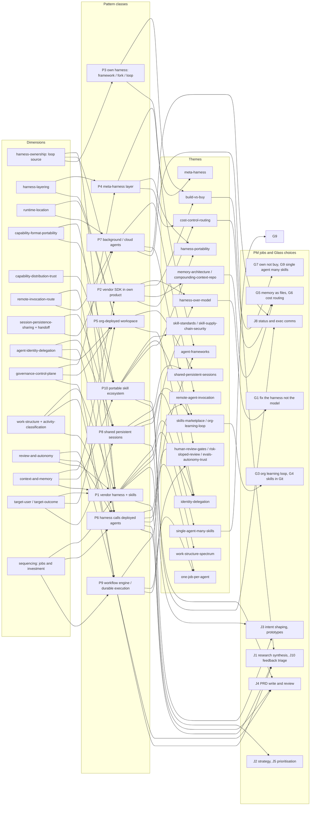

# Synthesis: a taxonomy of agent runtime patterns for coding and knowledge work

Date: 2026-10-24. Task: [research-agent-runtime-patterns-taxonomy](../research-agent-runtime-patterns-taxonomy.md). Plan: [00-research-plan.md](00-research-plan.md). Inputs: six track reports ([1](track-1-meta-harnesses.md), [2](track-2-harness-frameworks.md), [3](track-3-remote-deployed-agents.md), [4](track-4-portable-skills-plugins.md), [5](track-5-shared-persistent-sessions.md), [6](track-6-work-structure-fit.md)), the options register ([options/DIMENSIONS.md](../../options/DIMENSIONS.md), about 29 dimensions), the research library ([INDEX](../../research/INDEX.md), [THEMES](../../research/THEMES.md), 288 source notes), the [Ramp Glass teardown](../competitive-teardown-ramp-glass/00-teardown-summary.md), the [PM jobs brief](../research-pm-agents-jobs-to-be-done/00-brief.md) and [jobs map](../research-pm-agents-jobs-to-be-done/01-jobs-to-be-done-map.md), the [prior-work note](../research-product-agent-and-harness/00-prior-work-found.md), and Geoff's two intent documents ([Intent Factory](../../research/sources/geoff-building-accelerating-intent-factory.md), [Intent Shaping](../../research/sources/geoff-intent-shaping-well-managed-environment.md)).

What this document is: a menu of options by dimension with the key questions that would decide among them, a taxonomy of patterns, and a map tying both to the existing themes, PM jobs and Glass design choices. What it is not: a recommendation. No pattern is picked as the winner; where a lean is noted it comes with the evidence behind it and what would change it. Building our own harness is one option among several.

Evidence labels used throughout: **first-party** (the builder or vendor describing its own system), **vendor claim** (promotional, or about a customer), **independent** (not authored by an interested party), **anecdote** (forum, blog, second-hand). Every source link is to a note in `research/sources/`; the label is the note's frontmatter `evidence` field unless a track report refined it. The field moves monthly; all statements are as of 2026-10-24 and dates are given where they matter.

Companion files: a visual map in [map.html](map.html) (self-contained, no external requests) and the Mermaid diagram in section C.

---

## Contents

- [A. Executive summary](#a-executive-summary)
- [B. The taxonomy](#b-the-taxonomy)
- [C. Map of themes, concepts and patterns](#c-map-of-themes-concepts-and-patterns)
- [D. Options by dimension](#d-options-by-dimension)
- [E. Connection to existing work](#e-connection-to-existing-work)
- [F. Fit to unstructured vs task-specific work](#f-fit-to-unstructured-vs-task-specific-work)
- [G. Cross-cutting questions and what a resource request would fund](#g-cross-cutting-questions-and-what-a-resource-request-would-fund)
- [H. Evidence quality, gaps and inconsistencies](#h-evidence-quality-gaps-and-inconsistencies)
- [I. Open questions for Geoff](#i-open-questions-for-geoff)

---

## A. Executive summary

**The landscape.** Users today mostly sit in one general harness (Claude Code, Codex) and extend it with skills and subagents. Around that centre, the research found ten distinguishable pattern classes, none of them mainstream except the general harness itself and local parallel-session managers. They differ on where the loop runs, who owns it, how capability is packaged and reached, and how sessions persist and are shared. The vendors' own vocabulary is unsettled: "meta-harness" alone is used for at least six different shapes (a governance server over many CLIs, a hosted control plane, an SDK adapter, a local worktree manager, a model vendor's hosted service, and an optimiser of harness code), and Anthropic used the word for Managed Agents (2026-04-08) two months before Databricks used it for Omnigent (2026-06-13) ([Track 1](track-1-meta-harnesses.md); [CodePick](../../research/sources/codepick-meta-harness-guide.md), independent; [Anthropic](../../research/sources/anthropic-scaling-managed-agents.md), first-party).

**The main pattern classes** (section B): (1) vendor harness plus skills and subagents; (2) vendor SDK embedded in an own product (Ramp Glass); (3) own harness on a framework, a fork, or a minimal loop; (4) meta-harness layers above vendor harnesses (Omnigent, Warp Oz, Vercel HarnessAgent, Conductor-type managers); (5) org-deployed agent workspace with its own agent (Cloudflare OS, explicitly not a meta-harness); (6) a general harness calling deployed task agents (MCP tool, MCP Tasks, A2A, vendor API, CI); (7) background and cloud agents; (8) shared persistent sessions; (9) workflow engine and durable execution under agents; (10) portable skill and plugin ecosystems as the distribution layer.

**Strongest findings.**
- The loop is cheap; upkeep, evals and hosting are the cost. A working agent is under 400 lines ([Amp](../../research/sources/ampcode-how-to-build-an-agent.md), first-party), yet Manus rebuilt its framework four times ([Manus](../../research/sources/manus-context-engineering-lessons.md), first-party), Cognition rebuilt Devin for one model ([Cognition](../../research/sources/cognition-devin-sonnet-45-rebuild.md), first-party), and even with the Agent SDK the builder owns sandboxing, session storage, tenant isolation and scaling ([hosting guide](../../research/sources/anthropic-agent-sdk-hosting.md), first-party). The only systematic independent study found that none of eleven production coding harnesses imports a general agent framework ([arXiv eleven systems](../../research/sources/arxiv-harness-engineering-eleven-systems.md), independent; coding scope only).
- Portability exists for the skill file, not for behaviour. SKILL.md is read by Claude Code, Codex, Copilot, Gemini CLI, Cursor and OpenCode ([spec](../../research/sources/agentskills-specification.md), first-party), but Claude Code adds 13 non-portable fields, subagents have no shared format, and SkillsBench found Codex often ignored provided skills while curated skills still gave +16.2 points on average with 16 of 84 tasks getting worse ([SkillsBench](../../research/sources/arxiv-skillsbench.md), independent). Triggering is the weak link: a Vercel eval saw a skill never invoked in 56% of cases ([Vercel](../../research/sources/vercel-agents-md-outperforms-skills.md), vendor claim).
- MCP is the only protocol with documented examples of a deployed task agent reached from a general harness (Glean, Sentry), and their own constraints are the finding: read-only, no human-in-the-loop, finish in about 30 seconds ([Glean](../../research/sources/glean-agents-as-mcp-tools.md), vendor claim). The MCP Tasks extension (2026-07-28) is the standard path for long jobs; A2A v1.0 is specified and platform-supported but no named production deployment was found ([Glukhov](../../research/sources/glukhov-a2a-adoption-hype-reality.md), independent; [Ask HN](../../research/sources/hn-ask-is-anyone-using-a2a.md), anecdote).
- "Shared and persistent" is five separable decisions (where it runs, what makes it durable, who the agent acts as, how people join, how work is handed on), and the sharpest divergence is identity: Cursor runs shared agents with the creator's tokens, Codex as the requester, Claude Tag as a service account with channel-scoped bundles, Copilot as agent-with-co-author ([Track 5](track-5-shared-persistent-sessions.md)). Every handoff found is asymmetric.
- Standardised judgement work, where it works, is built as narrow specialists with explicit exclusions, deterministic gates, SME-labelled evals and a logged human override: Cloudflare's code reviewer (131,246 runs in a month, average $1.19, break-glass on 0.6% of MRs; [source](../../research/sources/cloudflare-ai-code-review-opencode.md), first-party), Stripe Minions ([source](../../research/sources/stripe-minions-one-shot-coding-agents.md), first-party), Ramp's Policy Agent ([source](../../research/sources/pragmatic-engineer-ramp-lessons-new-ai-product.md), first-party).

**Geoff's hypothesis after research.** Partly supported and refined ([Track 6](track-6-work-structure-fit.md)). All four major vendors draw a line between work whose path can be written down (workflow) and work whose path cannot (agent), and an independent survey of 86 deployed systems finds 68% run at most 10 steps before a human intervenes ([production study](../../research/sources/arxiv-measuring-agents-in-production.md), independent). But the line in the evidence is not "kind of user activity" (planning vs PRD review); it is a bundle of properties of a *step of work*: path predictability, verifiability, repeatability and consistency demand, error cost, audit need, context breadth, collaboration, and how much agency the person wants to keep. The same PM moves between these inside one session. Structure can also live inside the general harness (skills, hooks, subagents, headless runs), and structure that compensates for model weakness decays with each model release, while structure demanded by the work (verification, audit, permissions) persists. No controlled comparison of a task-specific agent against a skill in a general harness exists for any standard job; that is the central evidence gap for this project.

**Biggest evidence gaps.** Independent evidence is thin everywhere and mostly about failures: no independent post-mortem of a shared multi-user session, no cost-of-ownership account for an own harness, no quality or latency data for any MCP-served agent, no A2A production deployment, no independent review of Omnigent, Cloudflare OS adoption figures that are Cloudflare's own, and no evaluation of any PM agent on a PM job ([section H](#h-evidence-quality-gaps-and-inconsistencies)).

**Nothing is settled.** The register now holds about 29 dimensions, which this document consolidates to 20 (section D, with a merge table), each with options and unranked key questions. Several questions can only be answered by Geoff (section I), and most of the rest need a small set of prototypes, trials and interviews (section G) rather than more desk research.

---

## B. The taxonomy

### B.1 Axes

The plan's eight draft axes survived the research with refinements. They are also the spine of the dimensions in section D.

| Axis | Values found in the field | Refinement from the tracks |
|---|---|---|
| 1. Where the runtime lives | local process; local sandbox or worktree; user-owned remote box; third-party sandbox per session (E2B, Modal, Daytona); vendor cloud VM; customer-hosted runners with vendor control plane; org-deployed service; edge durable object | Track 5 added "customer-hosted runners, vendor control plane" (Claude self-hosted, Warp workers) as a distinct middle; Track 2 added self-hosted SDK containers |
| 2. Who owns the loop | vendor product; vendor SDK embedded; hosted harness (Managed Agents); framework-built; open-source fork; minimal own loop; meta-harness delegating the loop to vendors; none (workflow engine) | Track 2: split "own harness on a framework" into SDK-embed, framework, fork, minimal loop. Track 1 and 2: separate "who supplies the loop" from "is there a layer above" and from "who hosts it" |
| 3. Harness and provider coupling | tied to one harness; portable file formats (SKILL.md, AGENTS.md, MCP); harness-agnostic layer at process or SDK boundary; model-provider coupling as a separate axis | Track 2: provider coupling (access terms, caching) is a different choice from harness coupling; Track 4: file portability is not behaviour portability |
| 4. Packaging of capability | prompt; always-on context file; open-standard skill; harness-extended skill; subagent definition; plugin bundle; MCP server; deployed agent behind a protocol or API; registry or marketplace | Track 4: split format/portability from distribution/trust |
| 5. Invocation relation | in-process subagent; spawned child CLI; human-triggered cloud handoff; vendor background-agent API; sync MCP tool; MCP Tasks; A2A; event or CI trigger; cross-harness plugin | Track 3 enumerated about eight routes; most used today need no protocol |
| 6. Session locality, sharing, persistence | ephemeral-private; resumable-private; shared snapshot by link; shared-live (multiplayer); persistent-deployed (durable identity); team memory; plus handoff shape (fork-copy, move, branch-only, message-in) | Track 5: durability substrate and handoff are separable sub-choices |
| 7. Governance and control plane | per-harness settings; gateway or proxy; stateful action policies (Omnigent); zero-ambient-access capabilities plus observation log (Cloudflare OS); hosted audit and credit caps (Warp); deterministic gates in the harness (hooks); registry gates; identity model | Tracks 3 and 5: identity and delegation deserve their own dimension |
| 8. Work structure served | properties of a job step (predictability, verifiability, repeatability, error cost, audit, context breadth, collaboration, desired agency) and five working classes C1-C5 | Track 6: classify the step, not the activity or the person |

### B.2 Pattern classes

Pattern letters A-H from the plan are kept for traceability to Track 6's fit matrix; two were split (B and C) and the numbering below is P1-P10.

#### P1. Vendor harness plus skills and subagents (plan A)
- **Definition.** Users work directly in Claude Code, Codex or a similar general harness; capability is added as skills, subagent definitions, hooks, plugins, MCP servers and context files; structure is added on demand (vague prompt to explore, plan mode, skills for repeatable work, Stop hooks as deterministic gates, `claude -p` for unattended fan-out).
- **Examples.** Claude Code best practices ([source](../../research/sources/anthropic-claude-code-best-practices.md), first-party); Agent Skills ([source](../../research/sources/anthropic-engineering-equipping-agents-agent-skills.md), first-party); Intercom's rollout to about 1,000 non-engineers ([source](../../research/sources/intercom-we-gave-claude-code-to-everyone.md), first-party); Cowork PM plugin ([source](../../research/sources/anthropic-cowork-plugins-product-management.md), vendor claim, no outcomes).
- **Teardown examples** (added 2026-10-24 from [the teardown mapping](../teardowns-to-pattern-classes/00-mapping.md); fit marked clear, partial or contested). **Intercom, Claude Code for everyone** (clear): about 1,100 of 1,305 staff on one MDM-installed harness with 13 plugins and 267 skills; hooks force a create-pr skill and a SessionEnd hook mines gaps into new skills. [Scanlan](../../research/sources/ideas-fin-how-we-use-claude-code-today.md), [CTO](../../research/sources/ideas-fin-2x-nine-months-later.md) (first-party); [map](../research-pm-agents-jobs-to-be-done/04-pdlc-agent-ecosystem-map.md); **Anthropic, Claude Code and Cowork internally** (clear): plan mode, parallel sessions, CLAUDE.md and REVIEW.md for engineers; stacked department plugins for non-engineers. [Cherny](../../research/sources/lenny-podcast-boris-cherny-after-coding.md), [Cowork guide](../../research/sources/claude-guide-deploying-cowork-across-org.md) (first-party); [map](../research-claude-resources-articles/02-pdlc-agent-ecosystem-map.md); **Stripe and Shopify engineers** (clear): several general harnesses side by side, pre-configured, with no consolidation. [Kaliski](../../research/sources/howiai-stripe-minions-kaliski.md), [BVP](../../research/sources/bvp-inside-shopifys-ai-first-engineering-playbook.md) (first-party); [Stripe rollout](../../research/sources/claude-customers-stripe-claude-code-rollout.md) (vendor-claim); **Anthropic's AI-native SDLC playbook** (partial, prescription only): a committed intent.md → spec.md → plan.md chain run with skills, hooks and `claude -p`. No Anthropic team is shown using it. [playbook](../../research/sources/claude-ai-native-sdlc-playbook.md) (first-party); **Block, Goose company-wide** (partial; *placeholder*): one general agent extended by MCP for all staff, but the harness is Block's own. [Lenny](../../research/sources/lenny-podcast-block-dhanji-goose.md) (first-party).
- **Trade-offs.** Zero build and the best-maintained loop; default is local, private, ephemeral (transcripts deleted after 30 days by default, [ITdaily](../../research/sources/itdaily-claude-code-30-day-transcript-deletion.md), independent); skills are advisory and run with the host's permissions, so a skill cannot enforce a gate; consistency on standard jobs unmeasured; tied to one vendor's terms (subscription credit works only in official clients, [VentureBeat](../../research/sources/venturebeat-anthropic-third-party-harness-crackdown.md), independent).
- **Maturity.** Mainstream.
- **Themes.** `single-agent-many-skills`, `harness-over-model`, `skill-standards`.

#### P2. Vendor SDK embedded in an own product (plan B, split)
- **Definition.** The vendor's harness runs as a library or subprocess inside a product the organisation owns, which supplies UX, memory, connectors, policy and distribution.
- **Examples.** Ramp Glass on the Claude Agent SDK (desktop app, Okta SSO, MCP proxy, Dojo skills marketplace, 24-hour memory pipeline, cost router; [Goddijn](../../research/sources/x-sebgoddijn-glass-article.md), [Buchan](../../research/sources/x-shanebuchan-how-we-built-glass.md), first-party; [teardown](../competitive-teardown-ramp-glass/00-teardown-summary.md)); Agent SDK hosting cookbook patterns (ephemeral, long-running, hybrid with SessionStore; [hosting](../../research/sources/anthropic-agent-sdk-hosting.md), first-party); Codex SDK and app server ([source](../../research/sources/openai-codex-sdk-docs.md), first-party).
- **Teardown examples** (added 2026-10-24 from [the teardown mapping](../teardowns-to-pattern-classes/00-mapping.md); fit marked clear, partial or contested). **Ramp Glass, April 2026** (clear, historical): Claude Agent SDK inside a desktop app with Okta SSO, an MCP proxy, Dojo skills and a 24-hour memory pipeline. By October 2026 it had been replaced by Ramp's own harness, Laminar (see P3). [Charles](../../research/sources/x-geoffintech-ai-pilled-article.md), [Goddijn](../../research/sources/x-sebgoddijn-glass-article.md) (first-party); [teardown](../competitive-teardown-ramp-glass/00-teardown-summary.md); **Shopify Roast** (partial): Claude Code embedded as the CodingAgent step of an own workflow tool (2025). It is a precursor of Shopify's later own harness. [Roast](../../research/sources/shopify-engineering-introducing-roast.md) (first-party); **Spotify Honk** (partial; *placeholder*): Claude Agent SDK in a Kubernetes pod with user-added internal tools. [office hours](../../research/sources/claude-customers-spotify-office-hours.md) (vendor-claim).
- **Trade-offs.** Vendor-grade loop, tools, permissions, hooks, subagents without writing them; you own sandboxing, session storage, tenant isolation, scaling (about 1 GiB RAM per concurrent agent as a floor), observability; Claude-only; third-party products must use API keys, not claude.ai login, and cannot brand as Claude Code ([SDK overview](../../research/sources/anthropic-agent-sdk-overview.md), first-party). Glass's build accounts disagree on team size (3 vs 4) and give no run cost ([teardown](../competitive-teardown-ramp-glass/00-teardown-summary.md)); all Ramp evidence is first-party.
- **Maturity.** Early-adopter.
- **Themes.** `build-vs-buy`, `harness-over-model`, `memory-architecture`, `cost-control-routing`, `skills-marketplace`.

#### P3. Own harness: framework-built, forked, or minimal loop (plan B, split)
- **Definition.** The organisation owns the loop itself: composed on a general framework (LangGraph, ADK, Microsoft Agent Framework, Pydantic AI, Vercel AI SDK, Mastra, CrewAI), forked from an open harness (Goose, OpenCode, Cline, Pi), or written as a thin loop.
- **Examples.** Stripe Minions on a Goose fork ([source](../../research/sources/stripe-minions-one-shot-coding-agents.md), first-party; 1,000+ merged PRs per week self-reported); Pi ([Zechner](../../research/sources/mariozechner-pi-minimal-coding-agent.md), anecdote); Mini-SWE-Agent (about 50 lines, 74%+ SWE-bench Verified self-reported, via [arXiv](../../research/sources/arxiv-harness-engineering-eleven-systems.md)); framework docs ([LangGraph](../../research/sources/langchain-docs-langgraph-overview.md), [ADK](../../research/sources/google-adk-docs.md), [MAF](../../research/sources/microsoft-agent-framework-overview.md), [Pydantic AI](../../research/sources/pydantic-ai-docs.md), first-party).
- **Teardown examples** (added 2026-10-24 from [the teardown mapping](../teardowns-to-pattern-classes/00-mapping.md); fit marked clear, partial or contested). **Ramp Laminar, under Glass, Inspect, Stack and customer agents** (clear): an in-house, provider-agnostic harness. Version 1 took six weeks from about May 2026, after Ramp tried vendor SDKs and managed-agent APIs. [Building Laminar](../../research/sources/ramp-builders-building-laminar.md) (first-party); [New Stack](../../research/sources/thenewstack-ramp-laminar-agent-harness.md) (independent, relies on Ramp's post); [teardown](../competitive-teardown-ramp-glass/00-teardown-summary.md); **Shopify River on Aquifer** (clear): an own disposable loop outside the sandbox, over a durable session log, with new agents added as profiles. [Under the River](../../research/sources/shopify-engineering-under-the-river.md) (first-party); [teardown](../competitive-teardown-shopify-river/00-teardown-summary.md); **Stripe Kai** (clear): framework-built on LangChain Deep Agents over LangGraph plus a Stripe harness layer. It is the library's first production non-coding, multi-user agent on a general framework. [Kai post](../../research/sources/stripe-meet-knowledge-ai-platform.md) (first-party); [LangChain](../../research/sources/langchain-how-stripe-built-kai-deep-agents.md) (vendor-claim); **Stripe Minions** (clear): a fork of Goose. B.2 already lists it. [Minions](../../research/sources/stripe-minions-one-shot-coding-agents.md) (first-party); **Block Goose** (clear; *placeholder*): Block wrote and runs its own open harness, now foundation-governed. [Lenny](../../research/sources/lenny-podcast-block-dhanji-goose.md), [repo](../../research/sources/github-block-goose-repo.md) (first-party); **Ramp Inspect** (partial): Ramp's own background agent with OpenCode as the loop; whether it is forked is not stated. [Inspect post](../../research/sources/ramp-builders-why-we-built-background-agent.md) (first-party); **Shopify "Vanilla" pi profile** (contested): it may be the open-source Pi agent on Aquifer, but that is unverified. [Under the River](../../research/sources/shopify-engineering-under-the-river.md) (first-party); [adaptordie](../../research/sources/adaptordie-shopify-river-agent-stack.md) (independent, inference).
- **Trade-offs.** Maximum control of context and provider; model-portable. Costs: own provider abstraction, UI, caching, evals and safety; frameworks churn (AutoGen archived with no fixes, [notice](../../research/sources/github-microsoft-autogen-archive-notice.md), first-party); zero of eleven production coding harnesses use a general framework ([arXiv](../../research/sources/arxiv-harness-engineering-eleven-systems.md), independent); harness scaffolding goes stale per model ([Anthropic harness design](../../research/sources/anthropic-harness-design-long-running-apps.md), first-party: a planner/evaluator harness cost 20x a solo run on one task); evals are the unsolved part ([Ronacher](../../research/sources/lucumr-agent-design-is-still-hard.md), anecdote). Frameworks with explicit graphs fit the structured end; harness SDKs fit the open-ended end ([Track 2](track-2-harness-frameworks.md)). Every build example is a well-resourced engineering or AI-product company.
- **Maturity.** Mainstream for workflow apps; early-adopter for coding; untested as a knowledge-work harness base.
- **Themes.** `build-vs-buy`, `agent-frameworks`, `harness-over-model`.

#### P4. Meta-harness: a layer above vendor harnesses (plan C)
- **Definition.** A layer that launches, governs, shares or abstracts several harnesses while leaving the loop to the vendors. The term is unsettled; the shapes differ enough that they should not be compared as one product class ([Track 1](track-1-meta-harnesses.md)). Sub-shapes:
  - **Self-run server plus runners.** Databricks Omnigent: Apache-2.0 alpha, about 11k stars, 13+ harnesses, 12 sandbox providers, stateful contextual policies, URL sharing, attach and fork ([repo](../../research/sources/github-omnigent-repo.md), vendor claim plus open issues; [launch](../../research/sources/databricks-omnigent-meta-harness-launch.md), vendor claim; [policies](../../research/sources/databricks-omnigent-contextual-policies.md), vendor claim). Open issues dated 2026-10-23/24: sharing does not separate chat access from host access (#11413), stuck-running sessions, opaque auth failures, Entra OIDC login failing. HN launch drew 15 points ([HN](../../research/sources/hn-omnigent-launch-thread.md), anecdote). No independent hands-on review found. Nx Polygraph is a closed analogue ([source](../../research/sources/nx-polygraph-meta-harness.md), vendor claim).
  - **Hosted multi-harness control plane.** Warp Oz (beta, 2026-05-20): Claude Code, Codex or Warp Agent per task, shared skills/rules/triggers, audit, credit caps; third-party inference billed outside the platform ([source](../../research/sources/warp-oz-multi-harness.md), vendor claim).
  - **SDK-level adapter.** Vercel AI SDK HarnessAgent swaps Claude Code, Codex or Pi like models, experimental ([source](../../research/sources/vercel-ai-sdk-harnesses.md), vendor claim).
  - **Local parallel-session manager.** Conductor, Claude Squad, Superset, Vibe Kanban (company shut down 2026-04-10; [source](../../research/sources/vibekanban-shutdown.md), first-party); no governance or sharing ([Franke](../../research/sources/garrit-meta-harness-parallel-agents.md), anecdote).
  - **DIY coordinator.** A light harness spawns `claude -p` and `codex exec`; cost fan-out of about 23-25 internal sessions per high-reasoning delegation, approvals bypassed in shared CI, "no interop standard exists yet" ([Vaughan](../../research/sources/danielvaughan-meta-harness-pattern-pi.md), independent practitioner).
  - **Front-door dispatcher** (added 2026-10-24). A system of record or front door launches several vendors' agents from one item and lists their sessions: Atlassian Jira work items (Rovo Dev, Claude, Cursor, Copilot, Codex) and Stripe Kai projects backed by another harness. It counts as P4 only where the front door adds shared policy, visibility or audit across the harnesses; dispatch alone is a router. See the teardown examples below.
- **Teardown examples** (added 2026-10-24 from [the teardown mapping](../teardowns-to-pattern-classes/00-mapping.md); fit marked clear, partial or contested). **Ramp OCA** (partial, DIY-coordinator shape): one Temporal-orchestrated agent that runs inside Claude Code or Codex depending on the model. [OCA post](../../research/sources/ramp-builders-how-we-built-oca.md) (first-party); **Stripe Kai projects** (partial): a project can be backed by "a different harness" behind Kai's UI and governance. Described, not demoed. [Krishnamurthy](../../research/sources/howiai-stripe-kai-krishnamurthy.md) (first-party, ASR captions); **Atlassian Jira work items** (contested): one work item can launch Rovo Dev, Claude Agent for Jira, Cursor, Copilot or Codex, with sessions listed per space. A system-of-record dispatcher is not a B.2 sub-shape. [agents in a space](../../research/sources/atlassian-jira-manage-agents-in-space.md) (first-party); [map](../user-story-mapping/01-pdlc-agent-ecosystem-map.md); **Anthropic Managed Agents** (contested): B.2 lists it on Anthropic's own label, but it hosts one vendor's loop, so it fits P7 better. [launch](../../research/sources/claude-managed-agents-dreaming-outcomes.md) (first-party); No teardown supplies a clear P4 case.
- **Teardown examples, revised classes (2026-10-24).** Jira work items and Stripe Kai projects are now **front-door dispatcher** cases. Jira moves from contested to partial: it adds per-space session visibility, but no shared policy is documented. Kai projects stay partial. Anthropic Managed Agents leaves P4 (see P7).
- **Status after the teardowns** (2026-10-24). No teardown supplies a clear P4 case. The class stands on the examples outside the teardowns (Omnigent, Warp Oz, HarnessAgent, local managers, DIY coordinators), which meet its definition; it is kept, not merged.
- **Trade-offs.** Harness independence and uniform policy and sharing, in exchange for a new dependency that must track each vendor's login, terminal and hook behaviour; policies hold only for sessions launched through the layer; platform lock-in to the layer's host; supplier risk for small vendors. None has published effectiveness data.
- **Maturity.** Emerging (alpha to beta), except local managers (early-adopter).
- **Themes.** `meta-harness`, `harness-portability`, `shared-persistent-sessions`, `cost-control-routing`.

#### P5. Org-deployed agent workspace with its own agent (plan C, split out)
- **Definition.** A platform the organisation deploys that gives each employee a persistent, governed agent workspace; the agent is platform-native, not a wrapped CLI.
- **Definition (revised 2026-10-24; see the change log).** A platform the organisation deploys company-wide that gives employees persistent, governed access to a platform-native agent (not a wrapped vendor CLI). Two sub-types:
  - **P5a. Per-employee workspace.** Each employee gets their own workspace, sessions and outputs. Examples: Cloudflare OS; Ramp Glass on Laminar (October 2026). Cloudflare OS's zero-ambient-access security model is one way to build P5a, not a requirement.
  - **P5b. Company agent service.** One hosted agent service reached through shared surfaces (Slack, web, IDE), with project- or team-level governance and no personal workspace. Examples: Stripe Kai; Shopify River on Aquifer.
  - **Re-placement of Glass.** Glass in its October 2026 form is P5a on a P3 harness (Laminar), plus P7, P8c and P10. This supersedes B.3's reading of Glass as P2 plus P8 plus P10, which describes the April 2026 form.
- **Examples.** Cloudflare OS (open-sourced 2026-08-05, Apache-2.0 per repo, early access v2; internal v1 since May 2026): per-employee workspaces, apps as isolates with their own SQLite, zero ambient access, typed bindings, per-service Gatekeepers holding credentials, an observation log that re-checks a later viewer's access, shareable apps versus data-free blueprints, AI Gateway budgets, Code Mode agent on Pi ([announcement](../../research/sources/cloudflare-os-announcement.md), vendor claim; [repo](../../research/sources/github-cloudflare-os-repo.md), vendor claim; [rollout post](../../research/sources/cloudflare-how-we-rethink-work-with-cloudflare-os.md), first-party self-report: thousands of weekly users, >4,000 apps in 30 days, >10,000 hours saved, no method). HN: 668 points, 330 comments, lock-in, naming and sandbox-hardness critiques, early deployment problems ([HN](../../research/sources/hn-cloudflare-os-thread.md), anecdote). Cloudflare's wider agent cloud (Agents Week 2026-04-14 to 20; Project Think; Flue, 2026-06-17) supplies the framework/harness/runtime layering ([recap](../../research/sources/cloudflare-agents-week-in-review.md), [Think](../../research/sources/cloudflare-project-think.md), [Flue](../../research/sources/cloudflare-flue-agents-platform.md), vendor claims).
- **Teardown examples** (added 2026-10-24 from [the teardown mapping](../teardowns-to-pattern-classes/00-mapping.md); fit marked clear, partial or contested). **Ramp Glass, October 2026** (contested): an org-deployed, employee-wide, governed workspace with a platform-native agent on Laminar. It matches P5's definition, but B.3 classes Glass as P2+P8+P10+P7. [Building Laminar](../../research/sources/ramp-builders-building-laminar.md) (first-party); [Glyman](../../research/sources/x-eglyman-introducing-glass-learn-things-once.md) (vendor-claim); **Shopify Aquifer** (partial): an org platform with a platform-native agent for 7,000+ people, but the surface is Slack and there is no per-employee workspace. [Under the River](../../research/sources/shopify-engineering-under-the-river.md) (first-party); **Stripe Kai** (partial): a company-wide hosted agent service with project-level governance and many surfaces. Sessions are single-user and there is no personal memory. [Kai post](../../research/sources/stripe-meet-knowledge-ai-platform.md), [Krishnamurthy](../../research/sources/howiai-stripe-kai-krishnamurthy.md) (first-party); No teardown supplies a clear P5 case. Cloudflare OS stays the only example that meets every part of the definition.
- **Teardown examples, revised classes (2026-10-24).** **Ramp Glass, October 2026: P5a** (clear on the revised definition, first-party evidence only): a per-employee desktop workspace on Ramp's own Laminar harness. **Stripe Kai: P5b** (clear): a company-wide hosted agent service with project-level governance. **Shopify River on Aquifer: P5b** (clear): one platform-native agent for 7,000+ people through Slack.
- **Trade-offs.** Always on, multi-user, non-engineer friendly, the most distinctive security model found; but not harness-portable (does not wrap Claude Code or Codex), tied to Cloudflare's PaaS and Workers Paid plan today, early access with "rough edges", per-user app copies as a maintenance burden (HN), adoption figures self-reported.
- **Maturity.** Emerging.
- **Themes.** `shared-persistent-sessions`, `identity-delegation`, `non-engineer-builders`, `build-vs-buy`.

#### P6. General harness calling deployed task agents (plan D)
- **Definition.** Claude Code, Codex, Claude Desktop or Cursor reaches a more capable agent that runs elsewhere, over a protocol or API. Routes ([Track 3](track-3-remote-deployed-agents.md)): sync MCP tool backed by an agent; MCP with the Tasks extension; A2A; vendor background-agent API; event or CI trigger; self-hosted Agent SDK service; cross-harness plugin.
- **Examples.** Glean agents as MCP tools (admin-curated; read-only, no write tools, no human-in-the-loop, about 30 s runtime because hosts time out at 30-60 s; [source](../../research/sources/glean-agents-as-mcp-tools.md), vendor claim); Sentry MCP with Seer ([source](../../research/sources/sentry-mcp-server-seer.md), vendor claim, partly unverified); MCP Tasks extension in the 2026-07-28 revision, Claude Code support in public beta ([Tasks](../../research/sources/mcp-ext-tasks-long-running-operations.md), first-party spec; [changelog](../../research/sources/mcp-spec-2026-07-28-key-changes.md), first-party); A2A v1.0 (March 2026, Linux Foundation, 150+ supporting orgs, Copilot Studio client, AgentCore host; [spec](../../research/sources/a2a-project-specification-v1.md), first-party; [LF](../../research/sources/linuxfoundation-a2a-one-year-press-release.md), vendor claim); Claude Code GitHub Actions `code-review` ([source](../../research/sources/anthropic-claude-code-github-actions.md), vendor claim); Cloudflare's code reviewer as a CI component ([source](../../research/sources/cloudflare-ai-code-review-opencode.md), first-party); OpenAI's `codex-plugin-cc` in Claude Code ([source](../../research/sources/openai-codex-plugin-for-claude-code.md), first-party); Codex MCP server removed in favour of an experimental app server ([source](../../research/sources/openai-codex-mcp-server-removed.md), first-party).
- **Teardown examples** (added 2026-10-24 from [the teardown mapping](../teardowns-to-pattern-classes/00-mapping.md); fit marked clear, partial or contested). **Anthropic Code Review** (clear): a GitHub App starts parallel find, verify and rank agents on every PR, and never approves. [GA post](../../research/sources/claude-code-review-ga.md) (first-party); **Intercom "Shrek"** (clear): webhook-triggered review sub-agents (Claude and Codex) in short-lived containers. About 19% of PRs are auto-approved by risk and size. [webinar Q&A](../../research/sources/ideas-fin-webinar-qa-3x-rd-output.md), [AI approving PRs](../../research/sources/intercom-ai-approving-pull-requests.md) (first-party); **Atlassian Rovo A2A gateway** (clear, as capability): an inbound A2A endpoint to Rovo with user-delegated OAuth and a 30-second sync cap. It adds a named A2A host to B.2's evidence; there is still no usage data. [A2A docs](../../research/sources/atlassian-rovo-a2a-gateway-docs.md) (first-party); **Atlassian Rovo MCP server; Rovo Dev reviewer; Rovo Dev in Pipelines** (partial): the MCP server is a tool route, not an agent. The reviewer runs on PR creation, on each commit, or manually, and Pipelines is beta; in both the repository is the caller, not a general harness. [MCP tools](../../research/sources/atlassian-rovo-mcp-server-supported-tools.md), [AC review](../../research/sources/atlassian-rovo-dev-acceptance-criteria-code-review.md), [Pipelines](../../research/sources/atlassian-rovo-dev-bitbucket-pipelines.md) (first-party); **Agent-to-agent calls in the teardowns** (partial): Ramp OCA asks Inspect for a PR; Stripe Orbit hands a plan to Minions; Kai and devbox agents use Harbor's tools over internal MCP; Shopify's PR-review profile is woken by an external system; Sentry Seer hands off to a coding agent on Managed Agents. [OCA](../../research/sources/ramp-builders-how-we-built-oca.md), [Orbit video](../../research/sources/youtube-notmybusiness-inside-stripe-ships-fast.md), [Harbor](../../research/sources/stripe-harbor-ai-prototyping.md), [Under the River](../../research/sources/shopify-engineering-under-the-river.md) (first-party); [Sentry](../../research/sources/claude-customers-sentry-bug-fixing-agents.md) (vendor-claim); **Spotify Vedder** (partial; *placeholder*): one data agent served over Slack, an MCP server for IDEs and a web UI. [Vedder](../../research/sources/spotify-engineering-vedder-context-layer.md) (first-party).
- **Trade-offs.** Arbitrary complexity, own runtime and data, central governance, callable from several hosts; costs are host timeouts, host-dependent support for Tasks, Sampling deprecated (the served agent brings and pays for its own model), identity on behalf of the user unsettled (MCP forbids token passthrough; A2A leaves delegation to implementers; [MCP auth](../../research/sources/mcp-authorization-spec-draft.md), first-party), three systems to debug, unstable vendor routes. No independent quality, latency or cost data for any MCP-served agent; no native A2A client in Claude Code or Codex.
- **Maturity.** Sync MCP agents early-adopter; MCP Tasks and A2A emerging; CI reviewers early-adopter to mainstream among Claude Code teams.
- **Themes.** `remote-agent-invocation`, `identity-delegation`, `one-job-per-agent`.

#### P7. Background and cloud agents (plan E)
- **Definition.** A whole task is handed to an agent in a vendor cloud (or customer-hosted runner) that works while the laptop is closed and returns a PR, report or session link.
- **Examples.** Claude Code cloud sessions (`--cloud`, `--teleport`; GitHub-bound; excluded for ZDR/HIPAA/CMEK orgs; [source](../../research/sources/anthropic-claude-code-cloud-sessions.md), first-party); Claude self-hosted environments (runners poll outbound, owner-locked, transcript still with Anthropic; [source](../../research/sources/anthropic-self-hosted-environments.md), first-party); Codex cloud ([source](../../research/sources/openai-codex-cloud-docs.md), first-party); Cursor Cloud Agents API, Jules API, Copilot cloud agent (59-minute cap; [source](../../research/sources/github-copilot-cloud-agent.md), vendor claim); Managed Agents; Stripe Minions one-shot runs in pooled devboxes ([source](../../research/sources/stripe-minions-part-2.md), first-party); scheduled tasks and routines, personal not team-shared, "green does not mean the work succeeded" ([source](../../research/sources/anthropic-claude-code-scheduled-tasks.md), first-party).
- **Hosted harness service** (moved from P4 on 2026-10-24: it hosts one vendor's loop rather than sitting above several, and the teardowns use it as a runtime or as an option rejected, as Ramp did). Anthropic Managed Agents (public beta, April 2026): session as durable event log, stateless harness, sandbox, credential vault; calls itself a meta-harness ([engineering post](../../research/sources/anthropic-engineering-scaling-managed-agents.md), first-party; [CData](../../research/sources/cdata-claude-managed-agents-meta-harness.md), interested party on lock-in).
- **Teardown examples** (added 2026-10-24 from [the teardown mapping](../teardowns-to-pattern-classes/00-mapping.md); fit marked clear, partial or contested). **Stripe Minions** (clear): unattended one-shot runs on pre-warmed devboxes, started from a Slack emoji, up to 12 hours, returning a PR. [Part 2](../../research/sources/stripe-minions-part-2.md), [Kaliski](../../research/sources/howiai-stripe-minions-kaliski.md) (first-party); **Ramp Inspect** (clear): a Modal sandbox per session returns a PR under the requester's identity. Automations now start more sessions than humans do (vendor-claim). [Inspect post](../../research/sources/ramp-builders-why-we-built-background-agent.md) (first-party); [Modal](../../research/sources/modal-ramp-inspect-background-agent.md), [office hours](../../research/sources/claude-customers-ramp-office-hours.md) (vendor-claim); **Ramp Glass on Laminar** (clear): async agents on disposable cloud workers, with tasks of "minutes or hours" that survive the laptop sleeping. [Building Laminar](../../research/sources/ramp-builders-building-laminar.md) (first-party); **Shopify River automation and job modes, and Remote Dev** (clear): River opens its own threads from a security ledger, runs overnight mobile bug fixes, and claims a warm remote Mac per session. [vuln remediation](../../research/sources/shopify-engineering-river-vulnerability-remediation.md), [Remote Dev](../../research/sources/shopify-engineering-remote-dev.md) (first-party); **Atlassian Jira Coding Agent and third-party agents from a work item** (clear): assign or automate, then get a draft PR as the user. [coding agent](../../research/sources/atlassian-jira-coding-agent-generate-code.md), [agents in a space](../../research/sources/atlassian-jira-manage-agents-in-space.md) (first-party); **Anthropic Cowork and Claude Code cloud sessions; Managed Agents; the ABC Legal fleet** (clear): scheduled tasks and project threads run with no device online; a hosted runtime with lead-agent orchestration; 50+ single-job agents moved off desktops. [Cowork web](../../research/sources/claude-cowork-web-mobile-handoff.md), [projects](../../research/sources/claude-code-projects-redesigned.md), [Managed Agents](../../research/sources/claude-managed-agents-dreaming-outcomes.md) (first-party); [ABC Legal](../../research/sources/claude-abc-legal-managed-agents-builders.md) (vendor-claim); **Anthropic Claude Tag on-call** (partial): an event-started, channel-resident agent that writes post-mortems and fix PRs but cannot deploy. [CI on-call](../../research/sources/claude-tag-ci-cd-first-responder.md) (first-party); **Intercom CI-watcher and "Buzz"; Block background Goose; Spotify Honk** (partial; Block and Spotify are *placeholders*): each is named, with no runtime described. [Scanlan](../../research/sources/ideas-fin-how-we-use-claude-code-today.md), [webinar Q&A](../../research/sources/ideas-fin-webinar-qa-3x-rd-output.md), [Lenny/Block](../../research/sources/lenny-podcast-block-dhanji-goose.md) (first-party); [office hours](../../research/sources/claude-customers-spotify-office-hours.md) (vendor-claim).
- **Teardown examples, revised classes (2026-10-24).** **Anthropic Managed Agents** moves here from P4 as a hosted harness service (clear). Ramp names it among the options it rejected before building Laminar ([Building Laminar](../../research/sources/ramp-builders-building-laminar.md), first-party).
- **Trade-offs.** No ops, laptop independence, parallel throughput; the independent evidence on autonomy is dated and poor: Answer.AI's Devin trial, 3 successes in 20 tasks, success unpredictable, infeasible tasks pursued rather than flagged (January 2025; [source](../../research/sources/answerai-thoughts-month-with-devin.md), independent); Willison's merge-rate log by tool ([source](../../research/sources/simonwillison-async-coding-agents-tag.md), independent). Failures with permission inheritance (Kiro, contested; [source](../../research/sources/the-decoder-aws-kiro-outage.md), independent) and ignored freeze instructions (Replit; [source](../../research/sources/theregister-replit-saastr-response.md), independent).
- **Maturity.** Early-adopter (vendor cloud sessions); emerging (APIs, self-hosted runners).
- **Themes.** `remote-agent-invocation`, `human-review-gates`, `agent-failure-modes`, `evals-autonomy-trust`.

#### P8. Shared, persistent, multi-user sessions (plan F)
- **Definition.** A session that outlives one person's laptop and can be joined, steered or handed on by others; or a chat-native shared agent.
- **Sub-types by sharing model (revised 2026-10-24; see the change log).** P8 stays the parent; the privacy default is the sharpest difference between them.
  - **P8a. Public by default, chat-native.** Anyone in the workspace can join and redirect: Shopify River.
  - **P8b. Channel-scoped, with the agent's own identity.** Channel membership sets access: Anthropic Claude Tag; Codex in Slack and Ramp Research are related chat-native forms.
  - **P8c. Private, shared on demand.** The owner hands a session to someone: Ramp Glass.
  - **P8d. Multiplayer session control plane.** Each session is a shared object several people steer: Ramp Inspect, Open-Inspect, Omnigent URL sharing, Warp attach-and-steer.
  - **P8e. Watch-only public run log.** Others watch and can pair-prompt but don't own the run: Stripe Minions' public channel.
  - **P8f. Shared plan workspace.** Teammates share context and comment on a plan across sessions: Stripe Orbit.
- **Examples.** Ramp Inspect (Modal sandbox per session, Slack and web clients, multiplayer-first; [Modal](../../research/sources/modal-ramp-inspect-background-agent.md), vendor claim; [Wavect](../../research/sources/wavect-ramp-inspect-architecture.md), independent critique); Open-Inspect (Durable Object per session, visibility enforcement default `shadow`; [source](../../research/sources/github-open-inspect-background-agents.md), first-party); Glass shared sessions and shared knowledge edits ([Glyman](../../research/sources/x-eglyman-introducing-glass-learn-things-once.md), vendor claim); Omnigent URL sharing; Warp attach-and-steer; Claude Tag channel agents ([source](../../research/sources/anthropic-claude-tag-agent-identity.md), first-party; [Tenable](../../research/sources/tenable-claude-tag-slack-access-model.md), independent); Codex in Slack ([source](../../research/sources/openai-codex-cloud-slack.md), first-party); Cursor Team Followups ([source](../../research/sources/cursor-forum-team-followups-act-on-behalf.md), anecdote plus staff reply).
- **Teardown examples** (added 2026-10-24 from [the teardown mapping](../teardowns-to-pattern-classes/00-mapping.md); fit marked clear, partial or contested). **Shopify River** (clear; public by default): Slack-only with no DMs; durable event-log sessions; anyone can join a thread. It has the only published multiplayer metric (171,853 same-thread links in September 2026). [Under the River](../../research/sources/shopify-engineering-under-the-river.md), [chart](../../research/sources/x-tobi-river-floods-shopify-chart.md) (first-party); [teardown](../competitive-teardown-shopify-river/00-teardown-summary.md); **Anthropic Claude Tag** (clear; channel-scoped): a resident agent with channel memory, its own identity per channel, personal connectors for on-behalf-of reads, and multiple engineers steering one investigation. [identity model](../../research/sources/claude-agent-identity-access-model.md), [CI on-call](../../research/sources/claude-tag-ci-cd-first-responder.md) (first-party); [Tenable](../../research/sources/tenable-claude-tag-slack-access-model.md) (independent); **Ramp Inspect** (clear; multiplayer control plane) and **Ramp Glass** (clear; private by default, share on demand): already in B.2; Laminar now lists multiplayer as a harness feature. [Inspect post](../../research/sources/ramp-builders-why-we-built-background-agent.md), [Building Laminar](../../research/sources/ramp-builders-building-laminar.md) (first-party); [Glyman](../../research/sources/x-eglyman-introducing-glass-learn-things-once.md) (vendor-claim); **Ramp Research** (partial): stateful, collaborative Slack threads; runtime not described. [Ramp Research](../../research/sources/ramp-builders-meet-ramp-research.md) (first-party); **Stripe Minions' public channel and Orbit's shared workspaces** (partial): others watch and "pair prompt"; plans are shared and commented. Both rest on thin, ASR-caption sources. [Kaliski](../../research/sources/howiai-stripe-minions-kaliski.md), [Orbit video](../../research/sources/youtube-notmybusiness-inside-stripe-ships-fast.md) (first-party); **Counter-example:** Stripe Kai is single-user by Stripe's own account, so it is not P8. [Kai post](../../research/sources/stripe-meet-knowledge-ai-platform.md) (first-party).
- **Teardown examples, revised classes (2026-10-24).** By sub-type: Shopify River is P8a. Anthropic Claude Tag is P8b, with Ramp Research as a related chat-native form. Ramp Glass is P8c. Ramp Inspect is P8d. Stripe Minions' public channel is P8e. Stripe Orbit is P8f.
- **Trade-offs.** Cross-role collaboration and "learn once"; costs are the identity model (see P6 and dimension D.8), channel membership becoming the IAM boundary, single-tenant trust, asymmetric handoff (cloud-to-terminal only as a fork; Cursor cloud-origin to local missing), retention rules, and almost no independent success evidence (first-party Ramp and Stripe; independent evidence only on failures and design critiques).
- **Maturity.** Early-adopter (per-session control planes, vendor cloud single-owner); emerging (chat-native, durable session logs).
- **Themes.** `shared-persistent-sessions`, `identity-delegation`, `org-learning-loop`, `memory-architecture`.

#### P9. Workflow engine and durable execution under agents (plan G)
- **Definition.** Deterministic steps and agent steps in one graph; the engine owns control flow, retries and checkpoints; the model fills steps.
- **Examples.** LangGraph checkpointers ([source](../../research/sources/langchain-langgraph-persistence.md), first-party); Temporal with the OpenAI Agents SDK ([source](../../research/sources/temporal-openai-agents-sdk-integration.md), vendor claim); Inngest, DBOS ([comparison](../../research/sources/hackernoon-durable-execution-compared.md), independent); Cloudflare Agents SDK durable objects and Workflows ([source](../../research/sources/cloudflare-agents-long-running-agents.md), first-party); Stripe Minions blueprints (deterministic nodes around a Goose loop); ADK and MAF workflow agents.
- **Teardown examples** (added 2026-10-24 from [the teardown mapping](../teardowns-to-pattern-classes/00-mapping.md); fit marked clear, partial or contested). **Stripe compliance agents** (clear): the review tooling orchestrates a DAG of tested sub-questions, and a human answers each one. [AWS/Stripe](../../research/sources/aws-stripe-compliance-agents.md) (first-party); **Stripe payment-method factory** (clear): "predictable coordination is better implemented in code"; an orchestrator LLM was dropped. [factory](../../research/sources/stripe-payment-method-factory.md) (first-party); **Stripe Minions** (clear): deterministic git, lint and test nodes around the agent loop. Already in B.2. [Minions](../../research/sources/stripe-minions-one-shot-coding-agents.md) (first-party); **Shopify Dispatch** (clear): a staged Ruby orchestrator for security scanning, with a verifier on a different model and published per-run costs ($50-300 per full scan). [Dispatch](../../research/sources/shopify-engineering-agentic-harness-outlasts-model.md) (first-party); **Shopify Roast** (clear): YAML workflows interleave shell, Ruby and agent steps, with replay from any step. [Roast](../../research/sources/shopify-engineering-introducing-roast.md) (first-party); **Ramp Laminar and OCA** (partial): Temporal provides durable orchestration under the agent loop, but no step graph is described. [Building Laminar](../../research/sources/ramp-builders-building-laminar.md), [OCA](../../research/sources/ramp-builders-how-we-built-oca.md) (first-party); **Anthropic's Claude Code review stack; Atlassian Jira automation; Shopify Helix** (partial): fixed CI gates with agent steps; work-tracker triggers that start agents; a migration harness with checkpoints, named only. [code review post](../../research/sources/claude-dev-claude-code-team-code-review.md), [Under the River](../../research/sources/shopify-engineering-under-the-river.md) (first-party); [agentic guide](../../research/sources/atlassian-jira-agentic-engineering-guide.md) (vendor-claim).
- **Trade-offs.** Predictability, per-step evals, checkpoint and resume, audit, explicit approval nodes; Microsoft's guidance "if you can write a function, do that" ([MAF](../../research/sources/microsoft-agent-framework-overview.md), first-party). Costs: a second control-flow language; determinism rules; model calls outside step boundaries are re-paid and durability does not give idempotency ([comparison](../../research/sources/hackernoon-durable-execution-compared.md), independent); too rigid for exploratory work.
- **Maturity.** Mainstream as infrastructure; early-adopter under coding and knowledge-work agents.
- **Themes.** `agent-frameworks`, `one-job-per-agent`, `work-structure-spectrum`.

#### P10. Portable skill and plugin ecosystems as the distribution layer (plan H)
- **Definition.** The organisation invests in harness-neutral assets (SKILL.md skills, AGENTS.md, MCP servers, subagent definitions where possible) and a registry that validates, versions and distributes them to whichever harness users run.
- **Examples.** Agent Skills spec and adopters ([spec](../../research/sources/agentskills-specification.md), first-party; [Codex](../../research/sources/openai-codex-skills-docs.md), [Copilot](../../research/sources/github-copilot-agent-skills-docs.md), first-party); PayPal registry, fail-closed checks plus human review, distributing to Claude Desktop and Codex ([source](../../research/sources/paypal-agent-skills-at-enterprise-scale.md), first-party); Ramp Dojo; Anthropic org marketplace and org plugin sync ([org mgmt](../../research/sources/anthropic-claude-code-plugins-org-management.md), [org sync](../../research/sources/anthropic-claude-org-plugin-sync.md), first-party); public registries skills.sh and ClawHub ([Vercel skills](../../research/sources/vercel-skills-sh-open-skills-ecosystem.md), vendor claim).
- **Teardown examples** (added 2026-10-24 from [the teardown mapping](../teardowns-to-pattern-classes/00-mapping.md); fit marked clear, partial or contested). **Anthropic data team's skill sync** (clear): on merge, skills go to a plugin marketplace, cloud-storage blobs and MCP resources, so one skill reaches IDEs, hosted apps and Slack. [self-service analytics](../../research/sources/claude-anthropic-self-service-analytics.md) (first-party). It sits alongside the org marketplace already in B.2; **Stripe shared rule files** (partial): Minions read the same agent rule files as Cursor and Claude Code. It is the clearest cross-harness asset in the teardowns, but there is no registry. [Minions](../../research/sources/stripe-minions-one-shot-coding-agents.md) (first-party); **Stripe Kai skills and Agent Studio** (partial): open-spec skills from 100+ teams, telemetry-driven promotion, and a quality-signal control plane. Distribution only into Kai is shown. [Krishnamurthy](../../research/sources/howiai-stripe-kai-krishnamurthy.md) (first-party); [LangChain](../../research/sources/langchain-how-stripe-built-kai-deep-agents.md) (vendor-claim); **Stripe Toolshed; Ramp tool catalog** (partial): central MCP tool layers used by hundreds of agents. They are hosted services, not distributed packages. [Minions part 2](../../research/sources/stripe-minions-part-2.md), [Pragmatic Summit](../../research/sources/pragmatic-engineer-ramp-lessons-new-ai-product.md) (first-party); **Ramp Dojo; Intercom's team-2x marketplace; Shopify profiles and World skills** (partial): governed, reviewed internal registries, each serving one harness or substrate. [Goddijn](../../research/sources/x-sebgoddijn-glass-article.md), [good skills, bad skills](../../research/sources/ideas-fin-claude-code-good-skills-bad-skills.md), [Under the River](../../research/sources/shopify-engineering-under-the-river.md) (first-party); **Block Goose skills** (partial; *placeholder*): reads SKILL.md from both the cross-harness and Claude Code paths. [goose skills](../../research/sources/goose-docs-using-skills.md) (first-party).
- **Trade-offs.** Reduces lock-in without building a harness; cheap packaging of a team standard. Costs: portability of the file not the behaviour; triggering unreliable; third-party supply-chain risk measured at 36.8% of 3,984 skills with any issue and 76 malicious ([Snyk](../../research/sources/snyk-toxicskills-study.md), vendor claim), 400 confirmed malicious of 150,108 across 7 registries ([MalSkills](../../research/sources/arxiv-malskills.md), independent), scanners miss natural-language payloads ([CSA](../../research/sources/csa-skill-md-context-poisoning.md), independent); plugin hooks and MCP servers run outside the sandbox with user privileges ([plugin security](../../research/sources/anthropic-claude-code-plugin-security.md), first-party); no cross-harness governance plane; nobody publishes reuse or quality data.
- **Maturity.** Early-adopter (format); emerging (private registries).
- **Themes.** `skill-standards`, `skill-supply-chain-security`, `skills-marketplace`, `org-learning-loop`, `harness-portability`.

#### P11. SaaS-embedded agents (added 2026-10-24)
- **Definition.** Agents that a SaaS vendor builds into its own system of record. The organisation adopts and configures them rather than choosing a runtime: the vendor owns the loop, hosting and context, and the agent works mainly on that product's data. Many also expose themselves to other harnesses over MCP or A2A, which is P6 from the caller's side.
- **Examples.** Atlassian Rovo agents: Rovo Chat, Deep Research, the Jira delivery agent, Ops Expert, Loom Record for agent, Jira Planner ([Deep Research](../../research/sources/atlassian-rovo-deep-research.md), [delivery agent](../../research/sources/atlassian-rovo-jira-delivery-agent.md), [Ops Expert](../../research/sources/atlassian-rovo-ops-expert-agent.md), first-party; [Jira Planner](../../research/sources/atlassian-blog-introducing-jira-planner.md), vendor claim). Notion custom agents, including Ramp's Q&A, enablement and feedback-triage agents before Glass ([launch](../../research/sources/notion-introducing-custom-agents.md), [Ramp video](../../research/sources/notion-inside-ramps-custom-agent-os.md), vendor claim). Glean agents on its enterprise graph, now authored from Claude Code or Cursor with Git sync ([Glean 2026](../../research/sources/glean-agents-go-2026.md), vendor claim).
- **Teardown examples.** Atlassian's Rovo agents (clear) and Ramp's Notion custom agents (clear) were listed as fitting no class in [the teardown mapping](../teardowns-to-pattern-classes/00-mapping.md), section 4. Intercom's Fin and Operator are products Intercom sells, not internal runtimes, so they are out of scope.
- **Trade-offs.** No build, and the agent comes already grounded in the product's data and permissions. The costs: the loop, models and context are the vendor's; skills and memory don't carry to other harnesses; and quality depends on how the product's data is configured. A Platinum Partner reports Rovo as inconsistent on backlog analysis and "half baked" without configuration ([CBTW](../../research/sources/cbtw-atlassian-rovo-real-world-feedback.md), anecdote). One team dropped Rovo for its own Jira-to-code pipeline grounded in repo files ([dev.to](../../research/sources/devto-tschimev-why-atlassian-rovo-failed-us.md), anecdote).
- **Maturity.** Mainstream as a product category; outcome evidence is thin and vendor-led.
- **Themes.** `org-context-grounding`, `build-vs-buy`, `remote-agent-invocation`.

### B.3 How the classes relate

Most real deployments combine classes. Glass is P2 plus P8 plus P10 plus a laptop-as-server form of P7. Cloudflare's code reviewer is P6 (CI route) built on an open harness (P3) with P9-style deterministic tiers. Omnigent is P4 providing P8 over P1 loops. The practical reading from Track 6: P1 is the default surface for open work; P9 or P3 is the evidenced home for repeatable standardised judgement once consistency and audit matter; P6 suits the read-only slice of that; P8 matters most for accountable commitments and hand-offs; P10 is the cheapest way to carry a team standard anywhere but cannot enforce it.

---

## C. Map of themes, concepts and patterns

The diagram links dimensions (section D) to pattern classes (section B), to the theme slugs in [THEMES.md](../../research/THEMES.md), and to the PM jobs (J1-J10 from the [jobs map](../research-pm-agents-jobs-to-be-done/01-jobs-to-be-done-map.md)) and Glass design choices (G1-G9 from the [teardown](../competitive-teardown-ramp-glass/00-teardown-summary.md)). Only the strongest links are drawn; the full matrix is in [map.html](map.html) and in sections E and F.

Reading the map: the runtime dimensions (D1-D9) decide which pattern classes are available; the user and product dimensions (D10-D14) decide which pattern a given job step should be routed to; the themes are what the existing research already says about each pattern; the jobs and Glass choices show where each pattern has been observed serving PM work.

---

## D. Options by dimension

This is the main product. The register has about 29 dimensions written by several agents with overlaps. Below they are consolidated into 20 for this document; [DIMENSIONS.md](../../options/DIMENSIONS.md) itself is unchanged (the director owns it). Options tables here are compact; the full rows with every evidence link are in the register sections linked from each heading.

### D.0 Proposed merges, splits and new dimensions

| Register dimension(s) | Proposal | Proposed by | Why |
|---|---|---|---|
| harness-ownership | Split into **loop-source** (vendor / SDK embed / hosted / framework / fork / own loop) and **harness-layering** (none / local manager / server meta-harness / hosted control plane / SDK adapter / platform-native) | Tracks 1 and 2 | "Who supplies the loop" and "is there a layer above harnesses" are different choices with different buyers; the section has 17+ rows mixing both |
| harness-ownership (hosting aspect), runtime-location | Move "where the loop is hosted" (local / self-hosted SDK / hosted) into runtime-location | Track 2 | Removes overlap between the two sections |
| capability-packaging | Split into **capability-format-portability** (skill, subagent, plugin formats; harness coupling) and **capability-distribution-trust** (registries, versioning, scanning, evals, org controls) | Track 4 | Different decision owners (authors vs security/platform); 20+ rows |
| remote-invocation-route | Keep as its own dimension (not fold into capability-packaging) | Track 3 | The call route is separable from the packaging format |
| governance-control-plane | Split out **agent-identity-delegation** (who the agent acts as; token exchange, vault, service account, creator tokens) | Tracks 3 and 5 | Same question appears in three places; has its own theme slug `identity-delegation`; distinct policy owner |
| session-persistence-sharing, session-handoff-portability | Merge handoff into persistence-sharing as a sub-axis | Tracks 1, 3 and 5 | Handoff is one of the five decisions inside "shared and persistent" |
| durability-substrate | Keep separate (technical choice under persistence) | Track 5; this synthesis | Decides who writes recovery and idempotency code and where state lives |
| model-provider-coupling | Keep separate from harness-ownership at first | Track 2 | Different decision owner (procurement, vendor terms) |
| harness-upkeep | Keep; place beside investment-sequencing and adoption-model as a resource-request dimension | Track 2 | Recurring cost, not architecture |
| memory-design, context-location, org-context-grounding-source | Merge into **context-and-memory** with three sub-choices (per-user memory, product context location, grounding source) | Prior-work note, PM-agents brief, this synthesis | Largely the same choice stated three ways |
| review-gating, review-gate-placement, autonomy-calibration (plus governance review rows) | Merge into **review-and-autonomy**: where gates sit, how review slopes to risk, who sets autonomy and how it changes | Track 6, prior-work note | The same choice appears in three sections; gates are "where", calibration is "who sets how much" |
| agent-unit | Merge into **work-structure** as "the naming unit" | Track 6 | One-job vs many-skills appears in both plus capability-packaging |
| activity-classification | Keep as companion to work-structure (new, proposed) | Track 6 | work-structure is about agent shape; classification is how we decide which shape applies |
| shared-agent-users-and-jobs | Merge into target-user and target-outcome, keep its options as examples | Track 5 | Overlap with the user/product dimensions |
| pm-job-sequencing, investment-sequencing | Keep both, present together as job-level and stage-level sequencing | PM-agents brief | Different granularity, same "what first" question |
| (new) skill-trigger-reliability | Treat as a cross-cutting key question rather than a dimension | Track 4 | Bears on skills vs deployed agents vs always-on context |

Seed rows in the register that still say "to be linked" or "to be researched" (for example "Use a vendor harness as is", "Ephemeral-private", "Per-harness settings") remain unsourced; they are the baseline options and need a citation before the deck uses them.

---

### D.1 Loop source: who supplies the agent loop
Register: [harness-ownership](../../options/DIMENSIONS.md#harness-ownership-who-owns-the-harness-the-agent-loop) (split proposed; see D.2 for the layer question).

**Choice.** Do users keep a vendor harness as the loop, do we embed a vendor's harness SDK in our own product, use a hosted harness, build on a general framework, fork an open harness, or write a minimal loop?

| Option | Examples | Gives | Costs / risks | Maturity | Evidence |
|---|---|---|---|---|---|
| Vendor harness as is | Claude Code, Codex | Zero build; best-maintained loop | One vendor's terms; local/ephemeral default | mainstream | seed row, unsourced; [best practices](../../research/sources/anthropic-claude-code-best-practices.md) (first-party) |
| Embed a harness SDK, self-hosted | Ramp Glass; Agent SDK; Codex SDK | Vendor loop, tools, permissions, hooks, skills | Own sandboxing, session store, tenancy, scaling, OTel; Claude-only; API keys only | early-adopter | [SDK overview](../../research/sources/anthropic-agent-sdk-overview.md), [hosting](../../research/sources/anthropic-agent-sdk-hosting.md) (first-party); [Glass](../../research/sources/x-shanebuchan-how-we-built-glass.md) (first-party) |
| Hosted harness | Claude Managed Agents (beta) | Least to build; durable sessions; cron | Anthropic-only; not ZDR/HIPAA; data server-side | emerging | [docs](../../research/sources/anthropic-managed-agents-overview.md) (first-party) |
| General framework | LangGraph, ADK, MAF, Pydantic AI, Vercel AI SDK, Mastra, CrewAI | Model portability, durable execution, graphs, evals | 0 of 11 coding harnesses use one; churn; abstraction hides prompts; still build sandbox, tools, permissions | mainstream (workflow apps); unproven as coding/knowledge harness | [arXiv](../../research/sources/arxiv-harness-engineering-eleven-systems.md) (independent); [AutoGen](../../research/sources/github-microsoft-autogen-archive-notice.md) (first-party); [Ronacher](../../research/sources/lucumr-agent-design-is-still-hard.md) (anecdote) |
| Fork an open harness | Stripe on Goose; OpenClaw on Pi; OpenCode, Cline | Working, provider-agnostic loop; permissive licence | Merge and maintenance burden; project governance risk; no subscription credit | early-adopter | [Stripe](../../research/sources/stripe-minions-one-shot-coding-agents.md), [Goose](../../research/sources/github-block-goose-repo.md), [OpenCode](../../research/sources/github-opencode-repo.md) (first-party) |
| Minimal own loop | Pi, Mini-SWE-Agent, Amp tutorial | Total context control; tiny prompt | Own provider abstraction, UI, evals, safety; no ecosystem | early-adopter (coding); untested for knowledge work | [Zechner](../../research/sources/mariozechner-pi-minimal-coding-agent.md) (anecdote); [Amp](../../research/sources/ampcode-how-to-build-an-agent.md) (first-party) |

**Key questions (unranked).**
- Is the funded thing a harness at all, or the assets and governance around vendor harnesses? The independent study says the competitive unit has moved from the loop to the ecosystem surface. *Answered by:* Geoff and the director scoping the request; Track 4 and 5 findings; a scoped upkeep estimate.
- Which target jobs need a coding-style harness (shell, files, sandbox) and which are workflow-shaped (fixed steps, structured I/O)? *Answered by:* job inventory scored against the PM jobs map; one job built as a skill in Claude Code, as an Agent SDK app and as a framework workflow, compared on reliability, cost and effort.
- Who would maintain the harness through model releases, and what is the recurring effort? Anthropic, Cognition and Vercel each report stale components or rebuilds after a model change. *Answered by:* interviews with Ramp- and Stripe-like adopters; staffing estimate; budget owner.
- Does Ramp's ownership rationale (moat, same-day fixes, learning for its own product) apply to our target users' orgs, or are they buyers of a harness? *Answered by:* user and sponsor interviews.
- Does "no production harness uses a general framework" hold for non-coding, multi-user, long-running agents where durable execution and HITL matter more? *Answered by:* research on knowledge-work agents on LangGraph/ADK/MAF with independent post-mortems; a prototype.
- How much of the vendor-claimed harness benefit transfers to our jobs (+13.7 points from harness changes alone on Terminal Bench, [LangChain](../../research/sources/langchain-improving-deep-agents-harness-engineering.md), vendor claim; 20x cost for a full planner/evaluator harness)? *Answered by:* a small eval of our own jobs with and without scaffolding.
- Can build-vs-buy be deferred by keeping the shaping skill, spec standard and context as plain text any harness reads (Geoff's Intent Factory, Action 5)? *Answered by:* running one shaping skill and context repo in two harnesses.

**Lean.** None recorded. The evidence that the loop is cheap and upkeep is not, and that every build example is a well-resourced engineering organisation, would need a scoped upkeep estimate before any build option could be preferred. An independent cost-of-ownership account from a non-AI-product company would change the picture most.

### D.2 Harness layering: is there a layer above the vendor harnesses
Register: [harness-ownership](../../options/DIMENSIONS.md#harness-ownership-who-owns-the-harness-the-agent-loop) rows on meta-harnesses (new dimension proposed by Track 1).

**Choice.** None (users run vendor CLIs directly); a local parallel-session manager; a self-run meta-harness server; a hosted multi-harness control plane; an SDK-level adapter inside our product; or a platform-native workspace that replaces the CLI.

| Option | Examples | Gives | Costs / risks | Maturity | Evidence |
|---|---|---|---|---|---|
| No layer | Claude Code, Codex directly | Nothing to run | No uniform policy, sharing or persistence | mainstream | baseline |
| Local parallel-session manager | Conductor, Claude Squad, Superset, Vibe Kanban | Many agents for one developer | Single user, own machine; supplier risk | early-adopter | [Franke](../../research/sources/garrit-meta-harness-parallel-agents.md) (anecdote); [Vibe Kanban](../../research/sources/vibekanban-shutdown.md) (first-party) |
| Self-run meta-harness server | Omnigent (alpha), Nx Polygraph | Uniform session API, policies, sharing over 13+ harnesses | Alpha issues (auth, stuck sessions, sharing vs host access); tracks each vendor CLI; bypassed by direct use | emerging | [repo](../../research/sources/github-omnigent-repo.md) (vendor claim + issues); [Atlan](../../research/sources/atlan-omnigent-explainer.md) (vendor-biased) |
| Hosted multi-harness control plane | Warp Oz (beta) | No server; triggers; audit; credit caps | Third-party inference billed outside; only vendor agent as parent; vendor claim only | emerging | [Warp Oz](../../research/sources/warp-oz-multi-harness.md) (vendor claim) |
| Model vendor's hosted meta-harness | Anthropic Managed Agents | Durable sessions, vault, no ops | Vendor infrastructure only; vendor's harnesses first | emerging | [post](../../research/sources/anthropic-engineering-scaling-managed-agents.md) (first-party); [CData](../../research/sources/cdata-claude-managed-agents-meta-harness.md) (interested party) |
| SDK-level adapter | Vercel HarnessAgent (experimental) | Swap Claude Code/Codex/Pi inside our product | Breaking changes; security varies by adapter | emerging | [docs](../../research/sources/vercel-ai-sdk-harnesses.md) (vendor claim) |
| DIY coordinator | Pi + `claude -p` / `codex exec` | Cheap, transparent | 23-25x session fan-out; approvals bypassed; weak context transfer | emerging | [Vaughan](../../research/sources/danielvaughan-meta-harness-pattern-pi.md) (independent) |
| Platform-native workspace | Cloudflare OS, Project Think | Durable, multi-user, capability security | Not harness-portable; Cloudflare PaaS today | emerging | [repo](../../research/sources/github-cloudflare-os-repo.md) (vendor claim); [HN](../../research/sources/hn-cloudflare-os-thread.md) (anecdote) |

**Key questions (unranked).**
- Which meaning of meta-harness matters: a governance and sharing layer, a local parallel-session tool, or an SDK adapter inside a product we build? *Answered by:* mapping the three aims to each shape; user interviews.
- Is "less dependent on Claude Code" satisfied by a platform-native agent (Cloudflare OS replaces the CLI), or must Claude Code and Codex stay in the loop? *Answered by:* Geoff; user interviews.
- Does a layer that wraps vendor CLIs stay viable as vendors change login, terminal and hook behaviour? *Answered by:* a two-week Omnigent trial with Claude Code and Codex; upstream issue history.
- Is the first-party path (Managed Agents, Claude Code on the web, Codex cloud) closing the gap a third-party layer would fill? *Answered by:* vendor roadmap review and briefings.
- Do policies need to hold when someone runs the vendor CLI directly? *Answered by:* security and policy owner.
- Is the buyer a platform or security owner (who gets governance from a layer) while the PM is the user? *Answered by:* sponsor and user interviews.
- Is the thin independent evidence on any meta-harness thin by nature (new, alpha) or not yet found? *Answered by:* more research (Reddit, X, Discord, GitHub discussions); ask Databricks.

**Lean.** None. Track 1 notes that individuals can skip a meta-harness ([CodePick](../../research/sources/codepick-meta-harness-guide.md), independent); the case for a layer is organisational (governance, sharing), which makes the buyer question decisive.

### D.3 Runtime location
Register: [runtime-location](../../options/DIMENSIONS.md#runtime-location-where-the-agent-runtime-lives).

**Choice.** Where the agent runs: user's laptop; laptop as server; third-party sandbox per session; vendor cloud VM; customer-hosted runners with a vendor control plane; self-hosted SDK containers; org-deployed workspace; edge durable objects; pooled devboxes.

| Option | Examples | Gives | Costs / risks | Maturity | Evidence |
|---|---|---|---|---|---|
| Local process | Claude Code CLI | Fast, private, full local access | Dies with the laptop; hard to share | mainstream | seed row |
| Desktop app, laptop as server | Ramp Glass | No server ops; local context; scheduled jobs while on | Laptop must be on; fleet management | early-adopter | [Goddijn](../../research/sources/x-sebgoddijn-glass-article.md) (first-party) |
| Vendor cloud VM per session | Claude Code on the web, Codex cloud, Cursor, Devin, Warp hosted | No ops; survives laptop close | GitHub-bound; IP-allowlisted orgs fail; ZDR/HIPAA/CMEK excluded (Claude) | early-adopter | [cloud docs](../../research/sources/anthropic-claude-code-cloud-sessions.md) (first-party) |
| Customer-hosted runners, vendor control plane | Claude self-hosted (beta), Warp workers | Code stays in the org network | Fleet ops; owner-locked runners; transcript still with vendor | emerging | [self-hosted](../../research/sources/anthropic-self-hosted-environments.md) (first-party) |
| Third-party sandbox per session | E2B, Modal, Daytona, Vercel, Cloudflare Sandbox, Blaxel | Isolation without own fleet; snapshots | Persistence differs; egress often open; credentials readable by guest code; ownership churn | early-adopter | [sandbox survey](../../research/sources/rywalker-ai-agent-sandboxes.md) (independent, disclosed conflict) |
| Self-hosted SDK containers | Agent SDK on Docker/Modal/K8s | Data location and network control | One subprocess per session; 1 GiB floor; tenant leakage via CLAUDE.md unless configured | early-adopter | [hosting](../../research/sources/anthropic-agent-sdk-hosting.md) (first-party) |
| Org-deployed workspace with capability security | Cloudflare OS | Always on, multi-user, viewer re-check | Early access; Cloudflare PaaS; self-reported adoption | emerging | [announcement](../../research/sources/cloudflare-os-announcement.md) (vendor claim) |
| Edge durable object | Cloudflare Agents SDK, Open-Inspect | Cheap idle; always addressable | Recovery and idempotency are yours; hours-long work needs Workflows | emerging | [docs](../../research/sources/cloudflare-agents-long-running-agents.md) (first-party) |
| Pooled pre-warmed devboxes | Stripe Minions | Reuses human tooling; ~10 s start | Needs mature dev infra | early-adopter | [Stripe](../../research/sources/stripe-minions-part-2.md) (first-party) |
| Vendor-hosted runtime, self-hostable sandbox | Managed Agents, AgentCore | No loop to build; residency route | Beta; no ZDR/HIPAA BAA; lock-in concerns | emerging | [docs](../../research/sources/anthropic-managed-agents-overview.md) (first-party) |

**Key questions (unranked).**
- Which tasks need local access (files, repos, private data) and which do not? *Answered by:* task inventory with users.
- What data-residency and security constraints apply (ZDR, HIPAA, CMEK, IP allowlists, GitHub dependence)? *Answered by:* policy owners; repo and data inventory.
- Is laptop-as-server enough for unattended work, or do real org workloads need a deployed runtime? *Answered by:* inventory of unattended jobs; prototype.
- Run Claude Code/Codex inside rented sandboxes, or replace the CLI with a platform-native agent, and what do users lose in each? *Answered by:* side-by-side prototype of one workflow.
- What must survive between sessions (files, memory, processes) and which sandbox classes provide it? *Answered by:* task inventory; provider trial against the survey's persistence matrix.
- Real per-session RAM, cold-start and idle cost at expected concurrency? *Answered by:* load test on the hosting cookbook.
- Who operates a runner fleet, if any? *Answered by:* platform/IT owner; cost estimate.
- Could Cloudflare OS be deployed in a pilot account and what would users and security say? *Answered by:* one-day deploy trial; security review.

**Lean.** None.

### D.4 Capability format and portability
Register: [capability-packaging](../../options/DIMENSIONS.md#capability-packaging-how-skills-and-agents-are-packaged-and-invoked) (split proposed by Track 4).

**Choice.** Is reusable know-how an always-on context file, an open-standard skill, a harness-extended skill, a packaged subagent, a plugin bundle, an MCP server, or a deployed agent; and how much of it moves between harnesses?

| Option | Portable across | Harness-specific edges | Gives | Costs / risks | Evidence |
|---|---|---|---|---|---|
| Always-on context file (AGENTS.md, CLAUDE.md) | ~20 tools (Claude Code reads CLAUDE.md; AGENTS.md support unverified) | none | No trigger decision; beat on-demand skills for reference docs in one Vercel eval | Costs tokens every turn; ETH study: reduced success, +20% cost | [agents.md](../../research/sources/agentsmd-agents-md.md) (vendor claim); [Vercel](../../research/sources/vercel-agents-md-outperforms-skills.md) (vendor claim); [ETH](../../research/sources/arxiv-evaluating-agents-md.md) (independent) |
| Open-standard skill (six fields) | Claude Code, Codex, Copilot, Gemini CLI, Cursor, OpenCode, ChatGPT | triggering, `allowed-tools`, script runtime | One authoring format; ~100-token metadata | No spec for triggering, sandboxing, versioning | [spec](../../research/sources/agentskills-specification.md) (first-party); [SkillsBench](../../research/sources/arxiv-skillsbench.md) (independent) |
| Harness-extended skill | none | `context: fork`, hooks, `paths`, `model`; Codex `agents/openai.yaml` | Multi-step workflow without infrastructure | claude.ai and Skills API reject non-spec keys; others silently ignore | [Claude skills docs](../../research/sources/anthropic-claude-code-skills-docs.md) (first-party) |
| Packaged subagent definition | none | Markdown vs TOML; implicit vs explicit delegation | Reusable specialist with tool and model limits | No shared spec; plugin agents lose hooks and permissionMode | [subagents](../../research/sources/anthropic-claude-code-subagents-docs.md) (first-party); [Vaughan](../../research/sources/danielvaughan-codex-vs-claude-code-multi-agent.md) (anecdote) |
| Plugin bundle | partial (skills + MCP only) | hooks, monitors, bin/, LSP, workflows | Closest to a packaged agent product without a runtime | Per-vendor manifests; plugin code runs outside the sandbox | [plugin reference](../../research/sources/anthropic-claude-code-plugins-reference.md), [Cursor](../../research/sources/cursor-plugins-building.md) (first-party) |
| MCP server | all MCP hosts | Tasks, elicitation support varies | Tools usable from any host | Sampling deprecated; host timeouts | [MCP changes](../../research/sources/mcp-spec-2026-07-28-key-changes.md) (first-party) |
| Deployed agent (see D.6) | hosts that support the route | protocol features | Complexity beyond a skill; own runtime | Latency, auth, two systems | [Glean](../../research/sources/glean-agents-as-mcp-tools.md) (vendor claim) |

**Key questions (unranked).**
- What is the most complex standardised workflow we need (PRD review?) and can a skill carry it; which parts stay in the six-field core and which need `context: fork`, hooks or scripts? *Answered by:* prototype one workflow as a portable skill and test it in two harnesses, following SkillsBench's design.
- How reliably do skills trigger in the harnesses our users use, with realistic prompts? *Answered by:* trigger eval per harness with a no-skill baseline (`claude plugin eval`-style).
- When does a skill stop being enough: deterministic multi-step control, long-running execution, per-user credentials, shared state, audit? *Answered by:* prototype plus Track 3/5 findings.
- How much does cross-harness movement matter to users versus working well in the one they use? *Answered by:* user interviews; usage data.
- Is a PRD-review job closer to Cloudflare's CI reviewer (event-triggered, risk-tiered, one comment) than to a chat skill, and what is its trigger? *Answered by:* workflow prototype both ways.

**Lean.** None. Track 4's inference (no source tests it directly): a Claude Code plugin can carry multi-step, partly deterministic workflows with no server of our own, but not guaranteed triggering, per-user credentials beyond `userConfig`, shared state, unattended execution, uniform audit or a sandbox for plugin code.

### D.5 Capability distribution and trust
Register: [capability-packaging](../../options/DIMENSIONS.md#capability-packaging-how-skills-and-agents-are-packaged-and-invoked) registry rows; [governance-control-plane](../../options/DIMENSIONS.md#governance-control-plane-permissions-cost-identity-audit) plugin policy rows.

**Choice.** How skills and plugins reach users and are trusted: public registries, a vendor-managed org marketplace, an org-governed private registry with scan plus review plus version pin, eval-gated changes, or Git-backed marketplace with hidden Git.

| Option | Examples | Gives | Costs / risks | Maturity | Evidence |
|---|---|---|---|---|---|
| Public registries | skills.sh, ClawHub, community marketplaces | Discovery; cross-agent installers | 36.8% any issue, 13.4% critical (Snyk); 400 malicious of 150k (MalSkills); 341-skill ClawHavoc campaign | early-adopter | [Snyk](../../research/sources/snyk-toxicskills-study.md) (vendor claim); [MalSkills](../../research/sources/arxiv-malskills.md) (independent); [ClawHavoc](../../research/sources/thehackernews-clawhavoc-341-malicious-skills.md) (independent reporting) |
| Vendor-managed plugin policy | Claude Code managed settings; claude.ai org sync; analytics | Fleet control; install and invocation counts | Claude-only; allowlist does not restrict inside an allowed marketplace | early-adopter | [org mgmt](../../research/sources/anthropic-claude-code-plugins-org-management.md), [org sync](../../research/sources/anthropic-claude-org-plugin-sync.md) (first-party) |
| Org-governed private registry | PayPal; Ramp Dojo | Decentralised authoring, central trust; harness-neutral distribution | Review bottleneck; scanners miss natural-language payloads; no reuse or quality data published | emerging | [PayPal](../../research/sources/paypal-agent-skills-at-enterprise-scale.md) (first-party); [CSA](../../research/sources/csa-skill-md-context-poisoning.md) (independent) |
| Git-backed marketplace with hidden Git | Ramp Dojo (350+ skills, Sensei recommender) | Non-engineers contribute; versioned, reviewed | Count only, no usage or quality data | early-adopter | [Goddijn](../../research/sources/x-sebgoddijn-glass-article.md), [Buchan](../../research/sources/x-shanebuchan-how-we-built-glass.md) (first-party) |
| Eval-gated changes | `claude plugin eval`, skill-creator evals | Detects regressions and model-change breakage | Billed model calls; per-vendor tooling; no cross-harness runner | emerging | [plugin evals](../../research/sources/anthropic-claude-code-plugin-evals.md) (first-party) |

**Key questions (unranked).**
- Is a skills-only internal marketplace an acceptable trust boundary, or must plugin code (hooks, MCP) be in scope, given it runs with user privileges outside the sandbox? *Answered by:* security review; test in a sandboxed runtime.
- What review and scan pipeline is proportionate, and what is its measured miss rate? *Answered by:* red-team a pilot registry with seeded malicious skills.
- Who owns the skill lifecycle (authoring, review, versioning, deprecation, evals), and will users accept a review step? *Answered by:* platform or policy owner; trial of a PayPal- or Ramp-style publish flow.
- How many of Dojo's skills are reused, and what is their quality control? *Answered by:* ask Ramp or analogous adopters.
- Can governance for skills be uniform across harnesses when each vendor's controls are separate? *Answered by:* vendor trial of Codex and Copilot admin controls; Track 1 control-plane research.

**Lean.** None.

### D.6 Remote invocation route
Register: [remote-invocation-route](../../options/DIMENSIONS.md#remote-invocation-route-how-a-primary-harness-reaches-a-remote-or-deployed-agent) (new, Track 3).

**Choice.** When a general harness needs a more capable agent that runs elsewhere: in-process subagent only; human-triggered handoff to the vendor cloud; vendor background-agent API; sync MCP tool; MCP with Tasks; A2A; event or CI trigger; self-hosted agent service; cross-harness plugin.

| Option | Examples | Long-running | Auth | Independent evidence of use | Evidence |
|---|---|---|---|---|---|
| In-process subagent only | Claude Code subagents | session lifetime | shared | n/a | [subagents](../../research/sources/anthropic-claude-code-subagents.md) (vendor claim) |
| Human-triggered cloud handoff | `claude --cloud`, Codex cloud, Copilot cloud agent | yes | account; GitHub proxy | Willison (positive, heavy user) | [cloud sessions](../../research/sources/anthropic-claude-code-cloud-sessions.md) (first-party); [Willison](../../research/sources/simonwillison-async-coding-agents-tag.md) (independent) |
| Vendor background-agent API | Cursor API (beta), Jules (v1alpha), Managed Agents (beta) | yes | API/service keys | Answer.AI on Devin (dated) | [Cursor](../../research/sources/cursor-cloud-agents-api.md), [Jules](../../research/sources/google-jules-api.md) (vendor claim) |
| Sync MCP tool backed by an agent | Glean, Sentry Seer | no (30-60 s host timeout) | per-server OAuth | none for quality; Willison on auditability | [Glean](../../research/sources/glean-agents-as-mcp-tools.md) (vendor claim); [Willison](../../research/sources/simonwillison-stateless-mcp.md) (independent) |
| MCP with Tasks extension | 2026-07-28 revision; Claude Code public beta | yes | same as MCP | none | [Tasks](../../research/sources/mcp-ext-tasks-long-running-operations.md) (first-party) |
| A2A agent | v1.0; AgentCore, Copilot Studio, Gemini CLI | yes | card-declared; delegation unspecified | none named; HN mixed to sceptical | [spec](../../research/sources/a2a-project-specification-v1.md) (first-party); [Glukhov](../../research/sources/glukhov-a2a-adoption-hype-reality.md) (independent) |
| Event or CI trigger | Claude Code GitHub Actions; Cloudflare review | per run | OIDC federation | Cloudflare (first-party production) | [Actions](../../research/sources/anthropic-claude-code-github-actions.md) (vendor claim); [Cloudflare](../../research/sources/cloudflare-ai-code-review-opencode.md) (first-party) |
| Self-hosted agent service | Agent SDK in containers; Inspect | yes | own gateway | Ramp first-party | [hosting](../../research/sources/anthropic-agent-sdk-hosting.md) (first-party) |
| Cross-harness plugin | `codex-plugin-cc` | local | local | none | [plugin](../../research/sources/openai-codex-plugin-for-claude-code.md) (first-party) |

**Key questions (unranked).**
- Can the target workflow finish inside host timeouts or does it need Tasks, and do our users' hosts support Tasks? *Answered by:* prototype as sync MCP tool and as Tasks tool; MCP client support matrix.
- Is there a genuine multi-owner or multi-vendor boundary that justifies A2A, or does MCP or plain HTTP do; which target hosts can be A2A clients at all? *Answered by:* architecture review with adopting teams; host feature check.
- Independent quality, latency and cost of any agent reached over MCP or A2A? *Answered by:* time-boxed trial of one existing remote agent from Claude Code against a no-agent baseline.
- With Sampling deprecated, who pays for and chooses the model of a deployed agent, and how is per-caller cost attributed? *Answered by:* policy and finance owner; design review.
- How stable are vendor routes and what is the exit cost if one changes (Codex removed its MCP server)? *Answered by:* roadmap review; adapter spike.
- Which jobs tolerate fire-and-forget autonomy given the only independent test (3 of 20)? *Answered by:* pilot on one job with a human review gate; fresh evaluation of a current product.
- Who debugs a failed call across harness, protocol and remote runtime? *Answered by:* prototype with end-to-end OpenTelemetry trace context.

**Lean (Track 3, thin and mostly vendor-sourced).** MCP (sync, Tasks for long jobs) over A2A for harness-to-agent calls today, because every named host supports MCP, concrete examples exist, and A2A's evidence is membership rather than use. Would change if a primary harness ships a native A2A client or independent accounts of A2A in production appear.

### D.7 Session persistence, sharing and handoff
Register: [session-persistence-sharing](../../options/DIMENSIONS.md#session-persistence-sharing-session-persistence-and-sharing), [session-handoff-portability](../../options/DIMENSIONS.md#session-handoff-portability-handing-a-session-between-people-devices-and-harnesses) (merge proposed).

**Choice.** Ephemeral-private; resumable-private cloud session with share-by-link snapshot; shared-live multiplayer on a per-session control plane; durable session log decoupled from harness; one-shot isolated runs with a human at the PR; scheduled or event-triggered runs; shared sessions over any harness; shareable apps with data-free blueprints. Handoff sub-choice: fork-copy, move toggle, branch-only, message-in, neutral trace record, retained transcripts.

| Option | Examples | Gives | Costs / risks | Maturity | Evidence |
|---|---|---|---|---|---|
| Ephemeral-private | local Claude Code | Simplicity, privacy | Knowledge lost; 30-day deletion default | mainstream | [ITdaily](../../research/sources/itdaily-claude-code-30-day-transcript-deletion.md) (independent) |
| Single-owner cloud, share by link | Claude Code on the web, Codex cloud, Warp | Persistence without ops; mobile steering | Shared view not live; one-way handoff; sessions expire | early-adopter | [cloud docs](../../research/sources/anthropic-claude-code-cloud-sessions.md) (first-party) |
| Live multiplayer on per-session control plane | Ramp Inspect, Open-Inspect | Real co-working across roles; attributed prompts | Single-tenant trust; enforcement off by default (Open-Inspect) | early-adopter | [Open-Inspect](../../research/sources/github-open-inspect-background-agents.md) (first-party); [Wavect](../../research/sources/wavect-ramp-inspect-architecture.md) (independent) |
| Shared sessions plus shared knowledge edits | Glass (323 employees, 6,500+ edits) | Learn once | No data on how often sharing is used | early-adopter | [Glyman](../../research/sources/x-eglyman-introducing-glass-learn-things-once.md) (vendor claim) |
| Durable session log, disposable harness | Managed Agents | Crash recovery | Vendor-hosted; multi-user semantics unstated | emerging | [post](../../research/sources/anthropic-engineering-scaling-managed-agents.md) (first-party) |
| One-shot isolated runs, human at PR | Stripe Minions | Bounded blast radius; scales | Not interactive; needs tests and dev infra | early-adopter | [Stripe](../../research/sources/stripe-minions-part-2.md) (first-party) |
| Scheduled or event-triggered runs | Claude scheduled tasks, Warp, Cloudflare alarms | Unattended work | Personal, not team-shared (Claude); silent skips | early-adopter | [routines](../../research/sources/anthropic-claude-code-scheduled-tasks.md) (first-party) |
| Shared live session over any harness | Omnigent, Warp run pages, Polygraph | Colleagues join a Claude Code or Codex session | Chat vs host access not separated (#11413); stuck sessions | emerging | [Omnigent repo](../../research/sources/github-omnigent-repo.md) (vendor claim + issues) |
| Shareable apps, data-free blueprints | Cloudflare OS | Clear line between sharing results and recipes; viewer re-check | Per-user copies to maintain | emerging | [announcement](../../research/sources/cloudflare-os-announcement.md) (vendor claim) |
| Handoff: fork-copy / move / branch-only / message-in / neutral trace | `--teleport`; Cursor toggle; Agent Trace | varies | Every shipped handoff is asymmetric; cloud-origin to local missing in Cursor | early-adopter / emerging | [cloud docs](../../research/sources/anthropic-claude-code-cloud-sessions.md) (first-party); [Cursor forum](../../research/sources/cursor-forum-cloud-to-local-handoff.md) (anecdote); [Thoughtworks](../../research/sources/thoughtworks-radar-agent-trace.md) (independent) |

**Key questions (unranked).**
- Which activities benefit from sharing or persistence, and which should stay private; which need live co-presence versus a snapshot or a handoff? *Answered by:* user interviews; ask Ramp for usage data; a pilot metric.
- Is the unit shared the conversation, the output or app, or a reusable recipe (blueprint, skill)? *Answered by:* user interviews on what colleagues reuse.
- Which unattended jobs do users want (digests, triage, PR fixes), and how often must they run with no laptop on? *Answered by:* job inventory; trial of cloud scheduled tasks on two real jobs.
- What retention, location and access rules apply to transcripts? *Answered by:* policy and security owner.
- What state must survive a restart (transcript, memory files, working files, tool state) and does the chosen option persist it? *Answered by:* kill-and-resume test on a prototype.
- Per-session cost of persistence and concurrency at expected users, and who pays? *Answered by:* pilot with metering; vendor pricing review.
- When users hand work on, do they need the transcript, the branch plus a summary, or the live session? *Answered by:* observe a handoff in a pilot.
- Is independent evidence available of teams running shared sessions at scale and what went wrong? *Answered by:* practitioner interviews, conference talks, incident write-ups.

**Lean.** None.

### D.8 Agent identity and delegation
Register: rows in [governance-control-plane](../../options/DIMENSIONS.md#governance-control-plane-permissions-cost-identity-audit) (new dimension proposed by Tracks 3 and 5; theme `identity-delegation`).

**Choice.** Whose authority a shared or delegated agent uses: the creator's tokens (teammates can steer), the requester's account, an admin-provisioned service identity with scoped bundles, the agent as co-author under human approval, environment-bounded with no human credentials, or per-server OAuth with token exchange or a vault for downstream calls.

| Option | Examples | Gives | Documented or reported leakage | Evidence |
|---|---|---|---|---|
| Creator's tokens, teammates steer | Cursor cloud agents | Easy team collaboration | Follow-ups run as the creator; origin prompt deletable; staff call it intended | [Cursor forum](../../research/sources/cursor-forum-team-followups-act-on-behalf.md) (anecdote + staff) |
| Requester's account | Codex in Slack | Clear attribution | Channel readers see output | [Codex Slack](../../research/sources/openai-codex-cloud-slack.md) (first-party) |
| Service identity, scoped bundles | Claude Tag | Auditable; credentials in a proxy | Channel membership is the IAM boundary | [Claude Tag](../../research/sources/anthropic-claude-tag-agent-identity.md) (first-party); [Tenable](../../research/sources/tenable-claude-tag-slack-access-model.md) (independent) |
| Agent as co-author, separate approver | Copilot cloud agent | Separation of duties | Firewall misses MCP servers | [Copilot risks](../../research/sources/github-copilot-cloud-agent-risks.md) (first-party) |
| Environment-bounded, no human creds | Stripe Minions | Contained blast radius | Needs QA envs and test suites | [Stripe](../../research/sources/stripe-minions-part-2.md) (first-party) |
| Zero ambient access, Gatekeepers, observation log | Cloudflare OS | Viewer re-check; credentials never in agent code | Gatekeeper per service; Cloudflare-specific | [announcement](../../research/sources/cloudflare-os-announcement.md) (vendor claim) |
| Per-server OAuth, audience-bound tokens; vault or token exchange downstream | MCP auth spec; Managed Agents proxy; Claude Code cloud proxy | No shared master token | Downstream on-behalf-of needs exchange, vault or Enterprise-Managed Authorization (mechanism not read) | [MCP auth](../../research/sources/mcp-authorization-spec-draft.md) (first-party) |
| OIDC workload federation for CI | Claude Code GitHub Actions | No stored key | CI only; broad GitHub App permissions | [Actions](../../research/sources/anthropic-claude-code-github-actions.md) (vendor claim) |
| A2A card signing and schemes | A2A v1.0 | Machine-readable auth | Delegation left to implementers | [spec](../../research/sources/a2a-project-specification-v1.md) (first-party) |

**Key questions (unranked).**
- Which identity behaviour is acceptable for a shared agent: requester, creator tokens, or service account? *Answered by:* security and policy owners; threat-model workshop using the Cursor and Tenable findings.
- When a harness calls a deployed agent, whose authority does it use downstream? *Answered by:* security architect plus a prototype against our IdP; read the MCP Enterprise-Managed Authorization extension.
- If channel membership is the access boundary, who owns channel hygiene? *Answered by:* IT/security owner; trial in one pilot channel.
- What would a permission-inheritance failure look like here (the reported Kiro case) and which controls exist? *Answered by:* security review of the systems the agent would touch.
- Can audit trails survive deletion of the originating prompt and link code to the session that wrote it? *Answered by:* vendor trial; trace-capture prototype.
- Least surprising behaviour for users when a teammate instructs an agent holding someone else's access? *Answered by:* user interviews plus security owner (a product decision as much as a security one).

**Lean.** None.

### D.9 Governance and control plane: policy, cost, audit
Register: [governance-control-plane](../../options/DIMENSIONS.md#governance-control-plane-permissions-cost-identity-audit) minus identity rows (D.8) and review rows (D.17).

**Choice.** Where policy, spend limits and audit are enforced: per-harness settings; gateway or proxy; stateful session policies above harnesses; zero-ambient-access capabilities plus observation log; hosted multi-harness control plane with shared audit; deterministic gates in the harness (hooks); hard per-run limits outside the agent; per-project meter plus model router.

| Option | Examples | Gives | Costs / risks | Maturity | Evidence |
|---|---|---|---|---|---|
| Per-harness settings | Claude Code settings | No new system | Inconsistent; hard to audit | mainstream | seed row |
| Gateway or proxy | Ramp LLM proxy; AI Gateway | Cost and tool control | Does not govern the loop | early-adopter | [Ramp lessons](../../research/sources/pragmatic-engineer-ramp-lessons-new-ai-product.md) (first-party) |
| Per-project meter plus router | Ramp Glass + Ramp Router (30% saving claimed) | Spend control at point of use | Saving self-reported; base unclear | early-adopter | [Glyman](../../research/sources/x-eglyman-introducing-glass-learn-things-once.md) (vendor claim) |
| Stateful session policies above harnesses | Omnigent contextual policies | "After a confidential read, no writes elsewhere"; soft/hard caps | Only sessions launched through the layer; no effectiveness data | emerging | [Databricks](../../research/sources/databricks-omnigent-contextual-policies.md) (vendor claim) |
| Zero-ambient-access plus observation log | Cloudflare OS Gatekeepers | Sharing without leaking; provisional writes | Build a Gatekeeper per service; sandbox-hardness doubts | emerging | [announcement](../../research/sources/cloudflare-os-announcement.md) (vendor claim); [HN](../../research/sources/hn-cloudflare-os-thread.md) (anecdote) |
| Hosted control plane with shared audit | Warp Oz | Harness allowlist; per-team billing | Vendor claim only | emerging | [Warp Oz](../../research/sources/warp-oz-multi-harness.md) (vendor claim) |
| Deterministic gates in the harness | Claude Code hooks, Stop hooks, `disable-model-invocation` | Enforcement without a new system | Per-harness; gate only as good as the check | mainstream | [best practices](../../research/sources/anthropic-claude-code-best-practices.md) (first-party) |
| Hard per-run limits outside the agent | hypothetical; Claude caps are rate limits | Stops runaway loops | The $47K incident is second-hand and the author sells a tool | emerging | [DEV post](../../research/sources/devto-47k-agent-loop.md) (anecdote) |

**Key questions (unranked).**
- What are the governance requirements of target orgs (audit, data, spend)? *Answered by:* policy owners; customer interviews.
- Which needs are about what an agent has seen (observation-based), what it does (action policies), or how much it spends (gateway)? *Answered by:* threat model of the target workflow.
- Do we accept governance that holds only for sessions launched through a layer? *Answered by:* security owner.
- Has anyone shown contextual or capability policies reduce incidents in production? None of the sources give data. *Answered by:* ask Databricks and Cloudflare for case evidence; red-team trial.
- Which gates must be deterministic for the jobs we pick, and which can be advisory? *Answered by:* classify jobs by error cost and audit need with policy owners.
- Can cost and audit be attributed per caller across a remote hop? *Answered by:* prototype with tracing and billing reconciliation.
- Ramp opened tools broadly then metered after a $1.5M week: what is our tolerance and sequencing? *Answered by:* policy and finance owners.

**Lean.** None.

### D.10 Durability substrate
Register: [durability-substrate](../../options/DIMENSIONS.md#durability-substrate-how-persistence-and-recovery-are-implemented) (Track 5).

**Choice.** What keeps a long-running or shared agent alive across crashes and idle: a platform session log, a framework checkpointer, a workflow engine, a durable object, or no durability (rerun from the repo).

| Option | Examples | Gives | Costs / risks | Maturity | Evidence |
|---|---|---|---|---|---|
| Platform session log | Managed Agents | No recovery code | Vendor-hosted; limited visibility | emerging | [post](../../research/sources/anthropic-engineering-scaling-managed-agents.md) (first-party) |
| Framework checkpointer | LangGraph Postgres saver | Thread resume; HITL; your DB | Async mode may lose newest checkpoint on hard crash | mainstream | [LangGraph](../../research/sources/langchain-langgraph-persistence.md) (first-party); [comparison](../../research/sources/hackernoon-durable-execution-compared.md) (independent) |
| Workflow engine under the agent | Temporal, Inngest, DBOS | Retry, replay, versioning | Determinism rules; cluster; model calls outside steps re-paid; no automatic idempotency | early-adopter | [Temporal](../../research/sources/temporal-openai-agents-sdk-integration.md) (vendor claim); [comparison](../../research/sources/hackernoon-durable-execution-compared.md) (independent) |
| Durable object agent | Cloudflare Agents SDK | Cheap idle; wakes on events | Recovery after eviction is yours; long jobs need Workflows | emerging | [docs](../../research/sources/cloudflare-agents-long-running-agents.md) (first-party) |
| No durability, rerun from repo | Stripe Minions; Claude cloud | Simple | Lost in-flight work; reruns cost tokens | mainstream | [Stripe](../../research/sources/stripe-minions-part-2.md) (first-party) |

**Key questions (unranked).** How long and costly are our runs and what loss is acceptable (rerun vs resume)? *Answered by:* run-length inventory; fault-injection prototype. If we use a harness we do not control, can we get durability from the vendor or must we wrap it? *Answered by:* vendor docs review. Where may session state be stored? *Answered by:* security owner. Who owns idempotency for side effects (PRs, tickets, emails)? *Answered by:* engineering owner; design review.

**Lean.** None.

### D.11 Model-provider coupling
Register: [model-provider-coupling](../../options/DIMENSIONS.md#model-provider-coupling-how-tightly-the-agent-is-coupled-to-one-model-provider) (Track 2).

**Choice.** Single-provider native harness; a provider-agnostic abstraction we maintain; or several vendor harnesses behind one interface.

| Option | Examples | Gives | Costs / risks | Evidence |
|---|---|---|---|---|
| Single-provider, native harness | Claude Code + Claude; Codex + OpenAI; Agent SDK | Best use of caching and thinking features; lowest effort | Access terms change abruptly (subscription OAuth blocked outside official clients, Jan 2026; third-party products need API keys) | [SDK terms](../../research/sources/anthropic-agent-sdk-overview.md) (first-party); [VentureBeat](../../research/sources/venturebeat-anthropic-third-party-harness-crackdown.md) (independent); [Pi lock-out](../../research/sources/yage-pi-coding-agent-locked-out.md) (anecdote) |
| Provider-agnostic abstraction | Pi, OpenCode, LiteLLM-based, ADK, Pydantic AI | Switch models; cheaper or local models | Abstractions leak (caching, thinking, tool schemas); maintained per-provider layer | [arXiv](../../research/sources/arxiv-harness-engineering-eleven-systems.md) (independent); [Ronacher](../../research/sources/lucumr-agent-design-is-still-hard.md) (anecdote) |
| Multiple vendor harnesses behind one interface | Vercel HarnessAgent; Omnigent | Keeps each vendor's best loop | Depends on each vendor's CLI and terms; behaviour differs per harness | [AI SDK](../../research/sources/vercel-ai-sdk-agents-docs.md) (first-party) |

**Key questions (unranked).** Is model-provider independence a requirement, or only harness independence? *Answered by:* user and procurement interviews. What are the current Anthropic and OpenAI terms for subscriptions, SDKs and third-party products, and who confirms them? *Answered by:* terms review plus vendor contact. How much quality and cost is lost routing the same jobs through an abstraction versus the native harness? *Answered by:* same job on both with matching evals.

**Lean.** None. Track 2 notes the first conflicts with current Claude access terms.

### D.12 Harness upkeep
Register: [harness-upkeep](../../options/DIMENSIONS.md#harness-upkeep-who-maintains-the-harness-over-time-and-at-what-cadence) (Track 2; a resource-request dimension).

**Choice.** Vendor maintains; an internal team with a model-release re-test routine; or a community-maintained base tracked upstream.

| Option | Examples | Gives | Costs / risks | Evidence |
|---|---|---|---|---|
| Vendor maintains | Claude Code, Codex, Managed Agents | No team; harness tracks the model | Behaviour changes without notice; beta APIs | [Managed Agents](../../research/sources/anthropic-managed-agents-overview.md) (first-party) |
| Internal team, per-model re-test | Ramp Glass team; Stripe; Cognition; Manus; LangChain | Control and fast fixes | Headcount; evals hard; overfitting; Ramp-level depth may not exist elsewhere | [Cognition](../../research/sources/cognition-devin-sonnet-45-rebuild.md), [Manus](../../research/sources/manus-context-engineering-lessons.md), [harness design](../../research/sources/anthropic-harness-design-long-running-apps.md) (first-party) |
| Community-maintained base | OpenCode, Goose, Cline, Pi | Shared maintenance | Archive, rename or direction change; vendor access conflicts | [Goose](../../research/sources/github-block-goose-repo.md), [OpenCode](../../research/sources/github-opencode-repo.md) (first-party) |

**Key questions (unranked).** What is the real recurring upkeep (people, eval infrastructure, per-model re-tests)? *Answered by:* interviews with Ramp- and Stripe-like teams; staffing estimate. Which vendor-claimed upkeep savings hold, and what changes silently? *Answered by:* trial with a changelog and regression routine. Can we fund an eval set for our jobs good enough to detect regressions? *Answered by:* PM team and policy owner (links to D.16).

**Lean.** None.

### D.13 Context and memory
Register: [memory-design](../../options/DIMENSIONS.md#memory-design-memory-design), [context-location](../../options/DIMENSIONS.md#context-location-where-product-context-lives-for-agents), [org-context-grounding-source](../../options/DIMENSIONS.md#org-context-grounding-source-how-organisation-context-reaches-the-agent) (merge proposed).

**Choice.** Three sub-choices. (a) Per-user memory: none, user-authored files, offline-built read-only profile, shared knowledge edited by users. (b) Where product context lives: scattered, shared plain-text repo near the code, systems of record queried by agents. (c) How org context reaches the agent: platform-native graph, connectors/MCP into a general harness, curated context repo, user-supplied.

| Option | Examples | Gives | Costs / risks | Evidence |
|---|---|---|---|---|
| Offline-built profile, read-only in session | Glass (24h pipeline) | Inspectable; predictable | Staleness; privacy of mined sessions; no data it improves answers | [Buchan](../../research/sources/x-shanebuchan-how-we-built-glass.md) (first-party) |
| Shared org knowledge edited by users | Glass (6,500+ edits) | Corrections reach everyone | Edit governance; conflicts | [Glyman](../../research/sources/x-eglyman-introducing-glass-learn-things-once.md) (vendor claim) |
| User-authored memory files | CLAUDE.md-style | Simple, transparent | Manual upkeep | seed row |
| Shared plain-text context repo | Geoff's Action 5; AGENTS.md conventions | Harness-agnostic; versioned; compounds | Governance stalls; upkeep; ETH study on context files | [Intent Factory](../../research/sources/geoff-building-accelerating-intent-factory.md) (first-party proposal); [ETH](../../research/sources/arxiv-evaluating-agents-md.md) (independent) |
| Systems of record queried by agents | Glass over Snowflake and specs; Atlassian teamwork graph | Uses existing systems | Retrieval misses; suite lock-in for native graphs | [Charles](../../research/sources/lenny-podcast-geoff-charles-product-when-coding-solved.md) (vendor claim); [Atlassian](../../research/sources/lenny-podcast-tamar-yehoshua-roles-expanding.md) (first-party) |
| Durable session log as memory | Managed Agents; LangGraph stores | Rewind; cross-thread facts | Vendor-hosted or own DB | [post](../../research/sources/anthropic-engineering-scaling-managed-agents.md) (first-party); [LangGraph](../../research/sources/langchain-langgraph-persistence.md) (first-party) |

**Key questions (unranked).** Does a mined profile measurably improve results versus user-authored context? *Answered by:* A/B prototype. Where does the context for a typical recent feature live today and how long does it take to assemble? *Answered by:* context audit of 2-3 shipped features. Who owns each domain's context, and is there a promotion path from evidence to fact that risk accepts? *Answered by:* domain leads; policy owners. Does always-on repo context outperform connector retrieval for our tasks? *Answered by:* small eval on real tasks. What privacy rules apply to mining Slack, Notion and session history? *Answered by:* policy owners. Which data sources do PM jobs need and where do they live? *Answered by:* data inventory with PMs and IT.

**Lean (recorded in the register).** Geoff's doc leans towards a harness-agnostic plain-text repo because it survives tool changes; it would weaken if connector retrieval proved reliably better in an eval or governance for a repo cannot be solved. Note the counter-evidence on always-on context files from the ETH study (reduced success, +20% cost) against Vercel's vendor eval in favour.

### D.14 Target user
Register: [target-user](../../options/DIMENSIONS.md#target-user-which-users-and-personas-we-serve-first), [shared-agent-users-and-jobs](../../options/DIMENSIONS.md#shared-agent-users-and-jobs-which-users-and-jobs-a-shared-persistent-agent-serves-first) (merge proposed).

**Choice.** IC PM at a mid or large company; head of product or CPO; founder-PM or AI builder; technical or platform PM and product ops; adjacent roles; every employee including non-engineers (agent workspace); engineers running many agents in parallel.

| Option | Examples | Gives | Costs / risks | Runtime patterns implied | Evidence |
|---|---|---|---|---|---|
| IC PM | Atlassian PMs; Lenny survey respondents | Largest pool; measured pain (user research gap) | Judgment jobs stay human; needs org context | P1 plus P10; C1/C2-heavy | [Atlassian](../../research/sources/lenny-podcast-tamar-yehoshua-roles-expanding.md) (first-party); [Lenny survey](../../research/sources/lennys-newsletter-ai-tools-overdelivering-results.md) (independent, self-selected) |
| Head of product / CPO | Meta VP's agents; CEO via Rovo | High leverage; sponsors budget | Few users; trusted summaries | P7 scheduled digests; P8 | [Meta VP](../../research/sources/lenny-newsletter-meta-chawla-pm-leader-agents.md) (first-party, sponsored) |
| Founder-PM / AI builder | Gamma ~1 PM per 4 engineers | Fast adopters | Thin evidence; wants a builder tool | P1 | [Gamma](../../research/sources/atlassian-bottleneck-keeps-shifting-gamma.md) (vendor-adjacent) |
| Platform PM / product ops | job posts, vendor blogs | Natural owners of agent integrations | Mostly vendor evidence | P6, P9, P10 | [TechnicalPM](../../research/sources/thetechnicalpm-platform-vs-core-vs-technical-pm.md) (practitioner) |
| Every employee incl. non-engineers | Cloudflare OS; Glass; Inspect non-engineer clients | Broad reach | Vendors' own evidence; PM need not shown | P5, P2, P8 | [Rhea](../../research/sources/cloudflare-how-we-rethink-work-with-cloudflare-os.md) (first-party); [Modal](../../research/sources/modal-ramp-inspect-background-agent.md) (vendor claim) |
| Engineers running many agents | Conductor, Omnigent users | Existing technical early adopters | May not be our PM users | P4 | [CodePick](../../research/sources/codepick-meta-harness-guide.md) (independent) |
| Team lead standardising a process | owner of PRD review or launch checklist | C3-heavy fit | Not yet interviewed | P9, P6, P3 | Track 6 (judgment) |

**Key questions (unranked).** Which persona feels the most pain and has budget and authority? *Answered by:* interviews with each persona; sponsor interviews. Do the first users mainly do open work (individual PMs) or standardise a team process (a lead or product-ops owner)? *Answered by:* interviews with both; check who owns the standard today. Is the buyer of a meta-harness the platform team while the user is a PM? *Answered by:* sponsor and user interviews. Do personas share a jobs map? *Answered by:* card-sort with each persona. Is there independent outcome evidence for non-engineer use of shared agents? None found beyond Ramp. *Answered by:* adopter interviews.

**Lean.** None.

### D.15 Target outcome and how we would know it worked
Register: [target-outcome](../../options/DIMENSIONS.md#target-outcome-which-outcome-or-value-we-target), [pm-agent-evaluation](../../options/DIMENSIONS.md#pm-agent-evaluation-how-we-would-know-a-pm-agent-works).

**Choice.** PM time saved; delivery throughput; decision and spec quality; consistency and reduced review noise; lower risk; org learning; product or business outcomes. Measured by self-report, throughput, blind-rated quality vs human baseline, intent-factory KRs, classification accuracy against SME labels, or product outcomes.

| Outcome | Measure | Examples | Costs / risks | Evidence |
|---|---|---|---|---|
| Time saved | Survey | 63% of PMs save 4+ h/week | Biased; reclaimed time absorbed by reactive work | [Lenny survey](../../research/sources/lennys-newsletter-ai-tools-overdelivering-results.md) (independent, self-selected); [Atlassian](../../research/sources/atlassian-state-of-product-2026-webinar-event.md) (vendor survey) |
| Throughput | PRs, cycle time | Atlassian 6-8 weeks vs ~6 months; Stripe ~30% of merges; Ramp 75% of PRs | Self-reported; attribution unclear | [Atlassian](../../research/sources/lenny-podcast-tamar-yehoshua-roles-expanding.md) (first-party); [Intent Factory](../../research/sources/geoff-building-accelerating-intent-factory.md) (relayed) |
| Quality | Blind rating; evals | Torres quote and fact evals | No published rubric for PM jobs | [Torres](../../research/sources/echai-torres-ai-interview-analysis.md) (independent) |
| Consistency and reduced noise | Findings per review; break-glass rate | Cloudflare 1.2 findings per review, 0.6% override | Code review is verifiable; PRD review less so | [Cloudflare](../../research/sources/cloudflare-ai-code-review-opencode.md) (first-party); [CR-Bench](../../research/sources/arxiv-cr-bench.md) (independent) |
| Classification accuracy vs SME labels | False positives and negatives | Geoff's risk-agent concept | Only for jobs with a known taxonomy | [Intent Shaping](../../research/sources/geoff-intent-shaping-well-managed-environment.md) (first-party concept) |
| Product or business outcomes | Adoption, revenue | none found | Long lag; confounded | unsourced |

**Key questions (unranked).** What outcome would the sponsor fund against? *Answered by:* sponsor interviews. Is speed, consistency, reduced review effort or org learning the target (speed alone is contested: METR's RCT found experts 19% slower while believing they were faster)? *Answered by:* choose the metric with Geoff; baseline trial. Can we get a before/after baseline for the first job? *Answered by:* pilot design. Which PM jobs can be framed as classification against a known taxonomy? *Answered by:* reviewing the jobs map with SMEs. What would a sceptical exec accept as proof? *Answered by:* exec interviews.

**Lean.** None.

### D.16 Sequencing: which jobs first and which layer first
Register: [pm-job-sequencing](../../options/DIMENSIONS.md#pm-job-sequencing-which-pm-jobs-to-automate-first), [investment-sequencing](../../options/DIMENSIONS.md#investment-sequencing-where-to-invest-first).

**Choice.** Job level: feedback triage and synthesis (J1, J10); status and "ask the org" (J8); spec/PRD draft and review (J4); prototyping (J3); metrics review (J9); strategy and prioritisation (J2, J5). Stage level: delivery factory first, shaping layer first, or discovery first.

| Option | Evidence it works | Risks | Runtime pattern that has served it | Evidence |
|---|---|---|---|---|
| Feedback triage and synthesis | Atlassian Rovo 900+ items; Glass ~20k requests/month; Notion routing agent | Invented or merged quotes; silent omissions | P1 skills; P6 read-only agent; P7 scheduled | [Atlassian](../../research/sources/lenny-podcast-tamar-yehoshua-roles-expanding.md) (first-party); [Torres](../../research/sources/echai-torres-ai-interview-analysis.md) (independent) |
| Status and ask-the-org | Atlassian weekly-update agent; Meta VP punch list; Gadget 85% of PM questions | Needs accurate org context | P7 scheduled; P8 chat-native | [Atlassian](../../research/sources/lenny-podcast-tamar-yehoshua-roles-expanding.md) (first-party); [Meta VP](../../research/sources/lenny-newsletter-meta-chawla-pm-leader-agents.md) (first-party, sponsored) |
| Spec/PRD draft and review | PRDs are PMs' top AI use (21.5%) | Generic output; no quality comparison vs human PRDs; no PRD-review agent evaluated anywhere | P1 skill for draft; P9/P6 for review (by analogy with code review) | [Lenny survey](../../research/sources/lennys-newsletter-ai-tools-overdelivering-results.md) (independent); [Fireside](../../research/sources/fireside-pm-tested-5-ai-tools-prd.md) (independent, weak) |
| Prototyping | Atlassian Loom-to-agent flow; Product Talk roundup | Breaks as complexity grows | P1; P7 | [Product Talk](../../research/sources/producttalk-ai-prototyping-lovable.md) (independent) |
| Metrics review | Amplitude, Mixpanel, Pendo agents | Vendor launches only | P6 vendor MCP servers | [Mixpanel](../../research/sources/mixpanel-spark-agent-mcp.md) (vendor claim) |
| Strategy and prioritisation | agent prepares, human decides | Weakest evidence | P1 | [SVPG](../../research/sources/svpg-four-big-risks.md) (first-party opinion) |
| Delivery factory first / shaping first / discovery first | Stripe and Ramp loops; Glass as define-stage agent | Starved by vague intent / little visible gain / balloons backlog | P7, P9 / P1, P2, P10 / vendor tools | [Intent Factory](../../research/sources/geoff-building-accelerating-intent-factory.md) (first-party) |

**Key questions (unranked).** Which jobs do target PMs find most painful and repetitive (frequency x pain x cost of error)? *Answered by:* PM interviews and time diary; scoring the jobs map. Score each PM job step on the activity axes before choosing (D.17). *Answered by:* scoring workshop with PMs and a policy owner. Where is the actual bottleneck today: shovel-ready intent, build, review or release? *Answered by:* value-stream data. Do we agree with the intent-first order? *Answered by:* Geoff. Is an intake-alias discovery phase (Cloudflare's rollout) a cheaper way to find which jobs to standardise than designing a jobs map first? *Answered by:* small pilot with one team. Which jobs have org data we can legally and technically reach? *Answered by:* data-access inventory.

**Leans (recorded in the register).** PM-agents brief: bounded, reviewable jobs first (feedback triage, status, spec first draft plus gap review) because they have the most first-party use and checkable output; would change if interviews show a different top pain or a trial shows review cost cancels the saving. Geoff's doc: delivery first, then shaping, then discovery; bottleneck data showing build is not the constraint would change it.

### D.17 Work structure and activity classification
Register: [work-structure](../../options/DIMENSIONS.md#work-structure-how-structured-the-work-is-and-what-agent-shape-fits), [agent-unit](../../options/DIMENSIONS.md#agent-unit-persona-job-or-stage-as-the-unit-of-an-agent) (merge proposed), [activity-classification](../../options/DIMENSIONS.md#activity-classification-how-we-classify-user-activity-for-agent-fit) (new, Track 6).

**Choice.** Which work stays in a flexible general harness and which moves to a task-specific agent or workflow; what the unit is (persona, job, stage, chain); and how we classify work to decide (two classes, multi-axis task properties, worker-desired agency, usage-derived).

| Option | Examples | Gives | Costs / risks | Evidence |
|---|---|---|---|---|
| General harness for all work, structure added on demand | Claude Code explore/plan/verify ladder; Glass "one agent, many skills" | One surface; no second system | Skills advisory; consistency on standard jobs unmeasured | [best practices](../../research/sources/anthropic-claude-code-best-practices.md) (first-party); [Ramp](../../research/sources/pragmatic-engineer-ramp-lessons-new-ai-product.md) (first-party: four versions of the same agent before consolidating) |
| Task-specific agent per job | Atlassian update agent; Vercel one-job agents; Microsoft feedback specialists | Consistency; evals; clear review point | Many agents; no head-to-head vs a skill | [Vercel](../../research/sources/vercel-sweet-spot-agentic-ai.md) (first-party); [Microsoft](../../research/sources/microsoft-feedback-noise-multi-agent.md) (vendor claim) |
| Persona agent | Cowork PM plugin; Meta VP agents | Maps to how buyers think | Blurry scope; ~6 months tuning | [Cowork](../../research/sources/anthropic-cowork-plugins-product-management.md) (vendor claim); [Meta VP](../../research/sources/lenny-newsletter-meta-chawla-pm-leader-agents.md) (first-party, sponsored) |
| Coordinator plus narrow specialists | Cloudflare review (7 specialists) | Less noise than one prompt; risk-tiered | Platform team; code review is verifiable, PRD review less so | [Cloudflare](../../research/sources/cloudflare-ai-code-review-opencode.md) (first-party); [CR-Bench](../../research/sources/arxiv-cr-bench.md) (independent) |
| Deterministic wrapper around an agentic core | Stripe Minions | Guaranteed required steps | Wrapper to maintain; coding-specific | [Stripe](../../research/sources/stripe-minions-one-shot-coding-agents.md) (first-party) |
| Workflow engine with embedded agents | LangGraph, ADK, MAF, Stripe blueprints | Per-step evals, checkpoint, audit | Less flexible; a second control-flow language | [effective agents](../../research/sources/anthropic-building-effective-agents.md) (first-party); [MAF](../../research/sources/microsoft-agent-framework-overview.md) (first-party) |
| Constrain by default, loosen with evidence | production study; 12-factor | Reliability first | May cap value on open work | [production study](../../research/sources/arxiv-measuring-agents-in-production.md) (independent); [12-factor](../../research/sources/humanlayer-12-factor-agents-small-focused-agents.md) (first-party) |
| Expect structure to decay; invest in context, checks, permissions | Claude Code team practice (second-hand) | Avoids sunk cost | Second-hand summary only | [Traces](../../research/sources/traces-boris-cherny-light-cone-summary.md) (anecdote) |
| Classification: two classes / multi-axis / worker agency / usage-derived | Anthropic workflows vs agents; Track 6 axes A1-A8; WORKBank; Economic Index | Simple / explanatory / captures trust / grounded in logs | Hides the middle / untested with users / O*NET not PM / reflects access route | [effective agents](../../research/sources/anthropic-building-effective-agents.md) (first-party); [WORKBank](../../research/sources/arxiv-future-of-work-with-ai-agents.md) (independent); [Economic Index](../../research/sources/anthropic-economic-index-2026-01.md) (first-party) |

**Key questions (unranked).**
- Is the step, not the person or the tool, the unit we classify? *Answered by:* walk three real PM jobs end to end with users and mark each step's class.
- Does a task-specific agent beat a skill in a general harness on output quality and review effort for the jobs we would standardise? No evidence either way. *Answered by:* bake-off on one or two jobs (feedback triage, PRD review) with a human-scored rubric.
- For a standard such as PRD review, is it a rubric of judgement criteria or a completeness checklist, and can SMEs label 20+ past PRDs against it? *Answered by:* standard owner; SME labelling exercise; specialist-plus-exclusions prototype.
- Does a gate need enforcing (hook, workflow node, deployed service) or is a skill plus logged human sign-off enough? *Answered by:* risk owner; compare a skill-plus-hook prototype with a workflow prototype.
- How fast does structure decay: would the model-compensating parts of a workflow be redundant in 6-12 months? *Answered by:* re-run the same job with the newest model with and without scaffold; roadmap review.
- Is there any ideation or planning outcome we can measure, or is "leave it unstructured" an untestable default? *Answered by:* user interviews; a small trial with a rubric scored by the decision owner.
- Is one context-sharing agent plus skills better than a crew for our jobs (Cognition vs Anthropic multi-agent)? *Answered by:* bake-off on one structured job.
- Which axes predict where a general harness underperforms a constrained agent for PM jobs? *Answered by:* score 10-20 PM job steps, then test the extremes.
- Do PMs think in personas, jobs or stages? *Answered by:* card sort of the jobs map.

**Lean.** None as a recommendation. Track 6's evidence-backed layered reading (judgment): one user-facing surface; a small bounded loop (about 3-10 steps) as the unit of reliability; a skill or subagent per job as the unit of packaging, with a deployed agent only when a job needs its own runtime or governance; narrow specialists plus a coordinator for review automation; interdependent work kept in one context.

### D.18 Review and autonomy
Register: [review-gating](../../options/DIMENSIONS.md#review-gating-how-human-review-of-agent-output-is-gated), [review-gate-placement](../../options/DIMENSIONS.md#review-gate-placement-where-review-gates-sit-on-pm-agent-output), [autonomy-calibration](../../options/DIMENSIONS.md#autonomy-calibration-who-sets-how-much-autonomy-an-agent-gets-and-how-it-changes) (merge proposed).

**Choice.** Where gates sit (human every time; automated verifiers plus spot check; isolation and blast-radius limits; risk-sloped autonomy; upstream risk classification at shaping time) and who sets autonomy (fixed by policy per task class; user-set slider; earned from measured accuracy; classifier-gated).

| Option | Examples | Gives | Costs / risks | Evidence |
|---|---|---|---|---|
| Human reviews every output / change | Stripe ("not moving money without human review"); 85% of PMs validate AI output | Accountability | Review becomes the bottleneck (Stripe ~7,000 PRs/week reported) | [Intent Factory](../../research/sources/geoff-building-accelerating-intent-factory.md) (relayed); [Product Focus](../../research/sources/productfocus-industry-survey-2026.md) (vendor survey, summary only) |
| Automated verifiers plus human spot check | Torres quote and fact evals | Catches known failure modes cheaply | Evals to build and maintain | [Torres](../../research/sources/echai-torres-ai-interview-analysis.md) (independent) |
| Isolation and blast-radius limits | Atlassian isolated repo; Stripe devboxes | Non-experts act safely | Does not improve content quality | [Atlassian](../../research/sources/lenny-podcast-tamar-yehoshua-roles-expanding.md) (first-party); [Stripe](../../research/sources/stripe-minions-part-2.md) (first-party) |
| Risk-scored routing, partial auto-approve | Ramp Review Buddy (93% of PRs claimed); Cloudflare approval-biased reviewer with critical blocking and 0.6% break-glass | Human attention where risk is | Trusted scorer; regulators may not accept | [Charles](../../research/sources/lenny-podcast-geoff-charles-product-when-coding-solved.md) (vendor claim); [Cloudflare](../../research/sources/cloudflare-ai-code-review-opencode.md) (first-party) |
| Upstream risk classification at shaping | Geoff's risk-agent concept | Catches risk while the plan can change | Needs taxonomy and heuristics; untested | [Intent Shaping](../../research/sources/geoff-intent-shaping-well-managed-environment.md) (first-party concept) |
| Fixed autonomy by policy per task class | Cloudflare | Predictable, auditable | Ignores user skill | [Cloudflare](../../research/sources/cloudflare-ai-code-review-opencode.md) (first-party) |
| User-set slider | Claude Code permission modes | Fits tolerances | Auto-approve drifts from 20% (new users) to over 40% (experienced) | [autonomy study](../../research/sources/anthropic-measuring-agent-autonomy.md) (first-party) |
| Earned from measured accuracy | Ramp Policy Agent | Trust grounded in data | Labelling effort | [Ramp lessons](../../research/sources/pragmatic-engineer-ramp-lessons-new-ai-product.md) (first-party) |
| Classifier-gated | Claude Code auto mode | Fewer prompts | Classifier errors; vendor-specific | [best practices](../../research/sources/anthropic-claude-code-best-practices.md) (first-party) |

**Key questions (unranked).** What review evidence do regulators and second-line risk require for agent-written changes, and would risk-scored auto-approval satisfy it? *Answered by:* risk, compliance and audit owners. For each candidate PM job, what is the cost of an error and who bears it? *Answered by:* PM and stakeholder interviews. Can source-link and quote verification be automated for the first job, and at what false-negative rate? *Answered by:* prototype with a seeded-error test set. Does a documented risk taxonomy with heuristics exist, and how accurate is an agent at classifying against SME reviewers? *Answered by:* risk teams; prototype on labelled past reviews. What review time per output do PMs accept? *Answered by:* trial. Do users' autonomy preferences change with experience, and should the product track that? *Answered by:* pilot telemetry; interviews. For which jobs would a policy owner refuse user-set autonomy? *Answered by:* risk owners.

**Lean (recorded in the register for review-gating).** In regulated organisations, evidence points to every-change review as the floor (Stripe), with upstream classification as the lever that could shrink review effort; would change if policy owners accept risk-scored auto-approval.

### D.19 Intent shaping mode and spec standard
Register: [intent-shaping-mode](../../options/DIMENSIONS.md#intent-shaping-mode-who-shapes-intent-and-how), [spec-standard](../../options/DIMENSIONS.md#spec-standard-what-counts-as-agent-ready-intent) (from Geoff's documents; kept as filed).

**Choice.** Who shapes intent (PM-led bespoke; PM-led with a versioned shaping skill; agent-led interrogation and research; prototype-first; agent-originated) and what counts as agent-ready intent (narrative PRD; short evidence-tied spec with a completeness standard; prototype as spec; canonical spec plus risk mitigations; spec pushed straight to coding agents).

Options and evidence are in the register sections linked above; all rest on Geoff's two documents (first-party proposals) with Ramp and Stripe examples relayed as vendor claims, plus [Productboard Spark](../../research/sources/productboard-introducing-spark.md) (vendor claim) and [ChatPRD](../../research/sources/aakashg-chatprd-guide.md) (vendor claim, sponsored).

**Connection to runtime patterns.** A versioned shaping skill is P10 packaging (portable, harness-agnostic by design, Geoff's Action 5); agent-led interrogation is P1 or P2 behaviour (Glass's shaping skill); a completeness standard with evals is the gate a P9 workflow or a P6 deployed reviewer would enforce; prototype-as-spec is P1/P7 output.

**Key questions (unranked).** What are the universal questions every piece of intent must answer here, and where is the source for each? *Answered by:* workshop with PMs plus review of past specs. Which answers can an agent find with today's context access? *Answered by:* prototype shaping skill on 3-5 live initiatives. Can product and engineering agree one completeness standard, and can an eval judge it reliably? *Answered by:* joint session, then an eval prototype. Is a prototype acceptable as the spec of record in a regulated setting? *Answered by:* risk and compliance owners. Which spec format does the chosen coding-agent approach expect? *Answered by:* engineering.

**Lean.** None beyond what Geoff's documents propose.

### D.20 Adoption model
Register: [adoption-model](../../options/DIMENSIONS.md#adoption-model-adoption-and-enablement-model).

**Choice.** Product-led enablement; mandates, leaderboards and a proficiency ladder; training; decentralised authoring with central trust; intake alias then skills with champions; admin-curated agent catalog in the hosts users already use.

| Option | Examples | Gives | Costs / risks | Runtime pattern | Evidence |
|---|---|---|---|---|---|
| Product-led enablement | Glass (skills and nudges) | Day-one results | Anecdotal claim it beat training | P2 | [Goddijn](../../research/sources/x-sebgoddijn-glass-article.md) (first-party) |
| Mandates, leaderboards, ladder | Ramp L0-L3 | Rapid visible adoption | Vanity metrics; Ramp culture | any | [Charles](../../research/sources/x-geoffintech-ai-pilled-article.md) (first-party) |
| Decentralised authoring, central trust | PayPal registry; Dojo | Domain expertise; org learns once | Review bottleneck; no reuse data | P10 | [PayPal](../../research/sources/paypal-agent-skills-at-enterprise-scale.md) (first-party) |
| Intake alias, then skills, champions and interns | Cloudflare OS rollout | Finds real jobs before building | Manual, costly early phase; self-reported numbers | P5 | [Rhea](../../research/sources/cloudflare-how-we-rethink-work-with-cloudflare-os.md) (first-party) |
| Admin-curated catalog in existing hosts | Glean MCP server | No new surface; consistent across hosts | Tool-count bloat; no adoption data | P6 | [Glean](../../research/sources/glean-agents-as-mcp-tools.md) (vendor claim) |

**Key questions (unranked).** Would target orgs tolerate mandates and leaderboards, or must adoption be product-led? *Answered by:* user interviews. How is adoption defined and does it correlate with outcomes (Ramp reports 99.5% but no outcomes)? *Answered by:* ask Ramp; define own metrics. Who should author and maintain standard skills, and what makes them do it? *Answered by:* interviews with domain experts; trial of a contribute-and-review flow. Do users call task agents from the harness they already use or from a new surface, and which hosts must we support? *Answered by:* user interviews; usage data.

**Lean.** None.

---

## E. Connection to existing work

### E.1 Patterns to themes

| Pattern | Primary themes | What the themes already say |
|---|---|---|
| P1 vendor harness + skills | `single-agent-many-skills`, `harness-over-model`, `skill-standards`, `work-structure-spectrum` | One surface; skills carry task shape; triggering unreliable; structure added on demand |
| P2 vendor SDK in own product | `build-vs-buy`, `harness-over-model`, `memory-architecture`, `cost-control-routing`, `skills-marketplace`, `enablement-by-product` | Ramp's reasons to own; memory as files; router and meter; all first-party |
| P3 own harness | `build-vs-buy`, `agent-frameworks`, `harness-over-model` | Loop cheap, upkeep not; no coding harness uses a framework; scaffolding decays |
| P4 meta-harness | `meta-harness`, `harness-portability`, `cost-control-routing`, `shared-persistent-sessions` | Term unsettled; six shapes; thin independent evidence; cost fan-out |
| P5 org-deployed workspace | `shared-persistent-sessions`, `identity-delegation`, `non-engineer-builders`, `build-vs-buy` | Capability security; blueprints; self-reported adoption; lock-in debate |
| P6 harness calls deployed agents | `remote-agent-invocation`, `identity-delegation`, `one-job-per-agent` | MCP only documented route; A2A unproven; on-behalf-of unsettled |
| P7 background/cloud agents | `remote-agent-invocation`, `human-review-gates`, `agent-failure-modes`, `evals-autonomy-trust` | Unpredictable autonomy; permission inheritance failures; green is not success |
| P8 shared persistent sessions | `shared-persistent-sessions`, `identity-delegation`, `org-learning-loop`, `memory-architecture` | Identity divergence; asymmetric handoff; no independent success evidence |
| P9 workflow engine | `agent-frameworks`, `one-job-per-agent`, `work-structure-spectrum`, `human-review-gates` | Deterministic gates; re-paid model calls; idempotency is yours |
| P10 portable skill ecosystem | `skill-standards`, `skill-supply-chain-security`, `skills-marketplace`, `org-learning-loop`, `harness-portability` | File portability not behaviour; supply-chain risk measured; registries emerging |

Cross-cutting themes that bear on every pattern: `vendor-claims-vs-independent-evidence`, `outcome-measurement-gap`, `org-context-grounding`, `compounding-context-repo`, `legible-org-for-agents`, `risk-sloped-review`, `evals-autonomy-trust`.

### E.2 Patterns to PM jobs

Which runtime pattern has been observed serving which PM job (from the [jobs map](../research-pm-agents-jobs-to-be-done/01-jobs-to-be-done-map.md) and the [brief](../research-pm-agents-jobs-to-be-done/00-brief.md)); "observed" means a source describes it, not that it was evaluated.

| PM job | Observed pattern(s) | Source | Activity class (Track 6) |
|---|---|---|---|
| J1 research synthesis | P1 skills (Glass feature-request capture); P6 vendor agents (Dovetail, Enterpret); P7 scheduled sentiment monitoring (Anthropic PM) | [Glyman](../../research/sources/x-eglyman-introducing-glass-learn-things-once.md) (vendor claim); [Anthropic product dev](../../research/sources/anthropic-product-development-agentic-era.md) (first-party) | C3 (clustering) with C1 (choosing what matters) |
| J2 strategy and vision | P1 only (agent prepares) | [SVPG](../../research/sources/svpg-four-big-risks.md) (opinion) | C1, C5 |
| J3 intent shaping and prototypes | P1/P2 (Glass shaping skill); P7 (Atlassian Loom to coding agent); P8 (Inspect for non-engineers) | [Charles](../../research/sources/lenny-podcast-geoff-charles-product-when-coding-solved.md) (vendor claim); [Atlassian](../../research/sources/lenny-podcast-tamar-yehoshua-roles-expanding.md) (first-party) | C1 then C2 |
| J4 PRD write and review | P1 (Cowork write-spec, ChatPRD, Cursor for PMs); review not observed in any deployed pattern; closest analogue is P6/P9 code review | [Cowork](../../research/sources/anthropic-cowork-plugins-product-management.md) (vendor claim); [Cloudflare](../../research/sources/cloudflare-ai-code-review-opencode.md) (first-party, code not PRD) | C1 (frame), C3 (review), C5 (ratify) |
| J5 prioritisation | P1 (Cowork roadmap skill) | [Cowork](../../research/sources/anthropic-cowork-plugins-product-management.md) (vendor claim) | C5 |
| J6 delivery management | P8 chat-native (Jira agent in Slack triaging to a coding agent) | [Atlassian](../../research/sources/lenny-podcast-tamar-yehoshua-roles-expanding.md) (first-party) | C3, C4 |
| J7 launch and GTM | P1 skills (Glass emails customers on ship) | [Glyman](../../research/sources/x-eglyman-introducing-glass-learn-things-once.md) (vendor claim) | C3 |
| J8 stakeholder comms | P7 scheduled (Atlassian weekly-update agent; Meta VP nightly punch list); P8 chat-native (Gadget) | [Atlassian](../../research/sources/lenny-podcast-tamar-yehoshua-roles-expanding.md) (first-party); [Meta VP](../../research/sources/lenny-newsletter-meta-chawla-pm-leader-agents.md) (first-party, sponsored) | C4 |
| J9 metrics review | P6 vendor MCP servers (Mixpanel, Amplitude); P7 adoption analytics agent | [Mixpanel](../../research/sources/mixpanel-spark-agent-mcp.md) (vendor claim) | C3, C4 |
| J10 post-launch triage | P1/P2 (Notion routing agent, Rovo 900+ items); P6 (Linear triage intelligence) | [Notion](../../research/sources/notion-introducing-custom-agents.md) (first-party); [Linear](../../research/sources/linear-product-intelligence-docs.md) (docs) | C3, C4 |

Not observed anywhere: a PRD-review agent in production, evaluated or not. The PM-agents brief found no independent controlled evaluation of any PM agent on any PM job.

### E.3 Patterns to Glass design choices

| Glass choice ([teardown](../competitive-teardown-ramp-glass/00-teardown-summary.md)) | Pattern it represents | Where it sits in the dimensions |
|---|---|---|
| G1 Fix the harness, not the model | P2 (own product around a vendor loop) | D.1 loop source; D.13 context and memory |
| G2 Don't dumb it down for non-technical users | P2; also P5's stated lesson (Cloudflare: friendlier skins on developer tools failed) | D.14 target user; D.20 adoption |
| G3 Org learning as a first-class loop | P8 (shared sessions, shared knowledge edits) plus P10 (Dojo) | D.7 persistence and sharing; D.5 distribution |
| G4 Skills as plain Markdown in Git, VCS hidden | P10 | D.4 format; D.5 distribution and trust |
| G5 Memory as inspectable files from an offline pipeline | P2 | D.13 context and memory |
| G6 Cost routing and metering in the harness | P2 governance | D.9 governance |
| G7 Own, not buy | P2 (and the general build-vs-buy question across P3) | D.1 loop source; D.12 upkeep |
| G8 Self-maintaining vibe-coded codebase | P2 upkeep practice | D.12 upkeep |
| G9 Single agent, many skills | P1/P2 surface with P10 packaging | D.17 work structure |

Glass's laptop-as-server scheduling is P7's weakest variant (D.3); its multiplayer sessions are P8 with no published usage data (D.7). All Glass evidence is Ramp's own.

### E.4 Connection to Geoff's documents

The Intent Factory's five actions map onto the dimensions as: Action 1-2 (delivery automation as a goal, factory capacity) to D.16 investment-sequencing and D.15 outcomes; Action 3 (agent-ready intent standard) to D.19 spec-standard and the gate options in D.17/D.18; Action 4 (versioned shaping skill) to D.19 and D.4 (a P10 artefact); Action 5 (compounding context repo, harness-agnostic) to D.13, and to the cross-cutting question in D.1 about deferring build-vs-buy by keeping the context layer portable. The Intent Shaping document's risk agent is a candidate C3 job (D.17), a P6 or P9 deployment shape, an upstream gate (D.18), and the origin of the SME-labelled classification measure (D.15).

---

## F. Fit to unstructured vs task-specific work

Track 6's classification: axes A1 step predictability, A2 verifiability, A3 repeatability and consistency demand, A4 error cost and reversibility, A5 audit and accountability, A6 context breadth and tacit standards, A7 collaboration, A8 desired human agency; and five working classes of job step:

- **C1 Open exploration and sensemaking** (planning, ideation, strategy framing, codebase orientation): A1 low, A2 low, A3 low, A5 low, A8 high agency.
- **C2 Directed construction with a check** (coding, prototyping, spec-to-prototype): A2 high, A1 medium.
- **C3 Repeatable standardised judgement** (code review, PRD review, policy and expense checks, risk classification): A3 high, A5 high, A6 high, A2 medium.
- **C4 Volume pipelines** (migrations, triage queues, scheduled reports, fan-out): A1 high, A3 high, A4 medium.
- **C5 Accountable commitments** (go/no-go, prioritisation bets, irreversible actions): A4 high, A5 high, A8 high agency.

The class belongs to a job step, not a person or a tool: a PRD job contains a C1 step (framing), a C3 step (review against a team standard) and a C5 step (ratify). C1 is unstructured in path but still wants structured context (folders, memory, naming).

### F.1 Matrix

S = strong fit, O = workable, W = weak, ? = no evidence. Each cell is marked **E** (at least one cited source bears on it) or **J** (judgment derived from the evidence; a hypothesis to test). Ratings are Track 6's, extended to the split pattern classes by this synthesis.

| Pattern | C1 Open exploration | C2 Directed construction | C3 Standardised judgement | C4 Volume pipelines | C5 Accountable commitments |
|---|---|---|---|---|---|
| P1 Vendor harness + skills | **S** E ([best practices](../../research/sources/anthropic-claude-code-best-practices.md) first-party; [HN](../../research/sources/hn-ask-claude-code-non-coding-workflows.md) anecdote) | **S** E (verification loop; [effective agents](../../research/sources/anthropic-building-effective-agents.md) first-party) | **O** J (skill gives shape, no enforced gate; consistency unproven) | **O** E (`claude -p` fan-out, [headless](../../research/sources/anthropic-claude-code-headless-agent-sdk.md) first-party) | **W** alone, **O** as assistant J |
| P2 Vendor SDK in own product | **O** E (Glass: non-engineers use it; first-party) | **O** J | **S** E (Ramp Policy Agent: gates, evals, audit; first-party) | **S** J | **O** J (can embed approval flows) |
| P3 Own harness (framework / fork / loop) | **O** J | **O** E (Stripe Minions first-party) | **S** E (framework graphs; Stripe blueprints; first-party) | **S** E (Stripe) | **O** J |
| P4 Meta-harness layer | **?** (no evidence on exploration) | **O** J (parallel managers suit separable tasks, degrade for large features; [Franke](../../research/sources/garrit-meta-harness-parallel-agents.md) anecdote) | **O** J (policy layer; [Omnigent policies](../../research/sources/databricks-omnigent-contextual-policies.md) vendor claim) | **O** J | **O** J (central audit) |
| P5 Org-deployed workspace | **O** E (Cloudflare targets non-engineers' unstructured requests first; [Rhea](../../research/sources/cloudflare-how-we-rethink-work-with-cloudflare-os.md) first-party) | **O** J | **O** J (then productises repeated patterns as apps) | **O** J | **S** J (observation log, viewer re-check; vendor claim) |
| P6 Harness calls deployed agents | **W** E (Glean advises short, read-only jobs; vendor claim) | **O** J | **S** for read-only bounded review returning findings E ([Glean](../../research/sources/glean-agents-as-mcp-tools.md) vendor claim; [Cloudflare](../../research/sources/cloudflare-ai-code-review-opencode.md) first-party via CI route) | **O** J | **O** J |
| P7 Background / cloud agents | **W** J | **S** for fire-and-forget PRs with tests; mixed independent results E ([Answer.AI](../../research/sources/answerai-thoughts-month-with-devin.md) independent, dated) | **O** J | **S** E (Stripe Minions first-party; Willison independent) | **W** E (permission-inheritance failures; [Kiro](../../research/sources/the-decoder-aws-kiro-outage.md) independent, contested) |
| P8 Shared persistent sessions | **O** J (shared thinking, hand-off; evidence thin) | **O** E (Inspect pairing PM with engineers; vendor claim) | **O** J | **O** J | **S** J (shared artefact, trace) |
| P9 Workflow engine / durable execution | **W** J (too rigid) | **O** E (Stripe blueprint first-party) | **S** E (deterministic gates, per-step evals; [MAF](../../research/sources/microsoft-agent-framework-overview.md), [effective agents](../../research/sources/anthropic-building-effective-agents.md) first-party) | **S** E | **S** J (explicit approval nodes) |
| P10 Portable skill ecosystem | **O** J (skills carry context) | **O** E ([SkillsBench](../../research/sources/arxiv-skillsbench.md) independent: +16.2pp average, variance by domain) | **S** as cheap packaging of a team standard, weak on enforcement J | **O** J | **W** J |

### F.2 Reading and the hypothesis

- P1 is the evidenced default for C1 and C2. P9 or P3 (and P2 when the gates live in an own product) is the evidenced home for C3 and C4 once consistency and audit matter. P6 suits the read-only slice of C3. P8 matters mainly for C5 and hand-offs. A hybrid in which the general harness hands off to a bounded, gated job (a skill with hooks, or a deployed workflow) when the user enters a C3 or C4 step has the best fit on paper and little direct evidence.
- The hypothesis holds as a tendency: planning and ideation sit at the C1 end and want P1; standardised review sits at the C3 end and the cases that work (Cloudflare, Stripe, Ramp Policy Agent) all use narrow specialists, exclusions, deterministic gates, SME-labelled evals and a logged human override rather than a loose general agent. But (a) the unit is the step, not the activity or the user; (b) "task-specific" does not require a task-specific *agent*: a skill plus hooks in the general harness is one option, a CI-triggered reviewer another, a deployed agent a third, and none has been compared; (c) structure that compensates for model weakness decays (Ramp's Policy Agent went from a fixed chain to an agentic loop; the Claude Code team's second-hand remarks), while structure demanded by the work persists; (d) where the hypothesis and the single-agent-many-skills theme truly conflict is governance: a skill inherits the harness's permissions and cannot enforce a gate, a deployed agent or workflow can.
- Where evidence is weakest: C1 quality with agents (only anecdote and usage logs); any PRD-review agent; the autonomy-by-class table, which the Anthropic study says drifts per user (auto-approve 20% for new users, over 40% for experienced).

---

## G. Cross-cutting questions and what a resource request would fund

### G.1 Cross-cutting questions (unranked)

From the register's cross-cutting section and the track reports:

1. Who is the user we are choosing for (individual PM, product team, whole org), and does the answer differ by dimension? *Answered by:* Geoff; user interviews.
2. What would the resource request fund first: prototypes to choose between options, or a build of a leading option? *Answered by:* Geoff; director.
3. Is the target setting a regulated organisation? If so, regulatory review shapes review gating, prototype-as-spec, context governance and harness choice. *Answered by:* Geoff; risk and compliance owners.
4. Shared-agent identity (creator, requester, service account) is a product decision as much as a security one: what is the least surprising behaviour for users? *Answered by:* user interviews plus security owner.
5. Is the first deployed task agent meant to be called from many harnesses we do not control, or only from our own product? That decides whether protocols (MCP, A2A) matter at all. *Answered by:* Geoff; user interviews.
6. Is the thing being funded a harness at all, or the assets and governance around vendor harnesses? *Answered by:* Geoff and director scoping; Track 4 and 5 findings; upkeep estimate.
7. Does the project treat "unstructured" work as out of scope for standardisation, or as something that still needs structured context (folders, memory, rubrics)? *Answered by:* Geoff; user interviews.
8. How reliably do skills trigger in the harnesses our users use? It bears on skills vs deployed agents vs always-on context across D.4, D.6 and D.17. *Answered by:* per-harness trigger eval with a no-skill baseline.
9. Is model-provider independence a goal, or only harness independence? The first conflicts with current Claude access terms. *Answered by:* Geoff; procurement.
10. Which hosts do target users actually use (Claude Code, Codex, Claude Desktop, Cursor, Copilot)? Support for MCP Tasks, A2A, plugins and background agents differs per host. *Answered by:* user interviews; usage data.

### G.2 What a resource request would need to fund to answer these

Grouped by instrument, unranked. Each item names the dimensions it informs.

**Prototypes and bake-offs**
- One reference workload (PRD review is the recurring candidate; feedback triage the alternative) built several ways with a no-agent baseline and a human-scored rubric: as a portable six-field skill tested in two harnesses; as a Claude Code skill with hooks and `context: fork`; as a sync MCP agent; as an MCP Tasks agent; as a CI-triggered reviewer; as an Agent SDK app; as a framework workflow. Informs D.1, D.4, D.6, D.17, D.18; answers the central gap (task agent vs skill) and the host-timeout question.
- A per-harness skill-trigger eval with realistic prompts and a no-skill baseline. Informs D.4, D.5, D.17.
- A two-harness run of one shaping skill and a plain-text context repo. Informs D.1 (deferring build-vs-buy), D.13, D.19.
- A kill-and-resume and fault-injection test on one persistent prototype; a per-session cost and RAM load test on the hosting cookbook. Informs D.3, D.7, D.10.
- A trace-capture prototype across harness, protocol and remote runtime (OpenTelemetry `traceparent`), with billing reconciliation. Informs D.6, D.8, D.9.
- A model-release re-test: the same job with and without scaffold on the newest model, to measure structure decay. Informs D.12, D.17.
- A small ideation/planning trial with a rubric scored by the decision owner, to test whether "leave it unstructured" is measurable. Informs D.17.
- An SME labelling exercise on 20+ past PRDs (or past risk reviews) against a rubric or taxonomy, then a specialist-plus-exclusions prototype measured for false positives and negatives. Informs D.15, D.17, D.18.

**Vendor and platform trials**
- Two-week Omnigent trial (Claude Code plus Codex, one shared session, one cost policy); one-day Cloudflare OS deploy in a pilot account with security review. Informs D.2, D.3, D.9.
- Trial of Managed Agents or Agent SDK with a changelog and regression routine; trial of cloud scheduled tasks on two real unattended jobs. Informs D.7, D.12.
- Trial of a PayPal- or Ramp-style skill publish-and-review flow; red-team of a pilot registry with seeded malicious skills. Informs D.5, D.20.
- Pilot of one chat-native shared agent in one channel with the identity model chosen deliberately. Informs D.7, D.8.
- Trial of Codex and Copilot admin controls (not covered by the research). Informs D.5, D.9.

**Interviews and workshops**
- Persona interviews (IC PM, head of product, platform PM/product ops, team lead owning a standard) and sponsor interviews on pain, budget, outcome metric and tolerance for mandates. Informs D.14, D.15, D.16, D.20.
- A scoring workshop: walk three real PM jobs end to end, mark each step's class on the activity axes, with PMs and a policy owner. Informs D.16, D.17.
- Threat-model workshop with security and risk owners using the Cursor, Tenable and Kiro findings; policy owners on ZDR/HIPAA/CMEK, transcript retention, data residency. Informs D.3, D.7, D.8, D.9, D.18.
- Adopter interviews (Ramp Glass team, Stripe, PayPal, Cloudflare, Databricks) on upkeep headcount, reuse and quality data, usage of sharing. Informs D.1, D.5, D.7, D.12.
- Vendor terms review and account contact (Anthropic, OpenAI) on subscriptions, SDK embedding, branding and login. Informs D.11.

**Further desk research (where the tracks said the gap may be findable)**
- Independent cost-of-ownership and post-mortem accounts of own harnesses outside AI-product companies; knowledge-work agents built on LangGraph/ADK/MAF with independent outcomes.
- A2A production case studies from Microsoft, AWS, Salesforce, ServiceNow, SAP; independent quality data on MCP-served agents (Seer, CodeRabbit, Greptile, Glean).
- Omnigent reaction on Reddit, X, Discord, GitHub discussions; Superset, OpenCode, Goose, Cline, Amp, Cursor's stance on third-party harnesses; enterprise "agent OS" vendors.
- Incident write-ups of shared or persistent agent sessions; durable-execution customer cases.
- Unread primaries: OpenAI's harness-engineering and Agents SDK posts (403), the OpenAI agents guide PDF, the McKinsey agentic AI report, the FT Kiro original, Devin and Cursor docs, Cloudflare Workflows and Sandbox coding-agents guide, MCP Enterprise-Managed Authorization extension, the rest of the A2A spec.

---

## H. Evidence quality, gaps and inconsistencies

### H.1 Evidence base by pattern

| Pattern | First-party / vendor only | Independent evidence found | Thin or absent |
|---|---|---|---|
| P1 vendor harness + skills | Anthropic docs and best practices; Cowork plugin (no outcomes) | SkillsBench; ETH AGENTS.md study; eleven-systems study (coding scope); METR RCT (early-2025 tools) | Consistency on standard jobs; any PM-job eval |
| P2 vendor SDK in own product | All Ramp Glass material; Agent SDK docs | None (Wavect critiques Inspect's architecture) | Team size (3 vs 4), run cost, usage of sharing, reuse of 350+ skills |
| P3 own harness | Stripe, Pi, Amp, Manus, Cognition, LangChain, framework docs | Eleven-systems study; Ronacher (anecdote) | Cost of ownership; post-mortems of abandoned harnesses (Octomind piece could not be fetched, not filed); knowledge-work scope |
| P4 meta-harness | Databricks, Warp, Vercel, Nx, Anthropic | CodePick guide; Vaughan and Franke (practitioners); Omnigent issue tracker; Vibe Kanban shutdown | Any hands-on review of Omnigent; effectiveness of policies; adoption beyond Databricks ("3,000+ engineers" second-hand) |
| P5 org-deployed workspace | Cloudflare posts and repo | HN thread (668 points, sampled not read in full) | Adoption figures (thousands of users, 4,000 apps, 10,000 hours) are Cloudflare's own; licence in repo only |
| P6 harness calls deployed agents | Glean, Sentry docs; MCP and A2A specs; LF and Google press | Glukhov on A2A; Ask HN; Willison on MCP auditability | Quality, latency, cost of any MCP-served agent; any named A2A production deployment; native A2A client in Claude Code or Codex |
| P7 background/cloud agents | Anthropic, OpenAI, Cursor, Google, GitHub docs | Answer.AI Devin (Jan 2025); Willison PRarena; Kiro (contested) and Replit press | Current-product independent evaluation; Managed Agents pricing from a primary source |
| P8 shared persistent sessions | Ramp, Stripe, Anthropic, OpenAI, Warp docs; Open-Inspect README | Tenable; Wavect; Cursor forum; ITdaily | Any independent post-mortem of a multi-user session going wrong; any independent success report; team-memory outcomes (Unblocked statistics unverified) |
| P9 workflow engine | LangGraph, Temporal, Cloudflare docs | HackerNoon comparison | Customer cases for agents specifically |
| P10 portable skill ecosystem | agentskills.io, Anthropic, OpenAI, GitHub, Cursor docs; PayPal | SkillsBench; MalSkills; CSA; ClawHavoc reporting | Reuse and quality data from any registry; Claude Code reading AGENTS.md unconfirmed; most supply-chain incidents are OpenClaw/ClawHub, not curated marketplaces |
| PM jobs (all) | Vendor launches, Atlassian talk, Meta VP (sponsored) | Lenny survey (self-selected), Torres, Product Talk roundup | No independent controlled evaluation of any PM agent; Atlassian says it has not figured out measurement |

### H.2 Dates and churn

The field moves monthly. Dated anchors: A2A v1.0 March 2026; Managed Agents public beta and the first-party "meta-harness" use 2026-04-08; Vibe Kanban shutdown 2026-04-10; Cloudflare Agents Week 2026-04-14 to 20; Cursor SDK public beta 2026-04-29; Warp Oz multi-harness 2026-05-20; Omnigent 2026-06-13; Flue 2026-06-17; Nx Polygraph 2026-06-26; MCP revision 2026-07-28; Cloudflare OS open-sourced 2026-08-05; Baseten-Blaxel 2026-09-10; Ramp Glass external launch 2026-10-13; Omnigent issues 2026-10-23/24. Several vendor doc pages carry no date and were marked `unknown`. Answer.AI's Devin trial is January 2025 and the product has changed; METR's RCT used early-2025 tools; tau-bench used 2024 models. Codex removed its MCP server at an undated point.

### H.3 Inconsistencies noticed

Between tracks, or between a track report and its source note:

- **Stripe PR volume.** Track 2 cites "1,000+ merged agent PRs per week" ([stripe-minions-one-shot-coding-agents](../../research/sources/stripe-minions-one-shot-coding-agents.md)); Track 5 cites ">1,300 merged PRs/week" ([stripe-minions-part-2](../../research/sources/stripe-minions-part-2.md)); Geoff's Intent Factory relays "more than 1,000 (1,300) by March 2026, reportedly about 7,000 a week (~30% of merges) by August". Different Stripe posts at different dates, all first-party; the deck should pick one and date it.
- **Omnigent stars.** Track 1 reports about 11k stars from the README at retrieval and notes a second-hand "8,000 stars at the time" from a Berkeley RDI talk write-up; not a contradiction but two dates.
- **SkillsBench headline.** The paper's text says +16.2pp average, its Figure 2 caption +12.66pp; abstract says 86 tasks, body 84 ([note](../../research/sources/arxiv-skillsbench.md)). Track 4 and the register use +16.2pp and 84 tasks.
- **MalSkills count.** 262 (earlier version and search summary) vs 400 confirmed malicious (v2, 2026-08-21); only the abstract page was read ([note](../../research/sources/arxiv-malskills.md)). Tracks use 400.
- **Glass team size and timeline.** 3 (Buchan) vs 4 (Charles); the "$1.5M week in May caused Glass" narrative conflicts with April articles that already describe Glass ([teardown](../competitive-teardown-ramp-glass/00-teardown-summary.md)).
- **Cloudflare OS "early access" vs "open-sourced".** Register rows call it early access v2 and open source (Apache-2.0 named only in the repo); both are true per the sources but the deck should say which.
- **Managed Agents dates.** Track 2 says "April 2026 header"; Track 3 says "beta (header 2026-04-01)"; Track 1 dates the meta-harness statement 2026-04-08. Consistent, but three different anchors for one product.
- **Cognition vs Anthropic on multi-agent.** Track 2 lists it as a disagreement; Track 6 reads it as partly a scoping difference (coding vs breadth-first research) untested head-to-head. Both readings are in the register.
- **Always-on context files.** Vercel's vendor eval (AGENTS.md index scored 100%) and the ETH independent study (context files reduce success, +20% cost) point in opposite directions; the register records both; the Intent Factory's context-repo lean should be read against the ETH result.
- **Seed rows.** Several baseline options in the register ("Use a vendor harness as is", "Ephemeral-private", "Per-harness settings", "User-authored memory files") still carry "to be linked" evidence.

### H.4 Possible-overwrite and duplicate-note problems

- **Track 6 overwrote two notes filed earlier by another agent:** [anthropic-building-effective-agents.md](../../research/sources/anthropic-building-effective-agents.md) and [cognition-dont-build-multi-agents.md](../../research/sources/cognition-dont-build-multi-agents.md). The current frontmatter carries Track 6's themes (`work-structure-spectrum`, `single-agent-many-skills`, `one-job-per-agent`, `evals-autonomy-trust`, `agent-frameworks` for the first; `single-agent-many-skills`, `one-job-per-agent`, `agent-failure-modes` for the second). Track 2 cited both notes for `build-vs-buy` and `agent-frameworks` claims (start with raw APIs; frameworks obscure prompts; crews make conflicting implicit decisions); the INDEX lines and THEMES bullets still reflect Track 2's reading and still match the live notes on the facts, but Track 2's original `build-vs-buy` framing in the frontmatter and any Track 2-specific detail may be lost. The owner of the first versions should check.
- **Duplicate source notes for the same primary source** (filed by different tracks): [anthropic-scaling-managed-agents.md](../../research/sources/anthropic-scaling-managed-agents.md) and [anthropic-engineering-scaling-managed-agents.md](../../research/sources/anthropic-engineering-scaling-managed-agents.md) (Track 1 suggested the director merge them); [answerai-month-with-devin.md](../../research/sources/answerai-month-with-devin.md) (Track 5) and [answerai-thoughts-month-with-devin.md](../../research/sources/answerai-thoughts-month-with-devin.md) (Track 3); [anthropic-claude-code-subagents.md](../../research/sources/anthropic-claude-code-subagents.md) (Track 3) and [anthropic-claude-code-subagents-docs.md](../../research/sources/anthropic-claude-code-subagents-docs.md) (Track 4). Facts agree across each pair.
- **Stray empty file** at `research/-we-rethink-work-with-cloudflare-os.md` (0 bytes), probably a mis-pathed write of the Cloudflare rollout note; the real note is in `research/sources/`.
- **Register formatting.** In `capability-packaging`, one option row (Cloudflare CI component) sits after the PM-agents "Added evidence" bullets rather than inside the table; `runtime-location` has a Track 3 question numbered "3." colliding with the existing 3; the `harness-ownership` "Added by" line lists "Track 2 pass" twice; Track 5's three new dimensions were added to the Contents by the director after Track 5's report noted they were missing. None affects content.

---

## I. Open questions for Geoff

Only Geoff can answer these; the tracks and the register depend on them. Unranked.

1. **Unit of classification.** Is the unit you want to classify the user (a PM who sometimes ideates and sometimes reviews) or the job step? The evidence supports the step; a persona-level split would be hard to defend.
2. **Which hypothesis to settle first.** (a) "Task agents beat skills in a general harness on standardised jobs" (no evidence either way; needs a bake-off), or (b) "ideation should stay unstructured" (guidance and anecdote support it; nothing measured). They need different research.
3. **Meaning of meta-harness.** Which do you need: a governance and sharing layer over many vendor CLIs (Omnigent, Warp Oz), a local parallel-session manager (Conductor), an SDK adapter inside a product we build (HarnessAgent), or none? And is "less dependent on Claude Code" satisfied by a platform-native agent (Cloudflare OS) that does not wrap Claude Code at all?
4. **Scope of the funded thing.** A harness we operate, or portable assets plus governance that work in whichever harness users run? Upkeep evidence bears on this.
5. **Harness vs model independence.** Is model-provider independence a goal, or only harness independence? The first conflicts with current Claude access terms.
6. **Who the first users are.** Individual PMs doing open work (C1/C2-heavy) or a team lead or product-ops owner standardising a process (C3-heavy)? And is the buyer a platform or security owner while the PM is the user?
7. **Where the first deployed agent is called from.** Harnesses we do not control (Claude Code, Codex, Claude Desktop, Cursor), or only our own surface? That decides whether MCP/A2A matter at all.
8. **Reference workload.** Which one job is the bake-off: PRD review (your example), feedback triage, or the risk-advisor agent from your Intent Shaping document? For PRD review: is the team's standard a rubric of judgement criteria or a completeness checklist, and can SMEs label 20+ past PRDs?
9. **Enforcement need.** Do you need the audit and enforcement a deployed workflow gives, or is a skill plus a logged human sign-off enough for the jobs you pick?
10. **Regulated setting and identity.** Is the target a regulated organisation (ZDR, HIPAA, CMEK, transcript retention, data residency)? Which identity behaviour is acceptable for a shared agent: requester, creator tokens, or service account? Who is the policy owner we can ask?
11. **Shared sessions.** Which jobs do you want shared or unattended first: interactive co-working, recurring digests, or chat requests? Is a shared persistent session more valuable for C1 (shared thinking) or C5 (accountable commitments)? Is laptop-dependence (Glass-style scheduling) a dealbreaker?
12. **Bitter-lesson weight.** How much weight do you put on "structure decays as models improve"? It affects whether to encode PM standards as workflows or as portable context (skills, rubrics, evals) that survive model changes.
13. **Target outcome.** Speed, consistency, reduced review effort, org learning, or something else? Speed alone is contested in the independent evidence.
14. **Trials as evidence.** Would a one-to-two-week Omnigent trial and a one-day Cloudflare OS deploy be acceptable substitutes for unavailable independent evidence? Should we chase adopters (Ramp, Stripe, PayPal, Cloudflare, Databricks) for interviews?
15. **Thin spots to continue.** Should the tracks continue on: A2A production evidence; Omnigent community reaction; Superset, OpenCode, Goose, Cline, Amp, Cursor's third-party-harness stance; Codex and Copilot admin controls; Cowork and Claude Enterprise plugin administration; enterprise agent-OS vendors? Or accept "unproven" for the deck?
16. **Register structure.** Do you accept the merges and splits in D.0, so the director can apply them to DIMENSIONS.md?

---

## Geoff's answers (2026-10-24)

Asked in this session at the director's request; Q16 (register merges) is the director's. Recorded in [options/DIMENSIONS.md](../../options/DIMENSIONS.md) under "Geoff's answers" in each affected dimension.

- 2026-10-24 **Q4 Scope of the funded thing:** "all of the above": whatever is needed for the highest-leverage build/buy and the best experience and outcomes. Build, buy and layer all stay open.
- 2026-10-24 **Q6 First users:** our own team plus a small number of beta users across the company. Internal tooling, not a commercial play.
- 2026-10-24 **Q3 Meaning of meta-harness:** define terms by real, common usage, not by what we want them to mean. Where a pattern lacks a consensus term, coin one explicitly. If Cloudflare OS fits a different pattern, name that pattern (here: *org-deployed agent workspace*, P5, our coined term) and do not stretch "meta-harness" to it. Follow-up: B.2 P4 should lead with the common horizontal sense and list the competing usages (Anthropic Managed Agents, the Stanford optimiser) as such.
- 2026-10-24 **Q5 Harness vs model independence:** both are benefits rather than goals, and their value is unquantified. Geoff would not trade harness quality for harness independence.
- 2026-10-24 **Q7 Where the first deployed agent is called from:** "we don't know; we are doing research and strategy." Stays an open key question.
- 2026-10-24 **Q8 Reference workload:** **intent shaping**, replacing PRD review as the example. Take high-level intent and shape it against the real constraints of a large enterprise into intent that deserves to ship and is ready to, with constraints identified and resolved, dependencies mapped, and ready for handoff to an engineering team or coding agent.
- 2026-10-24 **Q14 Trials:** yes. A short Omnigent trial, a Cloudflare OS deploy and adopter interviews (Ramp, Stripe, PayPal, Cloudflare, Databricks) are listed as proposed work for the resource request. Nothing is run now.
- 2026-10-24 **Q15 Thin spots:** propose a follow-up research round to the director, who decides.
- 2026-10-24 **Q13 Target outcome:** free human time for discovering novel problems, experiments and insight. Specifying and shaping simple intent should become trivial and approach full autonomy while meeting organisational standards for quality and good management. Consistency, reduced review effort, org learning and speed are all wanted.
- 2026-10-24 **Q1 and Q2:** agreed. Classify by job step, not by user. The first hypothesis to test is "task agent beats skill in a general harness on a standardised job", on intent shaping.
- 2026-10-24 **Q9 and Q10 Enforcement and regulation:** the setting is regulated and audit is needed. The specifics (residency, retention, identity behaviour) remain key questions for the policy owner.
- 2026-10-24 **Q11 and Q12 Sharing and encoding of standards:** these are open; don't force them. Geoff found the questions too vague and then too implementation-level for this stage. Both stay unranked key questions: which kind of sharing matters first, and whether to encode standards as fixed workflows or as rubrics and evals. They are candidate variables for the intent-shaping bake-off.

Lesson for this register: several items in section I were key questions the research should leave open, not decisions for Geoff. Future question lists should separate *direction only Geoff can give* (scope, users, outcome, terminology) from *open key questions* that funded work would answer.

## Change log

- 2026-10-24: added a "Teardown examples" line under each pattern class in B.2, from tasks/teardowns-to-pattern-classes/00-mapping.md (task pattern-classes-teardown-examples). No other text changed. P2's existing Glass example dates from April 2026; by October Glass runs on Ramp's own Laminar harness (P3), as its teardown example line says.
- 2026-10-24: **pattern classes revised** (Geoff: "Revise, with a change log"; task revise-pattern-classes). The options register (options/DIMENSIONS.md) and the films keep the old numbering until their next edit.

  | Old | New | What changed |
  |---|---|---|
  | P1-P3 | P1-P3 | Unchanged. |
  | P4 meta-harness | P4 | "Model vendor's hosted service" sub-shape moved to P7. Added a "front-door dispatcher" sub-shape (Jira work items, Kai projects), counting only where it adds shared policy or visibility. Kept as a class even though no teardown gives a clear case. |
  | P5 org-deployed agent workspace | P5, with P5a per-employee workspace and P5b company agent service | Definition widened from per-employee workspace only. Glass (October 2026) moves from contested to P5a. Kai and River on Aquifer move from partial to P5b. |
  | P4 hosted service (Managed Agents) | P7, hosted harness service | Moved. |
  | P6, P9, P10 | P6, P9, P10 | Unchanged; strains noted below. |
  | P7 | P7 | Gains the hosted harness service sub-shape. |
  | P8 | P8 (parent) with P8a-P8f | Split by sharing model: public chat-native, channel-scoped own identity, private share-on-demand, multiplayer control plane, watch-only run log, shared plan workspace. |
  | none ("fit no class") | P11 SaaS-embedded agents | New: Rovo, Notion custom agents, Glean agents. |

  B.3's reading of Glass is superseded for its October form (now P5a on P3, plus P7, P8c and P10). Strains not addressed in this revision: the P2/P3 line for open harnesses embedded unmodified; P3 cases that are whole in-house platforms; P6's definition assuming a general-harness caller; P9 mixing step graphs with durable substrates; P10 mixing portability with internal registries; and dating every placement. See [the mapping](../teardowns-to-pattern-classes/00-mapping.md), section 6.
